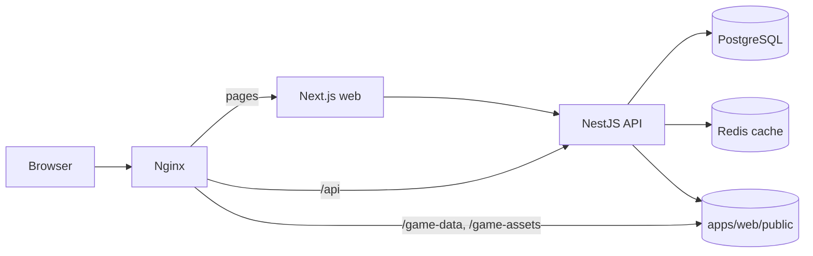
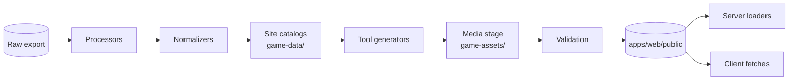
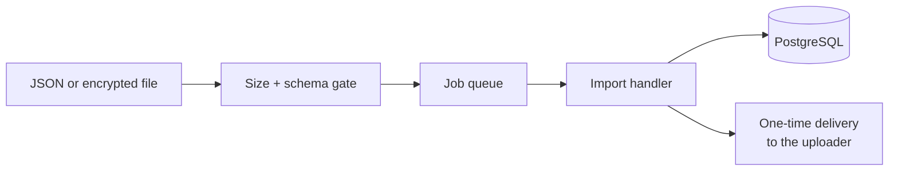

# Architecture overview

ToF Hub is a pnpm + Turborepo monorepo. The website, the API and the game exporter live together so that a change to a data format is checked against both its producer and its consumers in one place.

## Runtime services

| Service | Role |
| --- | --- |
| Nginx | The only service with a published port. Serves generated game data and images directly, proxies everything else. |
| Web | Next.js App Router. Server components load initial data; client components handle interaction. |
| API | NestJS. Imports, players, saved builds, wish history, the job queue and observations. |
| PostgreSQL | The source of truth for all user data. |
| Redis | Caches derived ranking responses. Losing it loses nothing. |

Security defaults in the Compose stack:

- PostgreSQL, Redis and the API publish no host ports. Nginx binds to `127.0.0.1` only.
- Migrations run as the schema owner (`tof_owner`); the API connects as a separate CRUD-only login (`tof_runtime`).
- The installation's RSA import key is generated once and lives in its own persistent volume.

## Packages

| Package | Responsibility |
| --- | --- |
| `packages/contracts` | Zod schemas for API payloads, import files and release manifests |
| `packages/game-domain` | Pure game calculations and entity types; no I/O |
| `packages/game-assets` | Resolves game-relative media paths to public URLs |
| `packages/i18n` | Locale registry, UI copy and translation helpers |
| `packages/ui` | Shared React components and styles |
| `packages/config` | Routes and shared application configuration |

Shared packages never import from an app. Game facts come from generated catalogs; components never hard-code game tables.

## How game data reaches a page

1. Processors read the raw export and the maintained editorial inputs.
2. Normalizers assign stable identities and produce one dataset per locale.
3. Site catalogs are written under `apps/web/public/game-data`.
4. Tool generators add Build, Wish, Handbook, progression and hub projections.
5. The media stage resolves every referenced image into `game-assets`.
6. Validation checks the whole tree before it can be released.

The application never reads game archives while serving a request. See the [pipeline guide](../pipeline.md) for details.

### Reading data in the app

| Consumer | Access |
| --- | --- |
| Web server | `apps/web/src/lib/game-data-server`, rooted at `GAME_DATA_ROOT` |
| Browser | Public `/game-data/...` URLs through typed feature loaders |
| API | Read-only catalogs via `GAME_DATA_ROOT` and `WISH_GAME_DATA_DIR` |

Rules for new readers:

- Never import a filesystem loader into a client component.
- Keep request deduplication, server-provided initial data and explicit loading and error states.
- The locale is part of the cache key. Do not cache cookie-dependent HTML across locales.
- Entity identity never depends on a display name.

## Imports

Plain JSON and installation-encrypted files go through the same path: cheap checks at the endpoint, then the [job queue](job-queue.md), then domain validation and persistence. When a build is accepted, the server signs it so that later edits to the saved card can be detected.

A signature proves that this server accepted the data unchanged. It does not prove the numbers came from the game. All imports are treated as user-provided data. See [imports](../imports.md).

## Updating data

Install content releases with the exporter's `apply-update` command so deleted files are removed too. After replacing data:

- restart `web` and `api` to clear in-process caches;
- rebuild `web` if a manifest imported at build time changed.

Missing data shows the normal empty or error state. The site never substitutes made-up values.
