

# My journey in Tower of Fantasy

**From a day-one F2P+ player to spreadsheets, datamining and ToF Hub**

[Live site](https://tof.smilekritik.beer/) · [Project README](../README.md) · [Documentation](README.md)

I started out as a Tower of Fantasy player. This is the story of how I became
an active contributor to its community, told through all the public projects
I worked on, the bugs I ran into and the jokes along the way. It covers my whole
time in ToF, with ToF Hub as part of that story.&nbsp;

The first part follows that journey. The later sections go into the technical
work behind the projects: the game's data, the formulas, the tools, the website
and the live data collector.

> [!NOTE]
> About 60 minutes to read. **Part 1** is the personal story. **Parts 2–7** are the technical deep dive:
> how the game stores its data, where every page's numbers come from, the formulas, the tools, the engineering
> and the live data collector. **Parts 8–9** return to the personal story: why I left the game
> and why I keep building ToF Hub.
> Each part stands on its own, so feel free to jump around.

## Contents

| Part | What's inside |
| --- | --- |
| **[1 · The story](#part-1-the-story)** | [The player years](#a-day-one-player-mostly-on-the-sidelines) · [My own spreadsheet](#my-own-spreadsheet) · [A website for the datamine](#a-website-for-the-datamine) · [On the way to ToF Hub](#the-patch-problem) |
| **[2 · How the game stores its data](#part-2-how-the-game-stores-its-data)** | Following enemy references, choosing Global/MMO sources, and what I still do not know |
| **[3 · Building the reference pages](#part-3-building-the-reference-pages)** | Character data, animated media, encounter scaling and progression |
| **[4 · Formulas](#part-4-formulas-measured-and-corrected)** | Titan, duo inheritance, gear comparisons, captured stats, Combat Strength and MMO cards |
| **[5 · The tools](#part-5-the-tools)** | Ranking, build card, optimizer, pull tracker, raids, team cards |
| **[6 · Engineering](#part-6-engineering-decisions)** | Data releases, page loading, indexed rankings, scoring revisions, imports and localization |
| **[7 · The live data collector](#part-7-the-live-data-collector)** | How the private collector turns packets into records |
| **[8 · Why I left the game](#part-8-why-i-left-the-game)** | Silent changes, content incentives, competitive windows, organising teams and bugs |
| **[9 · Why I still build and maintain ToF Hub](#part-9-why-i-still-build-and-maintain-tof-hub)** | Returning to the unfinished project, two months of development and what I learned |
| **[Credits](#credits)** | The people and projects that helped |

---

## Part 1. The story

### A day-one player, mostly on the sidelines

I've been playing Tower of Fantasy since launch day. A lot of time has passed since then, but for roughly the first year and a half, I barely took part in the community or did much around the game beyond playing it. I was what I'd call F2P+: the monthly pass and the battle pass.&nbsp;

Yes, I know what the F stands for. And as anyone who played ToF knows, this is not a cheap game. I always wanted to play at a high level, but spending so little made getting involved difficult for a few reasons.

1. **Getting into teams.** People did not exactly queue up to invite a low spender into their teams for difficult content. Being a physical main did not help: before Gnonno, physical was barely playable for what I wanted to do.
2. **Leaving the research to the experts.** Who was I to start researching anything? There were already experienced people who understood how games like this worked under the hood and could do the calculations. I was happy to leave that to them.
3. **No way to act on the knowledge.** I had no motivation to investigate mechanics I could do nothing about. Why care whether one encounter had 0% resistance and another had 35% if my build had no resistance ignore anyway? To know which one was harder? Come on. Playing it already told me that.

### Watching Maygi work

I was fascinated by Maygi's spreadsheets: the team calculations, the comparisons, all the work that went into them. People sometimes criticised her for getting some interaction or scenario wrong. My response was always the same: **then do it better?**&nbsp;

That was how I looked at community work like hers: with admiration and curiosity. For the record, I still cannot do those full team DPS calculations myself. All right, I haven't really tried to learn, either. To me, Maygi laid the groundwork for much of the theorycrafting that followed in ToF. Thank you for putting so much into this game and its community.

  <a href="screenshots/maygi-dps-calculations.webp">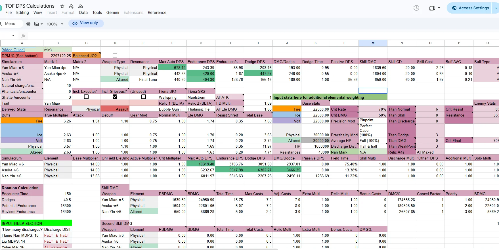</a>
   
  <i>Maygi&#39;s team DPS spreadsheet.</i>

### The early community projects

Maygi's spreadsheets were not the only community work I admired. Before getting into my own projects, I want to give some space to the ones that mattered to me back then.

**Incin - a better way to see your pulls**

There was a service called [Incin](https://www.incin.net/orders/view) that displayed your in-game pull history. It has been gone for a long time now, but I loved what it did. ToF's own history interface was poor and only showed pulls from the latest patch. Having a proper overview outside the game was a huge improvement.&nbsp;

I imagine its creators were doing their own research into the game's data. My guess is that there was an exposed API that made retrieving that history relatively convenient. I don't know whether it was officially supported, but the service itself was well made.

  <a href="screenshots/incin-pull-history.webp">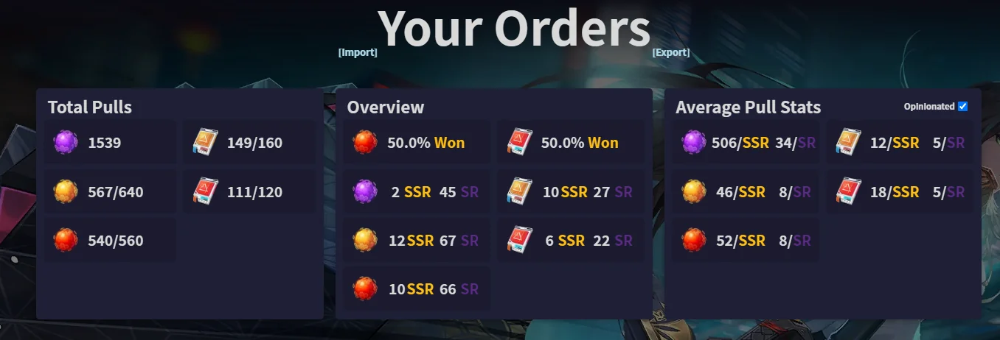</a>
   
  <i>Incin&#39;s pull-history overview.</i>

As I remember it, the service only worked while a hole in the game remained open. Does anyone else remember the version 1.5 incident where a cheater could remove equipment from other players' inventories? My view of that person is probably more positive than most people's: instead of quietly exploiting the game to give themselves whatever items they wanted, they exposed a problem publicly, even though players were hurt in the process. How else were you supposed to get the developers' attention? That was how I saw it. My understanding was that fixing that hole also cut off the access Incin relied on, and the site stopped working. I can't confirm the technical connection, but that is how I remember its disappearance.

**Tower of Fantasy Index - the first wiki**

&nbsp;Then there was [Tower of Fantasy Index](https://v1.toweroffantasy.info/), the first ToF wiki I remember: a beautifully presented collection of the game data people had gathered. I even helped with v3, entering data manually. Unfortunately, that never grew into a wider role in the project. When I showed interest in getting more involved, I was told I wasn't needed and was eventually removed from the project chat.

  <a href="screenshots/tower-of-fantasy-index-v1.webp">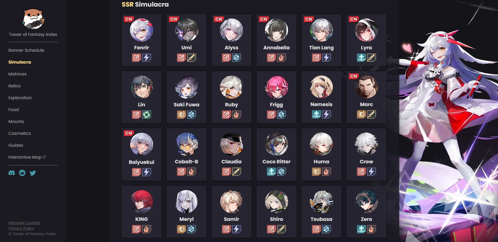</a>
   
  <i>Tower of Fantasy Index, v1.</i>

That experience is part of my story too, but I still respect the project and what it contributed. These were some of the earliest and most important community resources around the game, and I still appreciate the work that went into them.

---

### 10.08.2023 - 119.99

Some people might judge this part of the story. Fair enough. I usually enjoy drawing out a reveal, but I'll get straight to it: the Gnonno patch, the game's Epic Games Store release, and a regional pricing mistake. It also involved my favourite character in the game. More on her later.&nbsp;

When ToF arrived on Epic, its regional prices were wrong. From what I remember, the real exchange rate was around **35 UAH to $1**, while the store used **15 UAH** or **30 RUB** to the dollar. For the biggest, $100 pack, that meant:

- **Expected hryvnia price:** about 3,500 UAH.
- **Initial Epic price:** 1,500 UAH, or roughly $42.86 at the actual exchange rate.
- **Initial ruble price:** 3,000 RUB.

That lasted until the evening, when they went to fix it. And they did! The ruble price became correct. The hryvnia price became… **119.99**. Just a number. No currency shown in the game.

My guess is that someone meant to enter a dollar price: $100 for the biggest pack, plus 20% tax. What we actually got was the biggest pack for **119.99 UAH**. At 35 UAH to the dollar, that was about **$3.43**.&nbsp;

  <a href="screenshots/epic-tanium-119-99.webp">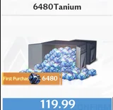</a>
   
  <i>The pack displayed at 119.99, with no currency label.</i>

A lot of people took advantage of that price. I did too. It let me finish a fully built physical setup. Fiona's banner was still running, Gnonno's had just started, and I already had Lin. To be clear, I got A6 Lin, A6 Gnonno and A6 Fiona without relying on this pricing mistake. The cheap packs paid for the matrices that completed the build.

There are a few details worth remembering before imagining an unlimited supply of almost-free Tanium:

- **Epic had spending limits.** If you've ever tried to spend a large amount through Epic, you may have run into them. In my experience, newer accounts have lower monthly limits, and eventually the store simply stops letting you pay into any game. I ran into this again in Blue Protocol in 2026, with a limit equivalent to roughly $400.
- **The ceiling for this was 20 of the biggest packs per account.** At the mistaken price, that was 2,399.80 UAH, or about $68.57 at the exchange rate above, for packs normally worth $2,000 before tax.
- **Buying them took hours.** The payment system was struggling. You pressed confirm, stared at a frozen screen for five minutes, and maybe the payment went through. Or it failed, and you started again.
- **Nobody knew what would happen afterwards.** Like many others, I was worried about a ban or having the currency removed after spending it. I had HoYoverse games in mind and was afraid of ending up with a negative balance and losing the account. I was also a first-year university student. Around $100 was my entire monthly living budget. Throwing that kind of money away was a real concern, even at such a ridiculous price.

### Finally playing DPS

&nbsp;That was my starting point. I could finally take part in Origin of War and other difficult content as a DPS. And before anyone says I could simply have played support: that was expensive too. As a physical main, I had skipped Lyra because I could not afford her. For the support setup I wanted, she needed A5 or higher, and making her work properly in a DPS build also meant maxed matrices.

So where did I get with my physical team?

  <a href="screenshots/raid-season-3-eu-smilekritik.webp">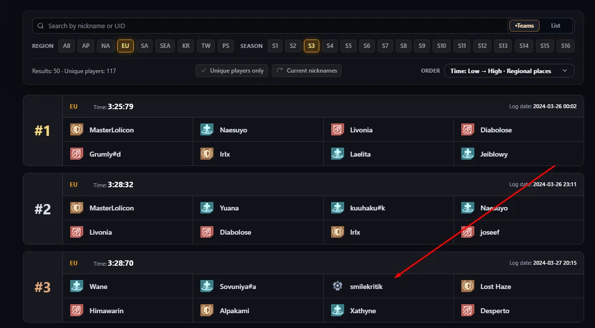</a>
   
  <i>EU raid season 3: our 3:28:70 clear, compared with the first-place 3:25:79.</i>

Here I am playing DPS in the third raid season, less than three seconds behind the EU region's first-place clear. My team was **Asuka, Yan Miao and Fiona**. The current meta used Nan Yin and had Attack resonance; mine had Balance. I don't have screenshots or recordings of the damage breakdowns, so you'll have to take this as a memory: I was comfortably outdamaging the Nan Yin players. The builds were close on the cactus and in ordinary content, but the boss's invulnerability windows made landing all of Nan Yin's explosions much harder.

Why was Europe almost 30 seconds behind the best teams in other regions? My suspicion is that hardly anyone on EU had been told that **Claudia's A3 effects could stack when applied by different players**. Yes, the old Claudia. I don't think many EU teams were even bringing her on their supports for physical raids. That *Clueless* atmosphere lasted a looooong time. People often did not seem interested in digging into how these interactions actually worked.

I include myself in that. I still wasn't actively researching mechanics, and I didn't really have anyone to research them with. I was known enough to get **invited as a DPS**, but not enough to be part of organising the teams.

### When support became accessible

The point where the game really opened up for me was when Lyra entered the standard pool. Suddenly, the core support build was **completely free to obtain** with standard pulls.&nbsp;

The remaining investment depended on what you were aiming for:

- **For the absolute ceiling:** A6 Fiona with a maxed three-star matrix set. Yes, those matrices were expensive, but this was the one limited investment the build needed, something you could put your savings towards.
- **For raids:** even Fiona without her matrices could do the job.

**Raid season 5 was the turning point.** I finally had a complete support build. I've always been adaptable, and I knew how to press my buttons. This was when people who understood the game could finally play alongside whales at the highest level. I don't just mean myself. I finally had people around me to form teams with, push content, and test mechanics together.

Communication had never been the problem. My English was good enough, and I had no trouble talking to people. The problem was finding players willing to work things out together. In my experience, the big spenders often either did not understand the mechanics well enough to analyse them, or wanted nothing to do with players whose accounts weren't maxed.

### The people I played with

From that point, I started playing high-end content with a regular group. And I mean **all of it**. The core was me, **ariveder4i** and **xikkari**, with **ladno** and other players filling the fourth slot.

&nbsp;A huge thank you to those guys. They took part in everything with me, helped with tests, and were a big reason I stayed in the game for so long. In terms of strategy and analysis, they were some of the most skilled players I knew on EU. Playing together was one of the best parts of ToF.

The frustrating part was never finding a permanent fourth player I could single out in the same way. It wasn't simply about account investment. Some strong players never had the time for a regular group; others, in my opinion, struggled to learn or adapt to what we were trying to do. I won't go into every case. I am grateful to the people who made that group such a good experience.

#### The team that let me play at the level I wanted

Eventually, an Origin of War season arrived that we could not clear with the DPS investment available to our group. Around then, I happened to cross paths with **Nezuko**. She invited me to play with **Eren**, whom I regarded as the strongest solo player on EU, and we started doing content together.

Honestly, that was the best chance meeting I had in the game. I finally got to play at the level I had always wanted: **fully invested accounts, fully invested builds, pushing everything we could**. My own account was ready for that setup too.

#### Competition came with some drama

Unfortunately, the move also caused local arguments. We were playing in an era of one main DPS per team, so I'll name the groups the way people understood them: **Eren's team** and **iRays's team**.

Before that, ariveder4i and I had already spent some time with iRays's group, looking at content and occasionally playing together. For example, I played tank with two of their supports so we could compare how our teams performed.

Then I joined Eren's group, and two different tensions followed:

- **My regular group was upset that I had cleared without them.**
- **iRays's group was upset that I had joined their competitors and was helping them improve.** That was how the situation felt from my side.

I can't say I was happy with every part of the outcome. I fell out with my regular group and became more distant from another group of good players. But I also found the conditions I had been looking for, and I think the competition on EU became more interesting because of it.

Soon after joining, we took **EU first place**. [This clear is one record of that period](https://www.youtube.com/watch?v=3BdlGcCJj3w).&nbsp;

#### The players in that final team

The fourth slot kept changing in Eren's team too, but several people deserve a mention:

- **Naesuyo:** a skilled player who eventually no longer had enough time for the game.
- **Ren:** an excellent player who brought his own ideas and took the initiative. Those ideas helped the team.
- **Lilou:** our final regular fourth player. She learned quickly after joining and grew into the demands of difficult content.
- **Nezuko:** an absolute whale who also knew how to play every role. Her one bad habit was being late.
- **Eren:** a strong, adaptable DPS. Communication could be difficult: he protected his anonymity and did not join Discord voice chat.

#### Credit to the other team, too

Competition did not stop me from respecting good players on the other side.

- **Boom** was a capable healer who showed how well a support could adapt to the encounter.
- **GMX** was the only other tank I knew on EU whom I put at that level. Perhaps part of the frustration with me was that I watched his gameplay and quickly adapted what I saw to my own play.

We also approached tanking differently. **GMX put more emphasis on controlling enemy positions during the fight; I focused on executing mechanics cleanly and providing reliable team buffs.** I don't think there is a useful way to declare one of us better on that basis. Among the other EU tanks I had played with or watched, I hadn't found the same level of execution.

Thank you to all of these players. Doing difficult content with them gave me a reason to keep playing, and people to keep learning the game with.&nbsp;

Alongside that team play, I started investigating stats, resistance, resistance ignore and how effects stacked. Much of the early work was trying to understand what Maygi had already done, more than a year after she had left. That was how I started putting together my own Excel spreadsheet.

---

### My own spreadsheet

I wanted to understand the game, but I realised nobody in the community was putting it all together in a way that was clear and easy for everyone to use. There were bits of information scattered everywhere, but no complete picture. And some explanations never went beyond **"trust me, bro."**&nbsp;

So I started relying on my own testing and **double-checking every piece of data myself**. I was comfortable with the basic maths: how much damage had dropped, or how much it had increased after adding a particular buff. Those were things I could measure, calculate and check for myself, and that gave me somewhere to start.

What began as a few notes turned into
[Everything by Kritik](https://docs.google.com/spreadsheets/d/1RExuEj6DGWgaYnN2lmYjbEO-ip-KzwHyNfGK_0M8Uro),
a spreadsheet that grew to 28 tabs and a change log I kept from patch to patch.
Its first page split everything into two halves: *Datamined* and *Calculation*.
Some of the tabs were calculators, some were datamined tables, and some were my
laboratory notes.

#### Learning to read the game files

The research developed on several fronts at once. One important change was that mods had become popular and accessible. Getting into the modding community did not seem particularly difficult if you were interested, or at least that was my impression. That was where I learned to open the game's files with **FModel** and read the data directly.

&nbsp;Honestly, it was a complete mess. There were piles of seemingly disconnected data, and even relating them to things we already knew from playing was difficult.

At times, I wondered whether the developers themselves still knew how everything worked. It felt as though staff turnover within the development team had left behind layer after layer of workarounds and tangled code. That was my impression as someone trying to make sense of the files, rather than something I could prove about the studio.

A few months later, by which point interest in the game seemed to be fading - were we approaching its third year? - I had become at least a little known.

**Afrodiy** came to me personally and shared links to the game's test clients. What he handed over was pretty minimal:

- **The clients:** links to the game's test builds.
- **Where to look:** a brief explanation of where upcoming-character information lived in the files.
- **The instructions:** a tiny guide in Chinese, with an account screenshot.

At the time, I was just someone who could open game files. I could dig upcoming information out of these semi-public clients, but I was still a nobody in that scene and had no idea what else I had been handed.

---

### Building my first Excel tables: resistance and scaling

The spreadsheet began with three questions:

- **Resistance:** how did it work?
- **Content:** how much resistance did each mode have?
- **Scaling:** what actually changed as difficulty increased?

I compared damage in actual content with damage on the cactus. Altered Nola helped enormously: one of her hits ignored the mechanics I was trying to isolate, which gave me a reference I could trust within the game's damage variation. A few tests were enough to narrow things down to a clear answer.&nbsp;

The experiments were straightforward:

1. **Establish a baseline:** hit the cactus with the flame bow.
2. **Change the conditions:** go into Origin of War, where I had already worked out the resistance.
3. **Compare the damage:** calculate how much had disappeared, account for resistance, and investigate the remaining damage reduction.

That let me work through the effects and their scaling. As far as I knew, I was breaking new ground with this approach.

The practical payoff was understanding **how much resistance ignore was actually worth in difficult content**. Once resistance climbed past 70%, builds with resistance ignore could beat builds that looked much stronger on raw damage. I also tested claims from the in-game descriptions, including the stated 50% cap on resistance ignore, rather than simply accepting them.

---

### The eternal question: which buffs add, and which multiply?

Then I moved on to the question that seemed to haunt every damage discussion: the categories for all the game's buffs. Back in Maygi's time, people had already found that descriptions such as "final damage" could not be taken literally. There was also a category players called **Normal**. But those conclusions came from in-game testing: try things, compare damage, unga bunga. I wanted to understand the whole system.

I spent **more than a week** testing just the basic multipliers. After I published what I was working on, **Avorozer** joined the research.&nbsp; We worked like two scientists:

- **Independent tests:** he ran his own experiments, rather than simply helping with mine.
- **Comparison:** we checked our calculated results against each other.
- **Corrections:** whenever they disagreed, we worked through the discrepancy.

Between us, we tested the fundamentals. But tests alone still felt insufficient, so I went digging through the files. Spoiler: that did not help. Not yet.

#### The test clients were more useful than I realised

Almost by chance, I decided to try the test clients again. If you've read this far and were always too shy to ask me about them, here is secret number one: the account names looked like `ht100`. One day I tried that as both the login and the password. <strong>Oh my God. It let me in. It was </strong><strong>that simple.</strong>&nbsp;

Those were initially the Taiwan-version accounts, with names along the lines of `ht100` through `ht999`. The Korean clients used other, rather odd ranges, such as `ht1210–ht1220` and `ht4001–ht4005`, but the idea was the same. That was what I discovered at the time.

I still had no proper guide I could read, and the client was in Chinese. But it had an **unrestricted admin console**. By poking around, I found how to inspect:

- **Effects on my character:** including their internal buff names.
- **Effects on enemies:** the other half of the damage calculation.
- **Hidden server-side buffs:** effects the normal game interface never showed.

  <a href="screenshots/test-client-active-buff.webp">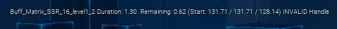</a>
   
  <i>An internal buff name exposed by the test-client debug display.</i>

Armed with those names, I went back to the exported files. And there they were! The frustrating part was that finding a name still did not tell me how it connected to the actual damage calculation.&nbsp; I had read earlier research by other testers, and they seemed to have hit exactly the same wall.

#### Looking at the structure around the buff

Eventually, I tried a different question: what if I needed to look beyond the buff itself, at the structure around it? That was the idea behind my [export scanner](https://github.com/smilekritik/Tower-of-fantasy-exporter-scanner).

The [scanner](https://github.com/smilekritik/Tower-of-fantasy-exporter-scanner/blob/master/main_scanning_files.py) kept three pieces of information together:

- **What changed:** the affected `AttributeName`.
- **Which category it belonged to:** its `ModuleExtraType`, or `NoModule` if none was specified.
- **Where it came from:** the source filename.

It read these from `ModuleExtraModifierInfos`, ordinary `Modifiers`, and `GameplayModifierInfos` inside application requirements. Then it indexed the results both ways: **attribute → category → files**, and **category → attribute → files**. That preserved the grouping I had missed when looking only at individual buff names.

And it worked. A full export of the game, followed by a long scan with my script, gave me the datamined table I needed. Optimisation was nowhere in sight: <strong>exporting and scanning everything could take a </strong><strong>whole day</strong>.&nbsp;

Then came the cross-checks:

1. **Equip** a matrix with a final-damage effect in the test client.
2. **Inspect** the active effect to get its internal buff name.
3. **Find** that name in the exported table and check its category.
4. **Compare** the category with what I already knew from damage tests.

Then repeat with another effect. **Everything I could verify lined up.** The table kept giving the right answer.&nbsp;

The remaining problem was naming: internal names and the names players recognised were two different things. But I finally had a basis for taking an internal buff name and identifying **which effects it added to, and which it multiplied with**. That breakthrough depended on all the testing that came before it. Without the groundwork, I would not have known what I was looking at.

Sadly, **Avorozer** seemed disappointed that I had found a way to answer the questions we had been testing one by one. I think it made his work feel unnecessary. He challenged one or two of the categories, but after checking his calculations, found that the discrepancy was in his maths rather than the datamine. Eventually, he stepped away from both the research and the game. I am still very grateful for his contribution. His independent testing mattered, even if the files eventually gave us a much broader answer. That was how we finally put the buff-category mystery to rest.

#### Turning the findings into useful tables

After that, I gradually filled out the simpler sections of the spreadsheet, checking what happened in the game and confirming it with straightforward calculations. I collected whatever I could establish reliably.

One thing I kept coming back to was the lack of clear comparisons for enemy HP in floor-based content. Surely it would be useful to estimate whether you had enough damage for a stage before spending hours trying it? The data was there, but connecting it to actual content was another problem:

- **Raw enemy stats:** HP and other values existed under internal IDs, without recognisable enemy names.
- **Origin of War and Sequential:** I gradually connected those entries to actual encounters.
- **Bygone:** low base stats were modified by many stacks of floor-dependent buffs. The file did not simply contain each floor's finished values.

Much of the rest was still a mystery. The game kept being more complicated than I wanted it to be.

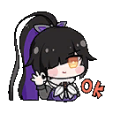&nbsp;That work produced my first **Sequential damage-requirement comparisons**. They matched my experience across more than ten accounts. Yes, by then I had become known enough that people sometimes paid me a little to clear content on their accounts. That also gave me plenty of opportunities to compare the estimates with actual runs.

  <a href="screenshots/sequential-damage-requirements.webp">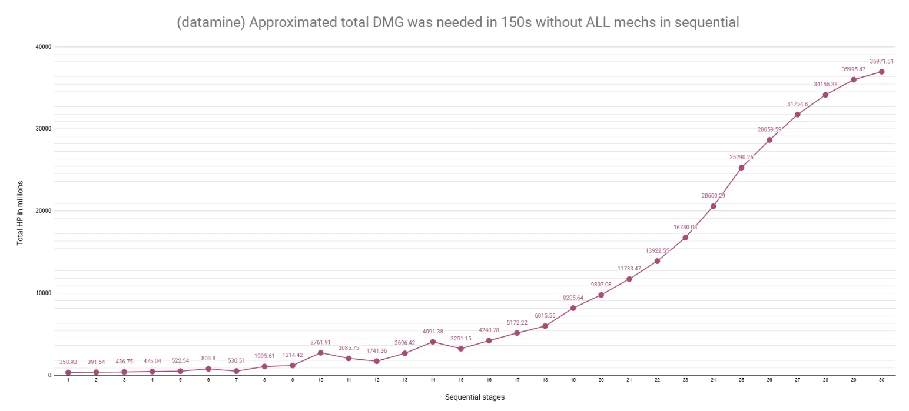</a>
   
  <i>My early Sequential damage-requirement chart in Excel.</i>

#### Comparing gear without counting what cancels out

Another important addition was the gear-comparison tab. Again, credit goes to **Maygi**: she had made a good start on the idea, but had not finished it. With the buff categories finally mapped out, I understood which factors the comparison needed, and built my own calculation from scratch.

The key was to separate what changed from what stayed the same:

- **Gear-dependent values:** recalculate them for each setup.
- **Unchanged multipliers:** effects from weapons, matrices or other sources that stayed identical cancelled out of the comparison.

> [!IMPORTANT]
> **If a multiplier did not change between the two setups, why count it as though it affected the difference?**

That was one of the problems I found in [Tower of Fantasy Tools](https://www.toweroffantasytools.com/). Its gear tool looked good and was more convenient than my spreadsheet, but in my comparisons its calculations had substantial errors. Judging by the activity I could see, people were using my spreadsheet a lot despite the less convenient interface. Thank you to everyone who trusted the work.

Looking back, I probably should have contacted the creator and worked with them. Honestly? I was too lazy. Maybe there was some ego in it too, but I did not feel like starting that conversation and untangling someone else's calculation when our formulas differed so much.&nbsp;

#### How the spreadsheet kept growing

Most new tabs started with a question that came up while playing, preparing for a clear, or arguing about a mechanic. I would work it out, keep the calculation, and make it usable for someone else. Some tabs became calculators people returned to. Others were a comparison I needed once, or notes from an unfinished test.

**What would actually improve this build?**

The resistance research and buff categories gave me a foundation for answering smaller, practical questions:

- **Resists, Resists Table and Resist Ignore dmg impact.** Once I knew the resistance in an encounter, I could put a number on the benefit of resistance ignore or reduction. The ready-made tables saved people from repeating the calculation every time they wanted to compare builds for difficult content.
- **Crit.** A crit rating on the character screen did not tell you your actual chance against every enemy. This tab converted rating to chance and back for different enemy levels, and collected the crit resistance I had found in different modes. It helped explain why something that looked sufficient on the cactus might behave differently in content.
- **Gear Compare.** The same maths became a way to answer the everyday question: is this new piece actually better for my current stats? It also compared the value of different stat rolls, rather than treating a roll as equally useful on every account.
- **Effective HP.** Damage was not the only thing worth calculating. This tab let me compare more HP, more resistance, and different defensive effects in terms of survival. I kept damage reduction and enemy ATK reduction separate so their different stacking rules were accounted for.
- **Universal Base ATK.** Some buffs raised questions about what the game meant by "base ATK." I used the change before and after a known buff to work backwards to the universal and elemental portions, then estimate what another base-ATK buff would contribute.

**Did we have enough damage for the content?**

The enemy data became useful once I could relate it to what we were trying to clear:

- **SEQ DB and Bygone DMG.** I wanted a useful comparison between damage on the cactus and the demands of a stage. Sequential's HP totals needed context such as time limits and resistance. The Bygone calculator approached the same practical question: how much damage should an account be able to do before a boss clear looked realistic?
- **OOW DB and OOW Resists.** Keeping enemy HP and difficulty scaling together helped distinguish the size of the HP pool from the resistance behind a difficulty percentage. That was important when comparing what different builds could do at different points in a season.
- **OOW Boses and Final Trial.** Sometimes the missing piece was a mechanic rather than a stat. I collected boss-mechanic cards and notes about Final Trial's difficulty and mechanic damage. One memorable example was its displayed 0.4 difficulty multiplier behaving like 0.7 in my tests.

Those tables made the research easier to use in a discussion about a run.

**Players Compare: a snapshot of a particular comparison**

This tab came out of wanting to understand the damage differences we saw between players and teams in Origin of War and raids. For my own comparisons, I also looked at Bygone results. Was someone behind on stats, or did a slower clear need another explanation?

&nbsp;One example was the great **M (macroer)**. I compared him with other players to understand how much of the difference could be explained by their accounts. In [one comparison](https://docs.google.com/spreadsheets/d/1RExuEj6DGWgaYnN2lmYjbEO-ip-KzwHyNfGK_0M8Uro/edit#gid=15741196), I put M, Syota and Eren side by side.

The comparison had a specific scope:

- **Shared data.** I could only do it when players shared the information I needed. I entered those values by hand, so the result described those accounts at that moment.
- **Comparable setups.** The sheet's own instructions required the same weapons and matrices. The point was to estimate the difference attributable to stats under comparable conditions.
- **Solo and team conditions.** I calculated them separately, because support buffs could change the relative gap between accounts. The result was a stat-based damage comparison; an actual run still depended on what happened in the fight.

That was enough to help answer the question we were discussing. Once that comparison was done, the tab stayed as a snapshot of it.

**Making the datamine readable**

The exported table was useful to me, but its internal names still needed translating into something players could recognise:

- **Multype datamine.** The scanner grouped modifier entries by the attribute and module category found in the files. This was the source I could return to when checking where a buff belonged.
- **Multype Rename.** I manually connected those entries to weapons, matrices, traits, relics and familiar buff names. The workbook explicitly warned that this translation could contain mistakes:&nbsp; recognising an obscure internal name was a separate problem from extracting its category correctly.
- **Enemies Name.** I kept notes connecting internal enemy IDs to recognisable enemies, gradually making more of the raw tables usable.

The scanner also gained companion scripts to compare exports between patches and turn the grouped results into Excel tables. Keeping the data readable and keeping it updated were becoming work of their own.

**The workbook was also my notebook**

Other tabs held working notes and unfinished investigations:

- **Shit.** Yes, that was the name. This was my scratchpad for checking absolutely every kind of calculation in the game. Whatever I was trying to work out, the numbers, tests and calculations went here.
- **Zero 4p.** A focused check of which shields interacted with Zero's four-piece matrix effect in patch 4.6. A small question got its own place to record the tests.
- **Gear CS.** An attempt to work out how individual stats contributed to Combat Strength. I left it marked *in progress*.
- **MMO global cooking and MMO Multype.** When I investigated the MMO version, I kept its resistance calculations and modifier categories separately. I needed to establish how that version worked too.
- **Titan chance, Shield Ignore and TODO.** There were smaller references, quick calculators and questions waiting for another round of testing. The TODO list included guides and "convert datamine info to people language," which says a lot about what I still felt was missing.

That was how the workbook grew: calculations I could reuse, data I had managed to explain, and working notes I still needed. They accumulated together because they came from the same process of playing, asking questions and checking the answers.&nbsp;

---

### A website for the datamine

&nbsp;I wanted to give the information I had gathered a **clear, attractive and convenient home**. Some findings were useful as reference material: a player should be able to open a page and find an answer without learning their way around my workbook.

That became the static site preserved in [tof-datamine-site](https://github.com/smilekritik/tof-datamine-site). It began as informative pages filled with data I had prepared manually or semi-manually.

  <a href="screenshots/legacy-datamine-hub.webp">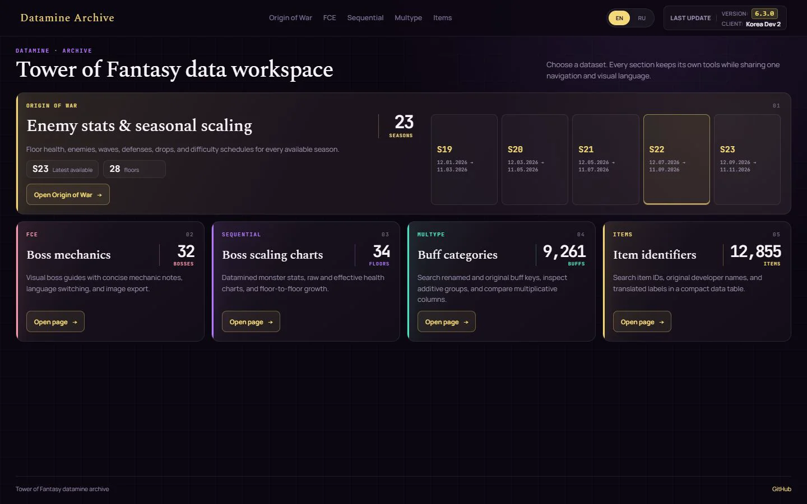</a>
   
  <i>The preserved Datamine Archive build, from tof-datamine-site.</i>

**Giving each subject its own page**

- **Origin of War:** seasons, floors, enemy waves, HP and difficulty information.
- **FCE boss mechanics:** readable cards in English and Russian that could also be saved as images and shared with a team.
- **Sequential:** tables and charts for boss HP, estimated damage requirements and the jumps between stages.
- **Multype:** the modifier groups from my scanner, with readable labels for the effects I had identified.
- **Items:** a searchable reference for item IDs and names.

These were pages backed by static files. I chose what to include, connected it to things players recognised, and prepared the explanations and presentation.

**What semi-manual meant**

I did not need to type every number. Once I understood a relationship in the data, a small script could repeat the lookup. Sequential's HP table is a useful example:

1. **Supply the file:** the exported monster-stat table, `DT_MonsterStaticData_Overseas.json`.
2. **Select the entries:** stage records named `endless_special_boss_<stage>`, with their `MaxHealth` values.
3. **Prepare the page:** use those values for the tables and charts, then check the explanations and mechanics-specific adjustments.

The archive's [Sequential processor](https://github.com/smilekritik/tof-datamine-site/blob/main/pipeline/processors/build-seq-data.js) shows that relationship. The repetitive copying could be automated once I knew which records mattered.

The rest still needed attention. Boss descriptions and artwork had to be arranged into cards. Internal buff names needed readable labels. A stage with unusual mechanics needed an explanation beyond its raw HP. The archive includes local editors for those jobs, exporting card data, rename files and stage adjustments separately from the extracted values.

The site gave the published findings a place to be read and shared.&nbsp; Excel remained the place where I worked through new calculations.

### The patch problem

A static page solved the presentation problem, but it created a maintenance job. After a game update, having a working page did not tell me whether its numbers were still current.&nbsp;

There were several separate jobs hidden inside "update the site":

- **Find the inputs again.** The useful files were a small part of a large client export.
- **Rebuild the relationships.** A changed row, reference or description could affect more than one page.
- **Keep the manual work.** Refreshing extracted data should preserve descriptions, translations and labels I had prepared.
- **Publish a consistent result.** Updating one table while leaving a dependent catalog behind could produce a page that looked complete but combined incompatible data.

This is where extraction and processing became a project of their own. Instead of repeating a collection of local steps, I needed a reproducible route from a chosen game client to the files the site consumed.

**The exporter grew around that requirement.** It discovers the client, extracts the relevant tables and media, runs processors in dependency order, builds the site catalogs and validates the result before packaging it. Maintained editorial inputs are carried through that process explicitly.&nbsp;

A patch also removes things. An update that only copies changed files can leave deleted records and images on the server, so the release format includes deletions as well as additions. A failed validation stops the package from being released. The complete workflow is documented in the [pipeline guide](pipeline.md).

### From reference pages to a wider toolkit

The data behind those pages was useful beyond the archive. A character, a matrix effect or a gear stat could appear in several different places, and each place needed to agree about what it meant.

That opened two directions:

- **A broader game reference:** characters, matrices, relics, progression systems and artwork, built from the same extracted sources.
- **Tools for an actual account:** a detailed build card, equipment comparisons, pull history and rankings.

The first direction needed more complete game-data extraction. The second needed something a static client export could never supply: **the player's current data**.

### Getting player data into the tools

The old player comparisons depended on information people shared with me. For a tool someone could use repeatedly, entering an account's equipment, matrices and supporting systems by hand was a substantial part of the work.

The collector addresses that input problem by reading data the game client already receives. It can turn profile, inventory and order-history responses into structured imports for the site. The difficult part is decoding those responses reliably and knowing when a capture is complete; I describe that separately in [Part 7](#part-7-the-live-data-collector).

There are therefore **two data flows**, with different jobs:

| Source | What it supplies | Used for |
| --- | --- | --- |
| Installed client files | Game rules, catalogs, descriptions, images and encounter configuration | Reference pages and calculation inputs |
| Player imports | Observed equipment, account systems, inventory and pull history | Build, Optimizer, Wish and Ranking |

A game-data export cannot reconstruct someone's pull history. A player capture cannot replace the tables that explain the stats on their equipment. The tools need both sources, kept distinguishable.&nbsp;

### Bringing the pieces into one codebase

Once several tools used the same calculations, copying a formula into each page would have recreated the maintenance problem in another form. A fix to element inheritance or Titan growth needed to reach every consumer together.

The current project keeps those responsibilities in shared packages:

- **Contracts** define the files and API payloads the components exchange.
- **Game-domain code** holds calculations used by Build, Ranking and Optimizer.
- **Generated catalogs** provide game identities, stat ranges and source values.
- **Shared assets and interface components** keep the same entity readable across pages and languages.

The website, API and exporter live in one repository so a format change can be checked against both its producer and its readers. That is the engineering behind the transition from a set of individually maintained pages to ToF Hub.&nbsp;

The following parts explain that work by subject. They are a technical account of the implementation, rather than a claim that every feature was developed in the order listed.

<a href="#contents">↑ Back to contents</a>

---

## Part 2. How the game stores its data

When I started turning the exports into website pages, I needed to connect the files to things players recognised. For a boss page, that meant finding which enemy appeared on a floor, which stats belonged to it, and where its name and artwork came from.

### Following one enemy through the files

I could find a table full of HP values without knowing which familiar enemies they described. To assemble a usable enemy entry, I had to follow several connections:

| What I wanted to show | What I had to connect |
| --- | --- |
| The enemy on a floor | The encounter's lineup and its `MonsterClass` reference |
| Its base stats | The `AttributeID` from the lineup or class defaults and the corresponding stat row |
| A recognisable name | Blueprint defaults, sometimes inherited from a parent, and the localization reference |
| Its artwork | An image reference or a confirmed mapping to the right texture |

I built the parent-class lookup into my [shared enemy resolver](../scripts/game-processors/processors/enemy-identity.ts). If an enemy file inherited its name from another Blueprint, I followed that chain to put a readable label beside its stats.&nbsp;

### Finding the right version of a value

I also had to work out which copy of a table applied. The export contained base resources under `Resources/`, international overrides under `ResourcesOverSea/`, and separate Balance/MMO families.

For Global, I made the processors use the applicable Overseas overrides with base fallbacks. That choice had to carry through both the description and the values inserted into it. Finding the right text was only half the work if its numbers still came from another version.&nbsp;

### MMO meant tracing the connections again

For MMO, I encountered familiar names such as `BigSecret` for Bygone and `OriginWar` for OOW, but needed different tables and scaling rules.

I followed the table bindings in assets such as `BP_GameData_MMO_Base` to establish which monster and progression records that mode used. Those references let me keep the two editions separate instead of connecting rows just because their names looked alike.

### Using the data to make combat easier to read

Studying these files also let me contribute to useful UI mods. I could connect effects to their internal identities and image references, then change how important information appeared during a fight.

#### Execute markers on the enemy HP bar

Many players may have seen my HP-bar variant. It marked **Lechesis's 16% execute threshold**, with different marker positions for enemies with **three or five HP bars**.

  <a href="screenshots/mod-execute-thresholds.webp">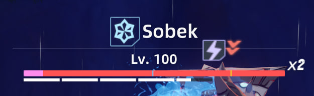</a>
   
  <i>Both markers show the same 16% threshold, for enemies with three or five HP bars.</i>

#### Debuffs I could recognise during a fight

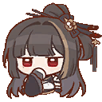&nbsp;I also reworked status icons to make **debuffs that restrict actions** stand out. In an active fight, I wanted to recognise those restrictions quickly among all the other effects on screen.

  <a href="screenshots/mod-debuff-icons.webp">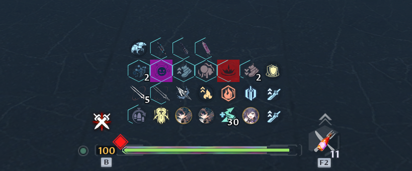</a>
   
  <i>The icon rework highlighted effects that prevented particular actions.</i>

#### Different buffs needed different pictures

Another mod was much harder to put together: replacing **identical-looking buff icons with distinct custom images**. Different effects had shared the same visual, making them difficult to tell apart even when I knew what each one did.

With recognisable images, I could use the buff bar to:

- **Spot a missing buff during a run**, including something we had forgotten to bring into the content.
- **Review a recording and find lost uptime**, seeing which buff had disappeared and when.

  <a href="screenshots/mod-distinct-buff-icons.webp">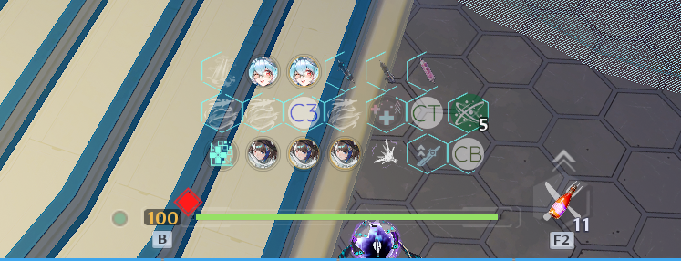</a>
   
  <i>Unique buff images helped me check missing effects and uptime in recordings.</i>

&nbsp;The changes looked simple on screen, but I found them extremely useful. Understanding the data behind those effects was what let me make them.

### More than a year in

**I have been digging through these files for more than a year, and I still do not know where all the useful data lives or how all of it connects.**

I keep the source paths and unresolved questions in the [game-data notes](game-data/README.md), with the input families listed in [data provenance](data-provenance.md).

<a href="#contents">↑ Back to contents</a>

---

## Part 3. Building the reference pages

> [!TIP]
> **Jump to a topic:** [Simulacra](#simulacra) · [Balance changelog](#balance-changelog) · [Relics](#relics) · [Pets](#pets) · [Cosmetics](#cosmetics) · [Arts](#arts) · [Origin of War](#origin-of-war) · [Bygone Phantasm](#bygone-phantasm) · [Sequential Phantasm and Biochemical Collapse](#sequential-phantasm-and-biochemical-collapse) · [Boss mechanics](#boss-mechanics) · [Handbook](#handbook) · [Multiplicative buffs](#multiplicative-buffs) · [Item identifiers](#item-identifiers) · [Version tracker and branch patcher](#version-tracker-and-branch-patcher)

### Simulacra

My visual starting point was **[tof.gg](https://tof.gg/)**. Its creators had built a similar game reference and kept it online for more than a year. I liked the modern design and wanted to recreate that presentation closely, then fill it through my own automated pipelines. I wasn't sure how much of their content was manual or generated.

To populate that interface from an export, I connected character records to their weapons, skills, advancements and artwork. Rebuilding a page then depended on those references instead of entering each character's details by hand.

Two details needed particular care:

- **Skill levels:** I preserved the coordinates stored in the curves. **The fourth stored key can describe level seven**; treating its position as the level gives the wrong progression.
- **Description arguments:** I had to connect each placeholder to its effect or progression value. A number from a similarly named effect could make the sentence look complete while giving the wrong skill information.

I also followed outfit and texture references for artwork, so a new character would not need another manually maintained folder-name entry.&nbsp;

  <a href="screenshots/gefion.webp">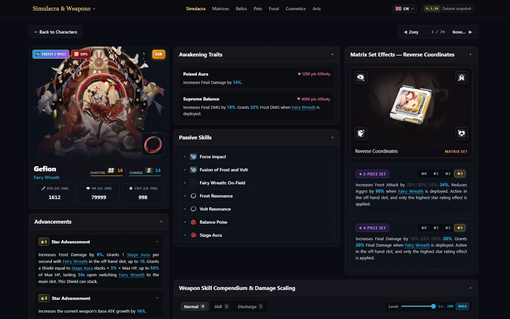</a>
   
  <i>The character page brings separately extracted records into one view.</i>

### Balance changelog

&nbsp;I wanted a record of patches because I was tired of checking everything after each update: had a value changed, had an interaction broken, had the developers touched something unrelated?

The changelog compares an export with a saved baseline and lists old and new values for character stats, skills, advancements, traits and matrices. That gives me specific changes to investigate in the game.

**The comparison works well; a complete patch history still needs someone to follow the live and test clients and export each version.** I am not planning to maintain it that closely. When I do export again, the tool handles the search that used to take so much manual work.

### Relics

I wanted a relic card to answer a basic question: **how long until I could use the ability again?** Extracting that number for MMO meant distinguishing the ability's base cooldown from upgraded cooldowns, cooldown reductions and durations such as a stun.

I gave the [relic processor](../scripts/game-processors/processors/build-relics.ts) a selection order: prefer the level-zero cooldown, then look for a base value while excluding reduction, buff and stun fields. If the effect data could not supply it, I used the ability description as a fallback.&nbsp;

### Pets

Smart Servants gave me another reason to cross-check raw values. An ATK-inheritance coefficient of **`1.0` looks like 100%**, but the export can use it as a placeholder. In those cases, including `FightPet_12`, I made the [pet processor](../scripts/game-processors/processors/build-pets.ts) take the percentage from the advancement description instead.

I also kept two module limits separate for each star level:

- **Slots:** how many modules the servant can equip.
- **Load capacity:** how much combined module load it can support.

&nbsp;An empty slot alone does not mean another module will fit. Showing both limits makes the upgrade information useful when planning a servant's setup.

### Cosmetics

I wanted the cosmetics catalog to show animated stickers as they moved in the game. What I could extract was often **a texture atlas: several frames packed into one image**, with a material describing how to display it.

To turn that into an animation, I had to:

1. **Follow the material and its parents** to find the texture and animation parameters.
2. **Read the frame grid and speed values**, checking for a supported FlipBook layout.
3. **Split the texture into frames and encode the animation** for the website.

That work produced the downloadable GIFs on the site, including the stickers used throughout this article.&nbsp;

The export did not retain the full shader wiring, so **the reconstructed playback speed is an estimate**. I record the supported layouts and unresolved effects in the [cosmetics notes](game-data/cosmetics.md).

### Arts

&nbsp;I wanted to keep older artwork available even when it disappeared from later clients. Extracting the current game alone could not preserve that collection, so I kept **historical images as a separate input** in the bootstrap package.

For new artwork, I used discovery rules for loading screens, wallpapers and other image families. The processor reports newly found images for naming, while retaining the titles I had already prepared. That lets extraction find additions without discarding the work of making the archive readable.

### Origin of War

For the OOW pages, I had to keep **the round's configured stat scaling separate from the season's changing difficulty percentage**. Those are different inputs, and confusing them would make the enemy numbers misleading.&nbsp;

One documented round uses a curve value of `200`, meaning a **2× stat coefficient**. Its boss has base HP of `62,961,076`, which becomes `125,922,152` after that coefficient. This is the round's configured strength, not a claim that moving the season's difficulty percentage doubles HP.

The buff data needed interpretation too:

- **Drop weights:** I converted each buff's weight into its share of the pool total. A raw weight is not already a percentage.
- **Environment markers:** some entries describe the environment rather than an extra buff on the enemy. I filtered those out of enemy effect lists.

I keep the source fields, that numerical example and the unresolved schedule details in the [OOW notes](game-data/origin-of-war.md).

### Bygone Phantasm

Bygone showed me another limit of an export: **finding possible bosses does not establish which one the server will choose**. Several enemy pools can qualify for the same floor, and the files I read did not settle that selection.

&nbsp;I made the page keep those candidates. It assigns a lineup only when one pool qualifies, so I do not turn an ambiguous set of records into a guessed repeating ladder.

For MMO, I traced the floor's HP-buff binding and scaling curve. Where the binding supports it, I calculate:

`HP = base HP × (1 + whole HP-buff stacks)`

I leave HP unknown when the buff does not fit that model. The [Global](game-data/bygone.md) and [MMO](game-data/mmo-bygone.md) notes explain which parts I can reconstruct and which remain unresolved.

### Sequential Phantasm and Biochemical Collapse

#### Making the Excel comparison adjustable

I brought the earlier Sequential comparison onto the site so players could adjust **resistance ignore and Space Support** rather than read one fixed damage requirement. I wanted a useful target for training-dummy damage, with the stage mechanics excluded from the estimate.

The treatment of bonuses matters. In the chart's model, Space Support adds to the reference fighter's existing damage-bonus category. Adding five percentage points to an existing 50% gives `1.55 / 1.50`, or about **3.33% more damage**.&nbsp; Treating it as a separate ×1.05 would overstate its benefit. The [Sequential notes](game-data/sequential.md) give the full formula, assumptions and excluded mechanics.

#### Getting the MMO effect descriptions to match

Biochemical Collapse gave me a different problem. Its description map repeated some texts under neighbouring keys, so using an effect's description ID as the map key could select another effect's text.

One entry had `DescID=10` and arguments `[12,500]`, but key 10 held the wrong description. I resolved the distinct texts in key order before inserting the numbers, following the pattern across the affected entries. That made the listed advantages and disadvantages readable with their own values. The [Biochemical Collapse notes](game-data/biochemical-collapse.md) document the example and its validation.

### Boss mechanics

For the mechanic cards, I needed the text and stats to describe **the same encounter and phase**. A familiar boss name could lead to several records, so I matched the Frontier Clash configuration to the last-phase stat row. Exceptional encounters needed their exact ladder attribute IDs.

I also separated internal configuration IDs from the season numbers players saw. A correctly extracted boss would still be confusing if I put it under the wrong season heading.&nbsp;

### Handbook

I built **[Handbook](https://tof.smilekritik.beer/datamine/handbook/)** to make the gear rolls, chances and progression details that the game leaves unclear **visible and easy to compare**. I wanted to see what a piece could roll, how likely a stat was, and what an upgrade path would cost before spending materials.&nbsp;

#### Seeing gear ranges and chances

- **Stat ranges:** base values, minimum and maximum upgrade rolls, and average and maximum totals for five-roll gear. Quality filters make the differences between rarities visible.
- **Chances by slot and source:** which stats belong to a gear pool and their weights. The page separates the chance on one draw from the modelled chance of a stat appearing on the item, accounting for guaranteed stats and selection without repeats.
- **Titan:** growth ranges by augmentation count, rare-property values and chances, and the chance of changing the rare stat. Estimated averages stay separate from minimum and maximum values.

  <a href="screenshots/handbook.webp">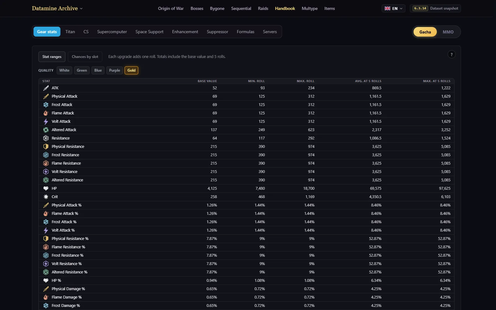</a>
   
  <i>Gear ranges in Handbook: base values, individual rolls and totals after five rolls.</i>

#### Planning progression

For progression, I wanted to compare **costs, unlock requirements and bonuses across a chosen upgrade path**.

- **Supercomputer:** EXP requirements, upgrade-outcome chances, estimated attempts and bonuses by level.
- **Space Support:** selected module levels, their total cost and the extra base-module upgrades needed to unlock higher tiers.
- **Enhancement and Suppressor:** materials between selected levels, progression requirements and the stats gained along the way.
- **MMO systems:** expansion-pack stats, installation slots and star upgrades, plus a Brainfield planner for node choices, materials and additive stats.

I keep CS weights and contributions, combat-formula references and the server directory there too.

#### One example: reconstructing Brainfield

For the talent planner, the stat tables gave me node values and costs, but I had to read the **exported interface layout** to recover positions and connections. Each node level also had its own upgrade record, so I summed the selected levels individually instead of multiplying the final row by the level count.

That produces a material total and a summary of direct additive upgrades. Special-skill interactions still need in-game confirmation; I keep those limits in the [Brainfield notes](game-data/brainfield.md).

### Multiplicative buffs

I wanted a readable visualization of the buff-category research, including the testing I did alongside **Avorozer**.

In Excel, the results were split between **the datamine table** and **the rename table**, where I connected internal names to effects players recognised. To find a buff's category, I had to cross-reference the two. The information was there, but looking it up, checking the connections and maintaining the labels was awkward.

&nbsp;I brought the readable names, extracted categories and source entries together in **Multype's visual table**. That made it possible to see which effects belonged together without switching between spreadsheet tabs. It also made reviewing and correcting the name mappings easier, with the underlying datamine visible beside them.

### Item identifiers

I mainly use the item lookup for **modding and working on the test server**. These are the IDs I use to **give my test character specific items**, so I wanted a convenient way to look up the identifier behind a familiar item name.

&nbsp;Building that reference required files **outside the game archives**: the `MappingItemId*.json` mappings in `Hotta/Config`. I added them to the exporter explicitly, alongside the item tables, to connect IDs with their names and qualities.

### Version tracker and branch patcher

I use a version of the tracker that sends me **Telegram notifications when a new client version appears**. That is how I keep up with updates and know when to inspect the fresh files and prepare leaks quickly.&nbsp;

The public page makes that information available to everyone: **which client branch is on which version**, with a history that grows as new updates are detected. Anyone who wants to follow releases or dig through fresh files can use it to identify the client they need. I keep launcher and resource versions separate because they describe different parts of the installation.

The companion [branch patcher](../tools/tof-client-patcher/README.md) helps obtain that client. It prepares the launcher configuration and clears update caches, then lets the official updater download the selected branch. I packaged it as a readable BAT/PowerShell file that runs with Windows' built-in tools.

<a href="#contents">↑ Back to contents</a>

---

## Part 4. Formulas, measured and corrected

Build, Ranking and Optimizer use [`packages/game-domain`](../packages/game-domain). The reference generator uses a pinned revision of [apache1123/tof-tools](https://github.com/apache1123/tof-tools), with refinements recorded alongside game-data evidence and equipment observations.

### A special thank you to rikuzero1

**rikuzero1** deserves a special thank you for **his articles on Reddit and for checking my formulas**. We did not cross paths much directly, but I think of him as a friend and value his technical writing and feedback.

I carried out my project's research, datamining and development myself. His published work gave me useful references, and his reviews helped me check and correct my own calculations.

In my view, the technical work he shared on Reddit was comparable to Maygi's contribution to the community. Much of it was spread across articles and discussions rather than gathered in one widely shared resource. **Thank you, rikuzero1.**&nbsp;

### Titan added stats

To rate an item against its possible maximum, I needed a ceiling for Titan's added stats. They do not each receive the full independent growth of an original stat. The current projection converts the primary stat's post-Titan roll amount into the target stat's range:

`added = target initial + observed share × primary post-Titan rolls × target max roll`

The [recorded observations](../scripts/data/titan-augment-observations.json) support refinements to the upstream fixed-share assumptions. A high share captured on gear is an **observed bound for the model**, not a guaranteed next upgrade.&nbsp;

### Equal stats must get equal ceilings

Titan's family pull-up can raise a lower elemental stat. The projection keeps the larger of that result and the stat's own supported growth, leaving unconfirmed ranks unknown. Reordering equivalent stat rows must not change their projected quality.

### Two-element weapons pick their best numbers separately

I also used [AntonioS3's Reddit discussion](https://www.reddit.com/r/TowerofFantasy/comments/1cqzb6j/potential_major_bug_with_dual_element_systemsub/), reporting tests by **Kune**. It began as a suspected bug report; clarifications from **noname6600** and further Asuka tests from **rikuzero1** helped explain the results.

**Equipment inheritance and external buffs are separate steps:**

- **Equipment:** compare the two elements' whole-set totals for flat ATK, ATK% and DMG% independently. Each category can inherit from a different element.
- **External buffs:** matrix, weapon and food bonuses must apply to the damage element. Inheriting the other element's equipment stats does not transfer its buffs.
- **The stat window can mislead:** a sub-element buff can raise displayed ATK without increasing the tested attack's damage. Off-field effects that switch damage element follow their own rules.

`inherited category = max(total from element 1, total from element 2)`

A Frost/Volt build could take flat ATK from Volt, ATK% from Frost and DMG% from Volt. The [duo selection code](../packages/game-domain/src/build/gear-score.ts) stores those choices separately and counts universal ATK once. Picking the better element on each individual piece, or comparing already-buffed final ATK, would give a different result.&nbsp;

### How much is a stat worth?

&nbsp;For small stat changes, I use this simplified damage model:

`output = A × (1 + d) × (1 + c × k)`

`A` is final ATK, `d` the additive damage bonus, `c` crit chance and `k` the bonus damage of a crit. Percentages enter as fractions.

| Change | Relative weight near the current profile |
| --- | --- |
| One flat ATK | `(1 + a) / A`, where `a` is the applicable ATK% |
| ATK% | `B / A`, where `B` is the affected base ATK |
| DMG% | `1 / (1 + d)` |
| Crit chance | `k / (1 + c × k)`, while below the cap |
| Crit rating | Crit-chance weight divided by the level-dependent conversion denominator |

These local weights estimate the relative increase in damage dealt. A finite swap needs its totals recalculated, especially near a crit cap or element-selection boundary.

The two rating contexts are:

- **Global Roll Value (GRV):** a fixed, site-authored reference profile for comparing equipment.
- **Personal Roll Value (PRV):** the account's current totals and caps.

Healer ratings optimise ATK; tank ratings optimise effective HP.

### The optimizer follows my spreadsheet

&nbsp;The website applies the spreadsheet's remove-and-equip calculation across an inventory. Each replacement rebuilds the profile before the next comparison, because one swap can change the value of another.

Titan projections need known original stats and a sufficiently clear roll history. They describe supported resulting stats, without predicting upgrade probability or the number of clicks needed.

### Checking Combat Strength against the server

To check my CS calculation, I used **the weapon and matrix subtotals returned by the server**. I calculated weapons, individual matrix stats, set bonuses and progression systems separately, so a matching total would not hide an error in one of its parts.

One recorded loadout gave me these reference values:

| Captured component | Raw server CS |
| --- | --- |
| Weapons | 15,221.153 |
| Three level-100, three-star matrix sets | 25,720.008 |

I kept those comparisons as [checks alongside the CS calculations](../apps/web/src/features/build/system-cs.test.ts). Displayed stats needed separate handling too: a matrix's raw crit value of `416.6667` appears as `416` in the game. I kept the fractional value for scoring instead of summing already-rounded labels.&nbsp;

### Separating the build from temporary buffs

Player imports added another problem: **captured ATK describes the character's state at that moment**. A temporary matrix buff could raise it even though the equipment had not changed.&nbsp; Using that snapshot without accounting for the buff would distort the comparison.

I used the extracted effect data to distinguish the inputs:

- **Permanent relic passives:** count the applicable bonus once for its element.
- **Supported temporary ATK% buffs:** identify the effect and its stacks, then remove its contribution from the scoring inputs. Food and permitted injections remain part of the chosen setup.

If I could identify a temporary ATK effect but could not calculate its contribution, I kept that capture out of ranking. The [normalization logic](../packages/game-domain/src/build/temporary-attack.ts) records those unresolved cases instead of assigning them an estimated gear advantage.

### Reconstructing the MMO card descriptions

For MMO expansion cards, I had to distinguish **the number of equipped cards** from **their star levels**. The skill-description parameters use the equipped-card count to evaluate a curve; base stats use star-specific factors and a level curve.

Charge gave me a concrete check. Its exported curve makes one description parameter **4.45% with one card** and **29.638% with four cards**. The four-card value matched the recorded in-game text, including its rounding.&nbsp; I preserved that comparison in the [card calculation checks](../packages/game-domain/src/build/mmo-card.test.ts).

That let me reproduce the displayed description values. Special runtime interactions still needed their own in-game tests.

<a href="#contents">↑ Back to contents</a>

---

## Part 5. The tools

I looked at community services that solved similar problems in other games:

| Job | Useful reference | The corresponding ToF problem |
| --- | --- | --- |
| A readable build card | [Enka.Network](https://enka.network/) | Bring an account setup into one shareable view |
| Equipment comparisons under common assumptions | [Akasha](https://akasha.cv/leaderboards) | Define what a gear ranking measures |
| Retained pull history and statistics | [Paimon.moe](https://paimon.moe/) | Keep orders beyond the game's limited history view |
| Encounter information and clear records | [Stygian.moe](https://www.stygian.moe/) | Connect content, teams and recorded results |

### The gear ranking

The ranking evaluates **equipment under a defined rating model**, rather than player skill or full team damage. Its views distinguish:

- **An individual item:** current stats against the role and track's reference ceiling.
- **A player's best known set:** retained equipment for that role and track, including imported backpack pieces.
- **An equipped build:** the loadout saved in a particular capture.

&nbsp;Retaining gear across imports means switching elements does not erase a previously observed set. An upgraded item can return with different stats, so the store must reconcile its observations without counting it twice or merging unrelated pieces.

  <a href="screenshots/ranking.webp">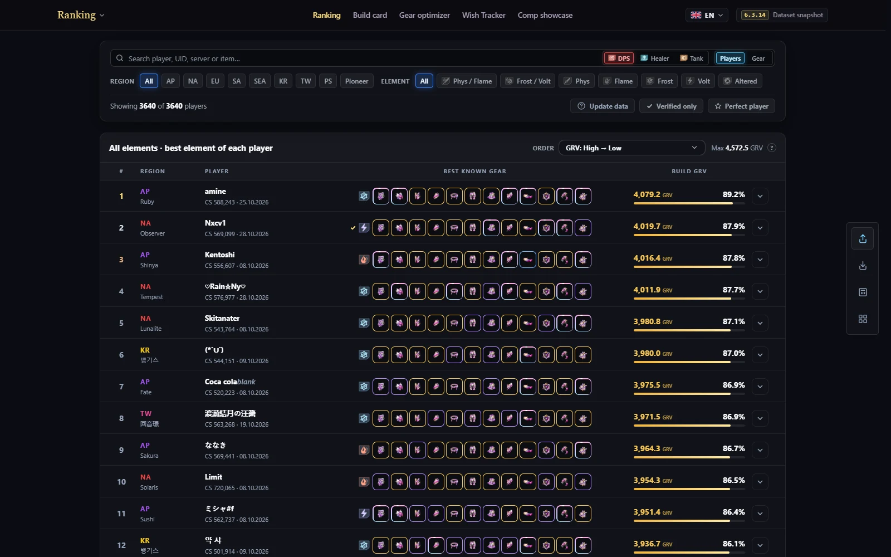</a>
   
  <i>The public gear ranking at capture time. Its positions describe the equipment-rating model.</i>

### The build card

&nbsp;The card brings equipment, weapons, matrices, relics and supported progression systems into one shareable view, with breakdowns behind the displayed totals. Manual editing, screenshot OCR and structured imports supply the account profile used for personal comparisons.

  <a href="screenshots/build-card.webp">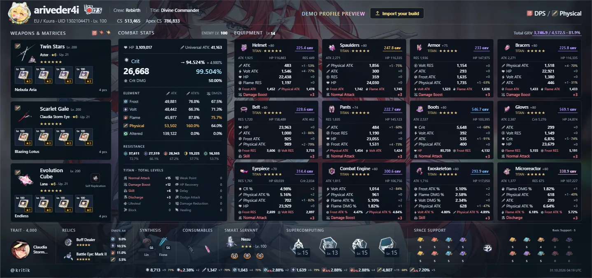</a>
   
  <i>The built-in demo profile, shown as a shareable build card.</i>

### The optimizer

&nbsp;Optimizer reads equipped and optional backpack gear from the Build import, then compares replacements for the selected role and element. It also shows personal stat weights and supported Titan scenarios; [Part 4](#part-4-formulas-measured-and-corrected) explains those calculations.

  <a href="screenshots/optimizer.webp">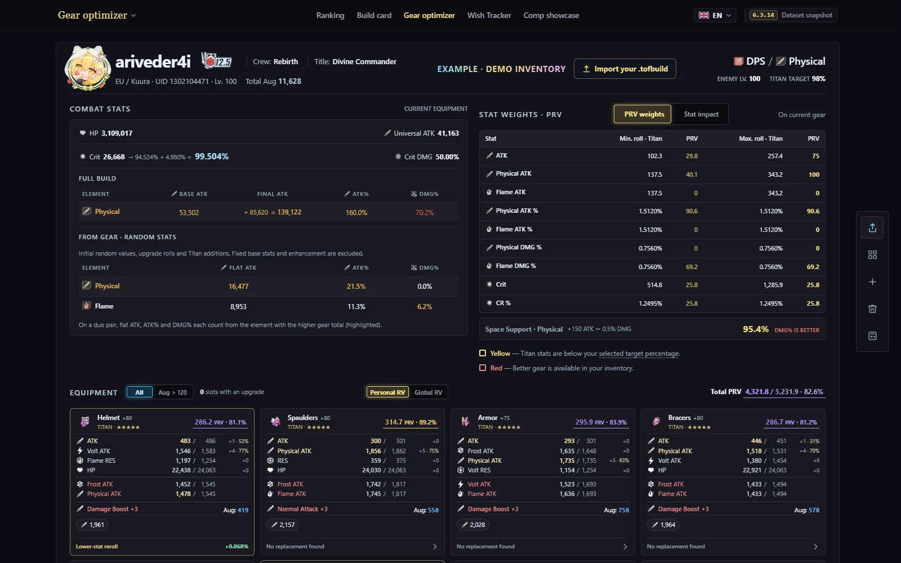</a>
   
  <i>Optimizer with the built-in demo inventory: personal stat weights and equipment comparisons.</i>

### The pull tracker

I had to preserve each track's order and deduplicate repeated imports. A partial history could not establish its starting pity by itself,&nbsp; so I used supplied pity snapshots where available. Banner attribution follows source pool codes and maintained schedules; the dropped item alone is insufficient.

Permanent and event orders have separate histories, with statistics, streaks, luck estimates, simulations and exportable cards. Unresolved banner attribution stays unresolved.

Accepted imports establish credentials for later access. Another player's UID alone cannot grant access to their history, which remains separate from the public gear database.

  <a href="screenshots/wish.webp">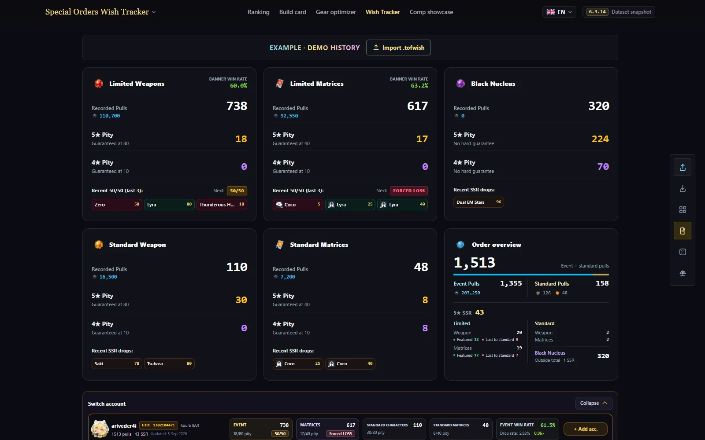</a>
   
  <i>Wish Tracker with its built-in example history.</i>

### Raid leaderboards

&nbsp;I wanted to compare raid results across regions and follow players over multiple seasons. Doing that inside the game was inconvenient in three ways:

| What got in the way | What I built on ToF Hub |
| --- | --- |
| **Comparing regions meant logging into an account in each region.** I could not browse their historical results together. | Region and season filters, with clear times from different regions in one view. |
| **The game kept the nickname from the day of the clear and never refreshed it**, even though the records it sent included a player ID. | Results linked through available player identifiers, with an option to show current nicknames where I can resolve them. The captured names remain in the historical records. |
| **There was no convenient overview of my own results across seasons.** | Search by nickname or UID, then open a player to see their recorded results across seasons. |

I put these together in the **[raid ranking](https://tof.smilekritik.beer/datamine/raids/?tab=ranking)**. It lets me compare regions, follow a player through name changes and look back over recorded clears without switching game accounts for each lookup.

  <a href="screenshots/raid-ranking.webp">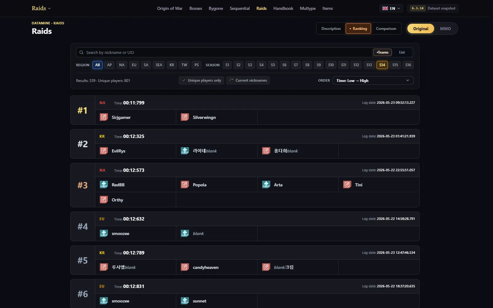</a>
   
  <i>The public raid ranking, with results from all regions in one view.</i>

### Team cards

I often needed to plan a run with a team or give someone a guide showing what to bring. We used to assemble similar composition images locally in **Photoshop**.

&nbsp;I built the squad editor to make that format **available to everyone in the browser**. Players can prepare four- or eight-player compositions for Standard or MMO, specify each person's role, trait, weapons, matrices and relics, then share the plan as a link or image.

The [tools guide](tools.md) covers current behavior, and the [import guide](imports.md) lists accepted inputs.

<a href="#contents">↑ Back to contents</a>

---

## Part 6. Engineering decisions

Once the tools shared game data and player captures, I had to keep the whole system consistent. A correct formula would not help if the database still held old scores, an update left deleted images on the server, or several imports exhausted the resources needed to serve pages.

### Keep extraction outside the request path

I kept the website, API and exporter in one monorepo, with shared contracts and calculation code. That lets a format change reach both the producer and its readers together. The calculation package has no file or network access, so the browser and server can use the same rules without depending on each other's runtime.

Their execution environments have different jobs:

- **The exporter** opens the game archives and produces catalogs, media and reports. Native extraction runs on Windows; processing an existing raw export can also run in Docker.
- **The Next.js application** renders pages and provides the interactive tools. Nginx serves generated catalogs and media directly.
- **The NestJS API** accepts imports and manages persistent player data in PostgreSQL. It reads the generated calculation references instead of opening game archives.

This puts expensive game-data reconstruction into an explicit build step. Visiting a character page does not start an extraction job, and the live server does not need the native extraction environment.&nbsp;

I packaged the Windows exporter with its processing code and runtime so the machine running it would not need my Node, pnpm and compiler setup. Native components may still be downloaded on first use, with pinned versions and checksums. The [architecture overview](architecture/overview.md) documents the service boundaries.

### Validate the dependency chain before packaging

The processors have dependencies: a consumer can need a catalog or identity that another processor has not produced yet. I declared those relationships in the [job graph](../scripts/game-processors/contracts/jobs.json) and run the pipeline through a staging tree before packaging its output.

Selective extraction adds another dependency problem. A processor developed against a full export can read a table that the exporter's selection rules never included. I added **file-read tracing** to record the inputs actually consumed, then compare that coverage with the extraction rules. A new client still needs a real export check; an old trace only describes the paths exercised by that run.&nbsp;

I also run media resolution twice. The first pass resolves images from normalized catalogs; later generators can introduce more references, so another pass follows them before final validation.

The release checks cover required inputs, catalog schemas, entity references, locale consistency and declared media. They also distinguish a preview from an original download: a WebP preview cannot satisfy a page's promise to provide the original PNG.

Asset paths needed the same care across environments. Windows can accept a filename with the wrong case while Linux rejects it. I kept URL resolution in the shared asset package and retained source-path identities instead of rebuilding paths independently in every page.&nbsp;

### Publish additions and deletions together

Copying newer files over the old site leaves removed records and images behind. I made the [release builder](../tools/patch-exporter/src/release-package.ts) hash the complete output tree and compare it with a baseline manifest.

- A **full release** contains the complete published tree.
- A **delta release** packs changed files and lists deletions, while its manifest still describes the complete expected output.

&nbsp;Unchanged artwork can then stay in place, and the installer knows which old files to remove. I keep editorial labels and preserved historical artwork as declared inputs, so refreshing generated output does not depend on whatever happens to remain in an old server directory.

Installation still needs coordination. The updater copies files and applies deletions; it does not atomically swap an entire running deployment. I restart the web and API processes after installing content to clear process caches, and rebuild the web application when a build-time manifest changes. The [pipeline guide](pipeline.md) describes that boundary between producing an update and installing it.

### Load the data a page actually needs

The full catalogs are useful for generators, but a browser listing characters does not need every skill, description and progression record at once. I generate **compact runtime catalogs and separate detail files**. A list can load its summary data; opening a character adds that entity's detailed record.

On the server, the [dataset loader](../apps/web/src/lib/game-data-server/loader.ts) deduplicates identical reads within a request. When it adds a selected entity's details, it creates a request-local result. Mutating a shared catalog would let one request's selected character or collection affect another request.

The browser starts from the server-provided data and caches by dataset and locale. The [client hook](../apps/web/src/lib/game-data-client/use-game-data.ts) discards late responses after navigation or a language change, so an older request cannot overwrite the current view.

Initial selection comes from the URL; browser preferences are read after mounting so they do not disagree with the server's first render.

I applied the same principle to animated cosmetics: lists use static posters, and opening a viewer loads the animation. A catalog with many animated items should not have to play and download all of them just to show the list.&nbsp;

### Compute ranking scores on writes

A ranking has many possible element and role tracks. Calculating all of them for every item whenever someone opens a board would repeat work even when no equipment had changed.

I moved that work to imports and rescoring. The store writes per-track scores and [precomputed best-track rows](../apps/api/src/ranking/best-tracks.ts). An all-elements board can read one best row per item or player instead of fetching every track and sorting them in the API. PostgreSQL applies the board's filters, ordering and page limit through the corresponding score tables and indexes.

**The tradeoff is more work and storage on writes.** Imports must update the derived rows, but ordinary board reads can reuse that work. Exact places for search hits and saved builds still require their own rank queries; I do not calculate those by numbering only the search results.

#### Cache the common reads

Redis sits above those database reads. For top-board responses, I cache selected common first-page queries; searches and custom combinations bypass that response cache. Within an API process, identical cache misses share one pending computation instead of launching the same query repeatedly.

The [cache keys](../apps/api/src/ranking/cache/ranking-cache.service.ts) include a **ranking-data revision read from PostgreSQL**. Imports and rescoring advance that durable revision. New reads therefore use a new cache namespace; correctness does not depend on waiting for the old entry's TTL to expire.

**This still costs a small database revision lookup on a cached request.** Redis reduces heavier queries, while PostgreSQL remains authoritative and supplies the fallback if Redis is unavailable.

In the [Compose configuration](../compose.yml), Redis has a 64 MiB limit with eviction and persistence disabled. Its contents can be rebuilt from the persistent records.&nbsp;

### Make formula changes reach stored scores

A ranking-data revision does not answer whether a stored score used the current formula. Updating a shared calculation function changes future evaluations, but leaves previously saved numbers untouched.

I added a separate [scoring fingerprint](../apps/api/src/players/scoring-revision.ts) over the scoring catalog and runtime calculation and persistence code. It hashes content rather than timestamps or a version number I have to remember to increment. A correction to duo inheritance or a reference coefficient can therefore trigger the same maintenance path.

Before a starting API instance becomes ready, it compares that fingerprint with the stored one. If they differ, it:

1. Takes a transaction-scoped database lock so simultaneous starts do not rescore independently.
2. Recalculates stored gear and player scores with the current rules.
3. Commits the scores, scoring fingerprint and ranking-data revision together.

&nbsp;If the transaction fails, it rolls back instead of marking partially updated scores as current. **The cost is startup time and a potentially long maintenance transaction.** I chose to make that work part of readiness rather than let a newly started API serve stored scores it knows use different rules.

### Serialize heavy imports across API processes

An upload can involve decryption, schema checks, equipment mapping, writes and scoring. I put that work behind a **PostgreSQL-backed queue**, where waiting jobs can survive an API restart and claiming work can use the same database coordination as admission.

The request endpoint runs cheap size, envelope and request-shape checks first. An accepted request receives a job ID; the page polls its state instead of keeping one HTTP request open through the entire import. The registered handler performs the expensive work when the job reaches its turn.&nbsp;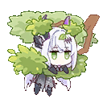

A JavaScript flag would coordinate only one process. I use a PostgreSQL advisory lock around admission and claiming, with a check for an existing processing job. That keeps normal heavy jobs serial even when more than one API process is running.

The queue allows one active job per requester IP, at most 20 waiting jobs and 128 MiB of active file payloads, in addition to per-format limits. **I accept lower import throughput to bound competing writes and file work.** The IP-based limit also means people on the same network share that admission budget.

#### Recover without replaying committed imports

Failure handling needed more than keeping a list of jobs. If an import handler finishes but recording its result fails, the running worker retries the final-state write before claiming another job; it does not rerun the import to obtain the result again.

**A process crash is different:** an interrupted processing job eventually expires as failed, and the user may need to resubmit. Repeated build captures are deduplicated by their digest at the storage layer.

I separate the compact job result from the private card and backpack delivery. Delivery is requester-bound, collected once or expired after an hour.

The queue clears **its own uploaded payload and raw requester address** when the job finishes; accepted profiles and import metadata have separate persistence. The public board exposes state and timing, not those private results. The [queue guide](architecture/job-queue.md) records the limits and recovery rules.

### Keep acceptance, ownership and source evidence distinct

The same import path accepts plain JSON and installation-encrypted files. Encryption protects a file for its destination installation; it cannot establish that the supplied numbers came from the game. I still validate the parsed schema, identities and domain rules before storing the accepted data.

For saved build cards, I sign a digest of the accepted card content; the optional backpack is delivered separately. A later save must match that signed content, so editing a card locally cannot silently turn the edited version into the original accepted capture. The signature establishes that the accepted capture has not been changed; source evidence and ranking eligibility remain separate checks.

&nbsp;Private pull history has another ownership rule: an accepted import grants a device token used for later access. A public UID is a lookup identifier, not permission to read that history. These boundaries are specified in the [import formats](imports.md).

I also use separate database roles for migrations and the running API. The runtime login needs data access, not schema ownership, and the API checks that boundary at startup. That limits what its database connection can do independently of whether an individual request passed validation.

### Reuse the pipeline without letting a locale change the data

Game descriptions and site interface copy come from different sources. I kept a shared locale registry, but game text is resolved by its exact namespace and key; matching an English display name would attach translations to the wrong records when names collide.

Each game-locale pass reruns the processors and generators in an **isolated work tree**. English owns the entity structure and numeric data. The merge uses stable identities and copies localized fields, so a language pass cannot replace an array with a differently ordered set of entities or change a stat while translating its label.&nbsp;

At generation time, a missing translation uses English for the same namespace and key, with fallback counts recorded in the localization manifest. At loading time, a missing locale dataset can fall back to English, while malformed JSON and network failures remain errors. Otherwise a broken data release could look like an ordinary untranslated page.

Interface phrases live in the site's translation tables and have their own coverage check. I can therefore validate application copy separately from the completeness of a particular game client's language files. The [localization guide](architecture/localization.md) documents both paths.

<a href="#contents">↑ Back to contents</a>

---

## Part 7. The live data collector

### The idea came from another game

The inspiration was **[BPSR-ZDPS](https://github.com/Blue-Protocol-Source/BPSR-ZDPS)**, a community damage meter for **Blue Protocol: Star Resonance**. It used network packets to show damage information the game itself did not provide. Seeing that approach in another game made me want to try it in ToF.&nbsp;

For ToF Hub, I wanted to collect the equipment, account stats, inventory and pull history already reaching the client. That would let players bring their data into the tools without entering everything by hand or assembling it from screenshots.

### From a web interface to a Windows application

I am a web developer, so putting together the interface was familiar work. Getting **WinDivert and the Windows capture side** working reliably was where I struggled.

I spent **more than a week on development**, and the application has already needed **around 50 bug fixes**.&nbsp;

- **Windows capture:** I kept WinDivert in a separate helper, so only that helper needed administrator rights. It copies incoming traffic without changing it.
- **TCP messages:** I had to reconstruct the byte stream, handle retransmissions and find message boundaries before decoding equipment or history records.
- **Unreal's UDP channel:** actor updates use a different, bit-level layout. They needed their own decoding; anything I could not interpret stayed raw.

### What the captures showed about game lag

#### Presets replaced every piece individually

Watching the TCP traffic during a preset change was revealing. For each replaced piece, I observed roughly this sequence:

1. **Remove the item**, with information about its stats.
2. **Update the character's stats** after removal.
3. **Equip the replacement.**
4. **Update the stats again.**

A full preset repeated that across gear and **all twelve matrices**, replacing them individually. One click produced a burst of equipment and stat updates before the final setup arrived.&nbsp;

During crowded world-boss sessions, I also received updates about players **elsewhere in the same channel**, beyond those standing near me.

That looked like a contributor to crowded-channel lag: more players changing gear meant more updates reaching everyone. Presets amplified an existing behavior. I did not measure how much of the lag came from the server, network or client, but I could see the repeated updates in the captures.

#### World chat carried more than text

Live Capture could discover a player **when they sent a chat message**. Their stats and weapons arrived with it, without me requesting their profile.&nbsp;

Each chat event was smaller than a preset change but reached a wider audience. It reminded me of world chat being disabled during EU Astora's first month, although the captures could not establish why that happened.

### A capture had to be complete before export

**A half-changed preset could send the wrong stats into the site's calculators.** The app also needed to wait for inventory pages and history batches before offering a complete export.&nbsp;

The [collector overview](../README.md#how-the-live-collector-works) and [import guide](imports.md) cover the implementation and file formats.

<a href="#contents">↑ Back to contents</a>

---

## Part 8. Why I left the game

I loved studying ToF, min-maxing, competing and figuring things out with a team. Improving at different parts of the game kept me interested for a long time.

**The examples below are just a few incidents I still remember today.** There were many more. As they piled up, I felt less and less like playing, until the frustration outweighed the enjoyment.&nbsp;

What wore me down was playing by rules that could change without anyone telling us. That covered the mechanics, the time we had to compete, and whether the results on a leaderboard still meant anything.

**In this part:** [Silent changes](#silent-changes-to-the-rules) · [Content incentives](#content-without-a-reason-to-return) · [The calendar](#competition-on-the-developers-calendar) · [Organising people](#getting-people-into-the-same-run) · [Bugs and the final straw](#bugs-for-breakfast-packs-for-120)

### Silent changes to the rules

The biggest frustration was feeling as though **every patch could turn ToF into a different game**, through changes that never appeared in the patch notes. Researching a mechanic did not tell me whether the next update would quietly invalidate the result.

#### OOW: rechecking the same hidden numbers

I measured OOW resistance manually, and I disliked having to guess what would change next season. Raising resistance could make an older build with **45% ignore** more competitive than a newer one with **30%**, despite the newer build's stronger damage elsewhere.

A value most players never saw could change the balance of an encounter. Finding out meant measuring it again.

#### Huma: broken in one micro-patch, back in the next

This happened while we were actively using Huma's matrices in **Final Trial challenges where enemies dealt enormous damage**:

- **One micro-patch:** their stacking stopped working.
- **The next:** the stacking came back.
- **For our team:** a defensive interaction our setup depended on could disappear and return between updates.

That was why keeping track of every tiny change wore me down. We had to check whether our strategy still worked, even when the patch notes gave us no reason to test it again.&nbsp;

#### The 30% resistance-reduction cap

Around raid season five or six, I began encountering what I identified as a **30% limit**. I could not establish exactly when it had been introduced.

Fiona's cells had stacked before that, and the stacking behavior was still there. Four supports contributing 8% each gave a **nominal 32%**. The separate limit on the effective reduction was what I was trying to establish.

I could understand a cap as a balance decision. My guess was that 30% fitted this particular combination:

| Source | Resistance reduction |
| --- | ---: |
| Asuka A6 | 12% |
| Meryl A0 | 10% |
| Fiona's cell | 8% |
| **Total** | **30%** |

What frustrated me was the history around it. For **three years**, in my experience, Frost had benefited from both strong damage and unusually generous support options. Terminator's discharge supplied a massive **50% reduction**; Physical had something like **Umi's 10%**. Other elements did not have their own Terminator.

We spent years playing around that imbalance, then a rule with major consequences appeared without a clear explanation of when it changed. <strong>A balance change needs to be something players can actually </strong><strong>know about.</strong>&nbsp;

As far as I could tell, I was the first person raising this particular limit publicly, largely because I happened to be investigating those interactions. In the sphere raid, I had personally seen both resistance reduction and extensions to the vulnerability mechanic stack; those interactions were subsequently reduced too.

#### Final Trial: the setting and the fight disagreed

At release, adjustable difficulty looked like a great playground for testing. Then I compared the setting with what happened in the fight:

| What I checked | What I found |
| --- | --- |
| Resistance multiplier set to **0.4** | I expected 40% of the baseline |
| Resistance inferred from damage tests | The measurements pointed to **0.7** |
| Additional resistance-reduction sources | They did not improve the result |

&nbsp;That was how I pinned down the limit in my research. The displayed setting, measured damage and lack of benefit from extra reduction exposed the problem. I still did not know when the restriction had entered the game.

---

### Content without a reason to return

I liked difficult content. I wanted a reason to return, improve a result and compete. Two modes captured the problem for me:

- **Final Trial:** the version I played felt like something one team on each server tried for entertainment, then left. The MMO version at least received a reason to participate. Turning every slider up until we could barely deal damage did not solve the incentive problem.
- **Frontier Clash:** once a result was recorded, there was little reason to keep pushing. Why not make the ranking worth contesting again with each new boss? That seemed like an obvious way to give players another round of competition.

&nbsp;The incentive kept running out even when I still wanted to play.

---

### Competition on the developer's calendar

The release schedule also shaped which builds got to matter. At first, it could look harmless: OOW overlapped a new patch for a week. If that patch introduced a particularly strong Frost weapon, the competitive plan was often already obvious.

New releases and the distribution of support buffs could decide the preferred element before we even started experimenting.

Then the competitive window became painfully short:

- **The wait:** a mode arriving roughly once every three months.
- **The opportunity:** about **three days of meaningful competition**.
- **The practical problem:** we sometimes could not get the team together inside that window.

What the hell? That was the content I wanted to play. What if someone worked all three days? What if our free evenings simply did not line up?

Months between releases did not make those few days easier to coordinate. From what I saw around and after my departure, the timing only became more frustrating.&nbsp;

---

### Getting people into the same run

Finding players was exhausting too, and this went beyond my regular team.

- We agreed on a time and checked that everyone was free, yet still started **30 to 60 minutes late**.
- Others seemed available for **one hour, once in a blue moon**, provided every possible condition aligned.

A short competitive window and an unreliable start time were a miserable combination. This followed me through almost everything I tried to organise. Eventually, I could not keep putting up with the waiting.&nbsp;

Call me weak if you want. I hated it.

---

### Bugs for breakfast, packs for 120

The final issue tied everything else together: **bugs kept deciding how we competed**.

Some broke a run. Others made content dramatically easier. Knowledge of the useful ones was often kept inside small groups, so competition also depended on which interactions a team knew about and kept quiet.

#### The mech-scorpion raid

The encounter mechanic could fail to damage the boss. My research pointed to that damage being treated as relic damage and not registering.

I investigated it thoroughly and kept the evidence. I stand by my conclusion: <strong>none of the supposed magical actions people suggested </strong><strong>fixed it</strong>.&nbsp;

That left us needing both of these things in the same attempt:

- Every player had to execute the mechanics properly.
- The bug had to leave the run alone.

We could practise our execution. We still had to hope the game's own mechanic would work.

#### Fiona's synthesis banner: the final straw

As I understood it, the abnormal synthesis damage had already been reported during beta testing. It still reached Global in that state.

The sequence that followed was what I could not accept:

1. **The damage went live.** Teams could set results using the broken interaction.
2. **The damage was fixed without an announced time for the change.** Competitive runs were now being set under different conditions.
3. **The old results stayed on the rankings.** Fixing the interaction did not restore a meaningful competition for teams playing afterwards.
4. **The promised follow-up did not arrive.** The developers said the rankings would be addressed in the next patch. I saw neither that fix nor a new room to move the compromised board out of the way.

In my recollection, the old **Altered Sequential board remained for roughly half a year**. Adding a new room, as had happened in other patches, would at least have given players a fresh competition.

A leaderboard result no longer necessarily meant a team had beaten the same challenge under the same rules. That undermined the reason I was putting so much effort into it.&nbsp;

#### It kept happening after I left

These were not isolated frustrations to me. After leaving, I still heard about:

- **Ten-second raid clears**, with an EU top eight containing only **nine unique players**. Eight full eight-player teams could represent as many as 64 people.
- **Two-second Frontier Clash clears.**

My anger there is directed at the developers. Players filling several ranking positions with duo clears were using the system they had been given. The developers were responsible for making it a competition worth taking seriously.

Competing with Fiona was not the problem. **The problem was that one day decided the competition for the entire patch.** Some players simply could not spend that day pushing content. Once the damage was fixed and those results stayed on the boards, the competition was effectively dead for everyone playing afterwards.

On the very first day of the bug, I said: **"If they fix this tomorrow and do nothing about the rankings, I'm leaving."**

That is what happened, and I left. **I keep my promises. Every last one.**

<a href="#contents">↑ Back to contents</a>

---

## Part 9. Why I still build and maintain ToF Hub

I **really, REALLY enjoy studying this game**. Of the games and communities I had been part of, ToF felt like one where I could make a useful contribution. There was plenty to investigate, and relatively few people were digging into how it all worked. I had already gathered enough data and experience to keep exploring.&nbsp;

### Returning to the unfinished website

I had started this work while I was still playing. By the time I left, I had put together the multiplicative-buff page and laid the groundwork for several other pages. Then I shelved the project.

Later, I had some free time and felt like coming back to the ToF I loved through that unfinished website. I picked it up again and started finishing the ideas I had left behind.&nbsp;

**Over about two months, it grew into the ToF Hub described in this article.** I kept finding more of my research that I could present on the site, and more tools I wanted to build around it.

### What I learned by building it

I'm pleased with how it turned out.&nbsp; The experience I gained matters just as much to me as the finished pages:

- **Datamining:** finding useful data, following its connections and checking what I could conclude from it.
- **Design:** turning that knowledge into pages, comparisons and interactive tools that someone else could understand and use.
- **Backend and desktop development:** building the services behind the website and a working Windows capture application, beyond the web interface I was already comfortable making.
- **Working within limited resources:** optimising the project so I could keep it running on the hosting I had.

My public hosting disclaimer gives you an idea of that last part:

> *current host is 500mb ram + 1/999999 part of zeon, so if something will be laggy -> sry.*

### Finding a form for what I know

I also wanted to see how well I could turn my knowledge into something visible and useful. Sometimes that meant a readable explanation; sometimes a table, a chart or a tool where you could try your own values.

ToF Hub grew out of that experiment. I still have things to investigate and better ways to present what I find, and I enjoy learning how to build them. That is why I keep developing and maintaining it after leaving the game.

<a href="#contents">↑ Back to contents</a>

---

## Credits

I built the research collection, website and tools with help, independent checks and references from the people and projects below.

| Contribution | Person or project |
| --- | --- |
| Team DPS spreadsheet and an important starting point for my research | Maygi |
| Reddit articles and technical discussions; review and corrections of my formulas | rikuzero1 |
| Independent testing, calculations and cross-checks during the buff-category research | Avorozer |
| Test-client links and the initial guidance that opened another route into the data | Afrodiy |
| Duo-equipment inheritance tests and the discussion used in the formulas | Kune; [AntonioS3's Reddit post](https://www.reddit.com/r/TowerofFantasy/comments/1cqzb6j/potential_major_bug_with_dual_element_systemsub/), with clarifications and tests from noname6600 and rikuzero1 |
| Upstream equipment definitions and model used by the pinned reference generator | [apache1123/tof-tools](https://github.com/apache1123/tof-tools) |
| Initial visual reference for the Simulacra and game-reference pages | [tof.gg](https://tof.gg/) |
| Tools used to inspect and export the Unreal Engine files | FModel and UnrealExporter/CUE4Parse |

If I haven't mentioned you by name, I'm sorry. I tried to highlight the people who had the greatest impact on my time in the game and on the project's development. I'm glad I had the chance to play or talk about ToF with all of you.

Players who shared account data, screenshots, captures and in-game observations also made it possible to check the work against actual play. Thank you as well to the people behind the early ToF community projects mentioned in Part 1.&nbsp;

<a href="#contents">↑ Back to contents</a>

