

# Мой путь в Tower of Fantasy

**От F2P+ с первого дня игры до таблиц, датамайна и ToF Hub**

[Сайт](https://tof.smilekritik.beer/) · [О проекте](../README.md) · [Документация](README.md)

Всё началось с того, что я просто играл в Tower of Fantasy. Здесь я рассказываю, как постепенно стал участвовать в жизни комьюнити: какие публичные проекты делал, с какими багами сталкивался и какие шутки из этого получались. Это история всего моего участия в ToF, а ToF Hub - одна из её частей.&nbsp;

Первая часть - про саму игру и людей. Дальше разбираю уже техническую сторону: файлы игры, формулы, инструменты, сайт и приложение для сбора данных.

> [!NOTE]
> На чтение уйдёт примерно час. **Часть 1** - личная история. **Части 2–7** - подробности разработки и исследований. **Части 8–9** - почему я ушёл из игры и почему продолжаю делать ToF Hub.
> Можно читать отдельными частями и переходить к тому, что интересно.

## Содержание

| Часть | О чём |
| --- | --- |
| [1 · История](#part-1-the-story) | Игра, люди, Excel и первые сайты |
| [2 · Как я разбирался в файлах игры](#part-2-how-the-game-stores-its-data) | Связи между файлами, Global/MMO и моды |
| [3 · Как появились справочные страницы](#part-3-building-the-reference-pages) | Персонажи, эффекты, контент, прокачка и медиа |
| [4 · Формулы](#part-4-formulas-measured-and-corrected) | Titan, дуо-элементы, гир, CS и временные бафы |
| [5 · Инструменты](#part-5-the-tools) | Рейтинг, карточка билда, оптимизатор, крутки и команды |
| [6 · Технические решения](#part-6-engineering-decisions) | Обновления данных, загрузка страниц, база, кеш и очередь |
| [7 · Приложение для сбора данных](#part-7-the-live-data-collector) | От идеи до Windows-приложения и разбора пакетов |
| [8 · Почему я ушёл из игры](#part-8-why-i-left-the-game) | Тихие изменения, соревнования, расписание и баги |
| [9 · Почему я продолжаю делать ToF Hub](#part-9-why-i-still-build-and-maintain-tof-hub) | Возвращение к проекту и полученный опыт |
| [Благодарности](#credits) | Люди и проекты, которые помогли |

---

## Часть 1. История

### Игрок с первого дня, но долго в стороне от комьюнити

Я играю в Tower of Fantasy с первого дня релиза. Времени с тех пор прошло немало, но первые полтора года я почти не участвовал ни в комьюнити, ни в чём-то ещё вокруг игры. Просто играл. Был, как я это называю, **F2P+: месячка и боевой пропуск**.&nbsp;

Да, я знаю, что означает F. И все, кто играл в ToF, знают, что игра совсем не дешёвая. Я всегда хотел играть на высоком уровне, но при небольших вложениях включаться во всё это было сложно по нескольким причинам.

1. **Попасть в команду.** Желающих взять небогатого игрока в сложный контент особо не было. Я ещё и мейнил физу, а до Gnonno она для моих целей была почти неиграбельной.
2. **Исследования оставлял тем, кто разбирается.** Кто я такой, чтобы что-то изучать? Вокруг уже были опытные люди, которые понимали устройство подобных игр и умели всё считать. Я спокойно оставлял это им.
3. **Не видел, как использовать эти знания.** Зачем изучать механику, на которую не можешь повлиять? Какая мне разница, в одном контенте 0% резистов, а в другом 35%, если игнора резистов у моего билда всё равно нет? Чтобы узнать, где сложнее? Смешно. Это и так понятно, когда играешь.

### Как я смотрел на работу Maygi

Меня очень впечатляли её таблицы: расчёты команд, сравнения и весь труд за этими цифрами. Кто-то критиковал её за ошибки в отдельных взаимодействиях или сценариях. У меня ответ всегда был один: **так сделайте лучше?**&nbsp;

Я смотрел на подобную работу с восхищением и интересом. К слову, полные расчёты командного DPS я и сейчас делать не умею. Ладно, я особо и не пытался этому научиться. Для меня Maygi заложила основу большого количества последующих расчётов по ToF. Спасибо ей за вклад в игру и комьюнити.

  <a href="screenshots/maygi-dps-calculations.webp">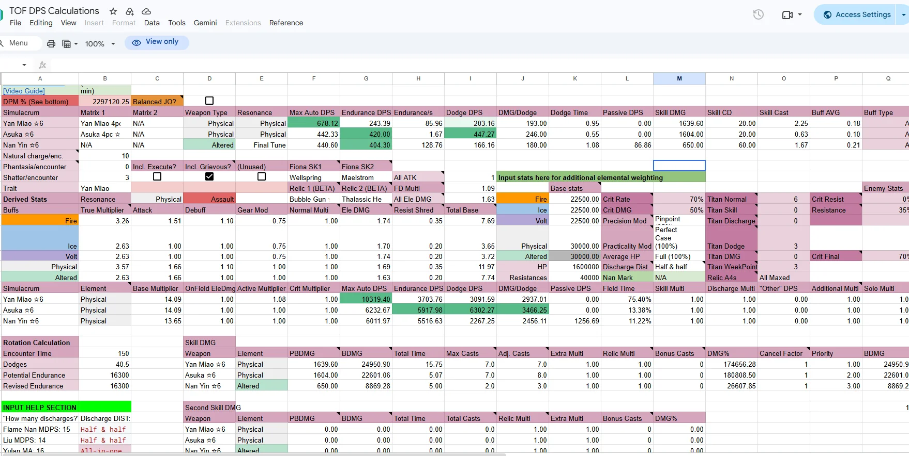</a>
   
  <i>Таблица командного DPS от Maygi.</i>

### Первые проекты комьюнити

Таблицы Maygi были не единственным проектом, которым я восхищался. Перед своей историей хочу вспомнить то, что было важно для меня в те годы.

**Incin - нормальная история круток**

Был такой сервис, [Incin](https://www.incin.net/orders/view), который показывал крутки в игре. Он давно не работает, но я обожал саму идею. Встроенный интерфейс ToF был неудобным и показывал историю только за последний патч. Получить нормальную сводку вне игры было огромным улучшением.&nbsp;

Думаю, его авторы тоже изучали данные игры. Предполагаю, что тогда существовало доступное API, через которое историю можно было удобно получить. Официально это поддерживалось или нет - не знаю, но сделали сервис добротно.

  <a href="screenshots/incin-pull-history.webp">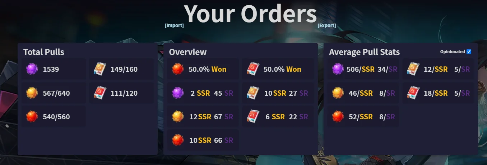</a>
   
  <i>Сводка истории круток в Incin.</i>

Насколько я помню, он работал, пока в игре оставалась открытой одна дырка. Помните историю из версии 1.5, когда читер удалял вещи из инвентарей других игроков? Моё отношение к нему, наверное, позитивнее, чем у большинства. Он публично показывал проблему, пусть и причиняя вред игрокам, вместо того чтобы тихо пользоваться ею и добавлять себе любые предметы. А как ещё привлечь внимание разработчиков? Тогда я смотрел на это именно так.

Насколько я понимал, исправление этой дырки заодно перекрыло доступ, на котором держался Incin. Подтвердить техническую связь я не могу, но исчезновение сайта запомнил именно так.

**Tower of Fantasy Index - первая вики**

&nbsp;Ещё был [Tower of Fantasy Index](https://v1.toweroffantasy.info/), первая вики по игре, которую я помню. Красивое оформление собранных игровых данных. Я даже помогал вручную заполнять информацию для v3. Но до более широкого участия это не дошло: когда я захотел включиться в развитие, мне сказали, что я не нужен, и в итоге убрали из чата проекта.

  <a href="screenshots/tower-of-fantasy-index-v1.webp">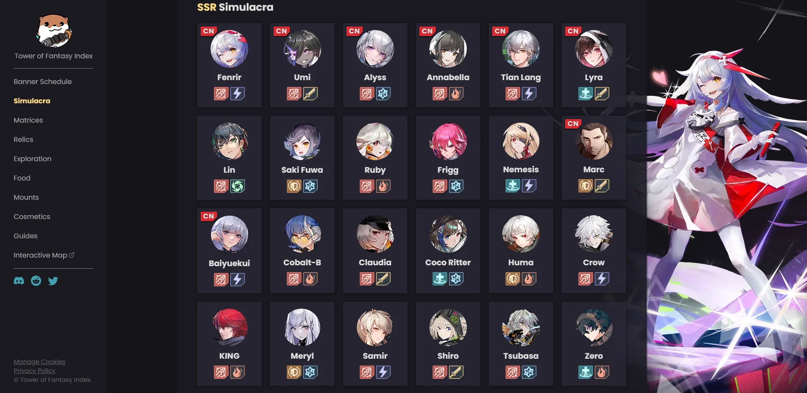</a>
   
  <i>Tower of Fantasy Index, первая версия.</i>

Это тоже часть моей истории, но уважение к самому проекту и его вкладу у меня осталось. Эти ресурсы были одними из самых ранних и значимых для игры. Я до сих пор ценю труд, который в них вложили.

---

### 10.08.2023 - 119.99

Кто-то, возможно, осудит эту часть истории. Ладно. Обычно я люблю тянуть интригу, но здесь скажу сразу: патч Gnonno, выход игры в Epic Games Store и ошибка региональных цен. Ещё тут мой любимый персонаж, но о ней чуть позже.&nbsp;

Когда ToF вышла в Epic, региональные цены оказались неправильными. Насколько я помню, реальный курс был примерно **35 гривен за доллар**, а магазин считал по **15 гривен** или **30 рублей**. Для самого большого пака за $100 получалось так:

- **Ожидаемая цена в гривнах:** примерно 3 500 грн.
- **Первая цена в Epic:** 1 500 грн, то есть около $42,86 по реальному курсу.
- **Первая цена в рублях:** 3 000 рублей.

Так было до вечера, пока они не пошли исправлять ошибку. И исправили! Цена в рублях стала правильной, а в гривнах получилось… **119.99**. Просто число, без валюты в интерфейсе.

Предполагаю, что кто-то хотел указать цену в долларах: $100 за пак и ещё 20% налога. А получилось **119,99 гривны за самый большой пак**. При курсе 35 это примерно **$3,43**.&nbsp;

  <a href="screenshots/epic-tanium-119-99.webp">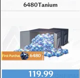</a>
   
  <i>Пак за 119.99 без указания валюты.</i>

Многие воспользовались этой ценой. Я тоже. Именно так смог закончить полноценную физическую сборку: баннер Fiona ещё шёл, баннер Gnonno уже начался, а Lin у меня была. Сразу уточню: **A6 Lin, A6 Gnonno и A6 Fiona я получил и без этой ошибки цен**. Дешёвые паки пошли на матрицы, которых не хватало для полного билда.

Но перед тем как представлять бесконечный запас почти бесплатного таниума, стоит вспомнить несколько вещей:

- **В Epic были лимиты на платежи.** Чем новее аккаунт, тем ниже мог быть месячный лимит. После определённой суммы магазин просто переставал принимать платежи в любую игру. Я снова столкнулся с этим в Blue Protocol в 2026 году: лимит был около $400.
- **Потолок составлял 20 максимальных паков на аккаунт.** По ошибочной цене это 2 399,80 грн, или около $68,57 по тому курсу, за паки обычной стоимостью $2 000 до налогов.
- **На покупку уходили часы.** Подтвердил платёж, пять минут смотришь в зависший экран, и, возможно, он прошёл. А возможно, упал, и всё сначала.
- **Никто не знал, что будет дальше.** Я, как и многие, боялся бана или списания уже потраченной валюты. Вспоминал игры HoYoverse и опасался отрицательного баланса с потерей аккаунта. Тогда я был первокурсником, и около $100 уходило у меня на целый месяц жизни. Просто потерять такую сумму было тяжело даже при настолько смешной цене.

### Наконец-то играю ДД

&nbsp;Вот это и стало моей отправной точкой. Я смог играть ДД в OOW и другом сложном контенте. И прежде чем сказать, что можно было просто стать саппортом: это тоже стоило денег. Как физ-мейнер я пропустил Lyra, потому что не мог её себе позволить. Для нужной мне поддержки требовалась A5 или выше, а для нормальной работы в ДД-билде - ещё и максимальные матрицы.

Чего в итоге добился со своей физой?

  <a href="screenshots/raid-season-3-eu-smilekritik.webp">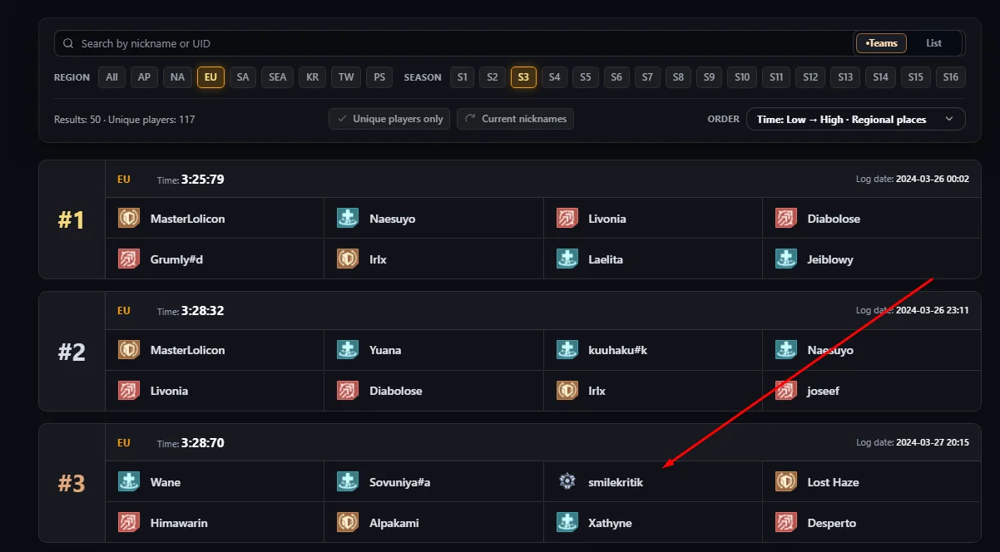</a>
   
  <i>Третий сезон рейдов EU: наши 3:28:70 и первое место с 3:25:79.</i>

Вот я в роли ДД в третьем сезоне рейдов, меньше чем в трёх секундах от первого места EU. Билд был **Asuka, Yan Miao и Fiona**. Актуальный вариант использовал Nan Yin и давал атакующий резонанс, у меня был баланс. Скриншотов или записи разбивки урона не сохранилось, так что здесь это мои воспоминания: игроков с Nan Yin я обгонял по урону очень уверенно. На кактусе и в обычном контенте билды были близки, но окна неуязвимости босса мешали попадать всеми взрывами Nan Yin.

Почему Европа отставала почти на 30 секунд от лучших команд других регионов? Мне кажется, людям на EU просто не рассказали, что **эффекты A3 Claudia от разных игроков стакаются**. Да, старой Claudia. По-моему, многие даже не брали её саппортам в физические рейды. Такая *Clueless*-атмосфера держалась оооочень долго. Люди часто не хотели разбираться, как взаимодействия реально работают.

Я себя из этого не исключаю. Тогда я ещё не занимался активными исследованиями, да и не особо было с кем. Меня уже знали достаточно, чтобы **позвать как ДД**, но в организацию команд я ещё не входил.

### Когда саппорт стал доступным

По-настоящему игра открылась для меня, когда Lyra попала в стандарт. Основу саппорт-билда внезапно стало можно получить <strong>совершенно бесплатно за </strong><strong>стандартные крутки</strong>.&nbsp;

Дальнейшие вложения зависели от цели:

- **Для абсолютного максимума:** A6 Fiona с максимальным трёхзвёздочным комплектом матриц. Да, матрицы дорогие, но это и было то единственное ограниченное вложение, на которое можно копить.
- **Для рейдов:** хватало даже Fiona без её матриц.

**Пятый сезон рейдов стал поворотным моментом.** У меня появился полный саппорт-билд. Я всегда умел адаптироваться и нажимать кнопки. Люди, которые понимали игру, наконец могли играть рядом с китами на самом высоком уровне. Я сейчас не только про себя. У меня появились люди, с которыми можно было собирать команды, пушить контент и тестировать механики.

Проблема никогда не была в общении. Английского мне хватало, с коммуникацией всё было нормально. Сложно было найти игроков, готовых вместе разбираться в игре. По моему опыту, многие киты либо сами недостаточно понимали механику, чтобы её анализировать, либо не хотели иметь дела с теми, у кого аккаунт не на максималках.

### Люди, с которыми я играл

С этого момента я начал ходить в сложный контент постоянной локальной командой. Причём вообще во весь. Основой были я, **ariveder4i** и **xikkari**, а четвёртый слот занимали **ladno** и другие игроки.

&nbsp;Огромное спасибо этим ребятам. Они участвовали со мной во всём, помогали тестировать и во многом удерживали меня в игре. По стратегии и анализу это одни из самых сильных игроков, которых я знал на EU. Совместная игра была одной из лучших частей ToF.

Жаль, что так и не нашлось постоянного четвёртого игрока, которого я мог бы выделить точно так же. Дело было не только во вложениях в аккаунт. У кого-то из сильных игроков не было времени на постоянную команду, кто-то, на мой взгляд, плохо учился и адаптировался к тому, что мы пытались сделать. В каждый случай вдаваться не буду. Спасибо всем, кто сделал этот период таким хорошим.

#### Команда, с которой я попробовал желаемый уровень игры

Потом вышел сезон OOW, который мы не могли пройти из-за недостаточных вложений в ДД. Примерно тогда я случайно пересёкся с **Nezuko**. Она позвала поиграть с **Eren**, которого я считал сильнейшим соло-игроком EU. Так мы и начали ходить вместе.

Честно, это было лучшее случайное знакомство в игре. Я наконец попробовал тот уровень, о котором мечтал: **полные аккаунты, полные билды, выжимаем всё возможное**. Мой аккаунт под такой формат тоже подходил.

#### Вместе с конкуренцией пришли скандалы

К сожалению, переход вызвал и локальные конфликты. У нас была эпоха одного основного ДД на команду, поэтому назову группы привычно: **команда Eren** и **команда iRays**.

До этого мы с ariveder4i уже пересекались с группой iRays, смотрели контент и немного играли вместе. Например, я занимал слот танка с двумя их саппортами, чтобы сравнить, как работают наши команды.

Потом я перешёл к Eren, и получилось сразу два недовольства:

- **Моя постоянная команда расстроилась, что я прошёл без них.**
- **Команда iRays обиделась, что я пошёл к конкурентам и помогаю им лучше играть.** По крайней мере, с моей стороны это выглядело так.

Не скажу, что я доволен всеми последствиями. Поссорился с локальной командой и отдалился от другой группы хороших игроков. Но при этом получил условия, в которых хотел играть, и, на мой взгляд, сделал конкуренцию на EU интереснее.

Почти сразу после вступления мы взяли **первое место EU**. [Вот одна из записей того периода](https://www.youtube.com/watch?v=3BdlGcCJj3w).&nbsp;

#### Игроки моей последней команды

Четвёртый слот менялся и здесь, но нескольких людей хочу отметить отдельно:

- **Naesuyo:** сильный игрок, у которого в итоге просто не осталось времени на игру.
- **Ren:** отличный игрок со своими инициативными идеями. Они очень помогали команде.
- **Lilou:** наш последний постоянный четвёртый игрок. После вступления быстро научилась играть сложный контент.
- **Nezuko:** абсолютный кит, который умел играть на любой роли. Единственная вредная привычка - опаздывать.
- **Eren:** сильный и адаптивный ДД. Общаться с ним бывало непросто: он сохранял анонимность и даже не заходил в голосовой Discord.

#### Уважение и другой команде

Соревнования не мешали мне уважать сильных игроков с другой стороны.

- **Boom** - способный хилер, который показал, как хорошо саппорт может подстраиваться под контент.
- **GMX** - единственный другой танк EU, которого я ставил на такой уровень. Возможно, часть недовольства мной была связана с тем, что я посмотрел его игру и быстро научился применять увиденное сам.

Но подход к танкованию у нас отличался. **GMX больше работал с расположением противников в бою, а я старался идеально выполнять механики и надёжно давать команде бафы.** По такому различию нельзя нормально определить, кто из нас лучше. Среди остальных танков EU, с которыми играл или чьи записи смотрел, похожего уровня исполнения я не видел.

Спасибо всем этим людям. Именно сложный контент с ними давал мне мотивацию играть дальше и людей, вместе с которыми можно было учиться.&nbsp;

Параллельно я начал изучать статы, резисты, их игнор и стакинг эффектов. Большая часть первых исследований была попыткой понять то, что Maygi сделала больше года назад. Так и появилась моя собственная Excel-таблица.

---

### Моя таблица

Я хотел разобраться в игре, но понял, что никто в комьюнити не собирает всё в удобном и понятном для остальных виде. Информация была везде по крупице, а полной картины не было. Некоторые объяснения вообще заканчивались на **«верь мне, брат»**.&nbsp;

Поэтому я начал полагаться на свои тесты и **перепроверять каждое значение сам**. Простую математику я понимал: насколько упал урон, насколько вырос после добавления бафа. Такое можно измерить, посчитать и проверить. От этого и оттолкнулся.

Несколько заметок выросли в [Everything by Kritik](https://docs.google.com/spreadsheets/d/1RExuEj6DGWgaYnN2lmYjbEO-ip-KzwHyNfGK_0M8Uro): 28 вкладок и история изменений от патча к патчу. Первая страница делила всё на *Datamined* и *Calculation*. Где-то были калькуляторы, где-то добытые таблицы, а где-то мои рабочие записи.

#### Как я учился читать файлы игры

Исследования шли сразу в нескольких направлениях. Важным изменением стала доступность модов. Попасть в комьюнити моддеров желающему было не так сложно, по крайней мере мне так казалось. Там я и научился открывать файлы игры через **FModel** и читать данные напрямую.

&nbsp;Честно, там была полная каша. Куча будто бы не связанных между собой данных, которые даже сопоставить с тем, что знаешь по игре, было трудно.

Иногда мне казалось, что сами разработчики уже не знают, как у них всё работает. Будто смена людей внутри команды годами оставляла новые слои костылей и запутанного кода. Это моё впечатление от попыток разобраться в файлах, а не доказанный факт о студии.

Через несколько месяцев интерес к игре уже будто затухал - третий год подбирался? - а меня начали хоть немного узнавать. **Afrodiy** сам пришёл и дал ссылки на тестовые клиенты. Информации было немного:

- **Клиенты:** ссылки на тестовые сборки игры.
- **Где искать:** короткое объяснение, в каких файлах лежит информация о будущих персонажах.
- **Инструкция:** маленькая памятка на китайском со скриншотом аккаунта.

На тот момент я умел только открывать файлы. Мог доставать будущую информацию из этих полупубличных клиентов, но в самой сфере оставался никем и даже не представлял, что ещё получил в руки.

---

### Первые Excel-таблицы: резисты и скейлинг

Начал с трёх вопросов:

- **Резисты:** как они работают?
- **Контент:** сколько их в каждом режиме?
- **Скейлинг:** что меняется с ростом сложности?

Я сравнивал урон в контенте с уроном по кактусу. Очень помогла Altered Nola: один из её ударов игнорировал те механики, которые я пытался отделить. Получался надёжный ориентир с учётом игрового разброса урона. Несколько тестов - и уже можно выйти на понятный ответ.&nbsp;

Схема была простая:

1. **Получить базу:** ударить кактус огненным луком.
2. **Поменять условия:** зайти в OOW, где резисты я уже выяснил.
3. **Сравнить урон:** посчитать потери, учесть резисты и разобраться с оставшимся снижением урона.

Так я и изучал эффекты и их скейлинг. Насколько я знал, подобным способом до меня это особо не разбирали.

Практический результат - понимание, **сколько реально даёт игнор резистов в сложном контенте**. Когда резисты перевалили за 70%, билды с игнором начали обгонять варианты с гораздо более высоким сырым уроном. Проверял я и описания игры, включая заявленный лимит 50% игнора, а не принимал их на веру.

---

### Вечный вопрос: какие бафы складываются, а какие перемножаются?

Потом перешёл к вопросу, который всплывал в каждом обсуждении урона: категории всех бафов игры. Ещё при Maygi выяснили, что словам вроде «final damage» в описаниях нельзя просто верить. Была и категория, которую игроки назвали **Normal**. Но всё это установили тестами: берём бафы, бьём, сравниваем, унга-бунга. Я хотел понять систему целиком.

**Больше недели** потратил только на базовые множители. Опубликовал то, чем занимаюсь, и к исследованиям подключился **Avorozer**.&nbsp; Работали как два учёных:

- **Независимые тесты:** он проводил собственные эксперименты, а не просто помогал мне с моими.
- **Сверка:** сравнивали результаты расчётов.
- **Исправления:** если они расходились, искали причину и поправляли друг друга.

Основу мы проверили, но мне всё равно казалось, что одних тестов недостаточно. Полез в файлы. Спойлер: не помогло. Пока.

#### Тестовые клиенты оказались полезнее, чем я думал

Почти случайно решил ещё раз их проверить. Если дочитали сюда и раньше стеснялись спросить лично, рассказываю секрет номер один: аккаунты назывались вроде `ht100`. Однажды я ввёл это и как логин, и как пароль. <strong>О боже. Меня пустило. Всё было </strong><strong>настолько просто.</strong>&nbsp;

Изначально это были аккаунты тайваньской версии, примерно от `ht100` до `ht999`. У корейской версии встречались странные диапазоны вроде `ht1210–ht1220` и `ht4001–ht4005`, но принцип тот же. Именно это я тогда обнаружил.

Нормального понятного руководства у меня по-прежнему не было, клиент был на китайском. Зато имелась **админ-консоль без ограничений**. Методом тыка нашёл просмотр:

- **Эффектов на себе**, включая внутренние названия бафов.
- **Эффектов на противнике**, то есть другой половины расчёта урона.
- **Скрытых серверных бафов**, которых в обычном интерфейсе вообще не было.

  <a href="screenshots/test-client-active-buff.webp">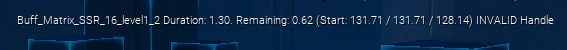</a>
   
  <i>Внутреннее имя бафа в отладочном интерфейсе тестового клиента.</i>

С этими названиями снова пошёл в экспортированные файлы. И они там были! Но само найденное имя всё ещё не объясняло, как баф связан с расчётом урона.&nbsp; Я читал старые исследования других тестеров, и, похоже, они упирались ровно в эту же стену.

#### Смотрим на структуру вокруг бафа

В итоге задал другой вопрос: может, смотреть нужно шире, на обёртку вокруг самого бафа? Из этого и вырос мой [сканер экспорта](https://github.com/smilekritik/Tower-of-fantasy-exporter-scanner).

[Скрипт](https://github.com/smilekritik/Tower-of-fantasy-exporter-scanner/blob/master/main_scanning_files.py) сохранял вместе три вещи:

- **Что меняется:** атрибут `AttributeName`.
- **К какой категории относится:** `ModuleExtraType` или `NoModule`, если значение не задано.
- **Откуда взято:** имя исходного файла.

Он читал `ModuleExtraModifierInfos`, обычные `Modifiers` и `GameplayModifierInfos` внутри условий применения. Потом строил индексы в обе стороны: **атрибут → категория → файлы** и **категория → атрибут → файлы**. Вот эту группировку я и терял, когда смотрел только на отдельные имена бафов.

И получилось! Полный экспорт игры и длинный проход скрипта дали нужную датамайн-таблицу. Оптимизацией тогда не пахло: <strong>на экспорт и сканирование мог уйти </strong><strong>целый день</strong>.&nbsp;

Дальше проверял:

1. **Надевал** матрицу с эффектом final damage на тестовом клиенте.
2. **Смотрел** внутреннее имя активного бафа.
3. **Находил** его в экспортированной таблице и проверял категорию.
4. **Сравнивал** с тем, что уже установил по тестам урона.

Повторял с другими эффектами. **Всё, что мог проверить, совпадало.** Таблица продолжала давать правильный ответ.&nbsp;

Оставалась проблема названий: внутреннее имя и знакомое игроку имя - разные вещи. Но теперь по внутреннему названию можно было понять, **с чем баф складывается, а с чем перемножается**. Без всей предыдущей работы я бы даже не понял, что нашёл.

Жаль, что **Avorozer**, кажется, разочаровался, когда я нашёл способ сразу ответить на вопросы, которые мы до этого проверяли по одному. Мне кажется, он почувствовал, будто его работа стала не нужна. Он оспорил одну-две категории, но после проверки понял, что ошибка была в расчётах, а не в датамайне. Со временем отошёл и от исследований, и от игры. Я всё равно очень благодарен за его вклад: независимые тесты были важны, даже если файлы потом дали более полный ответ. Так мы и разобрались с загадкой категорий.

#### Превращаем находки в полезные таблицы

Потом постепенно заполнял простые разделы Excel: сверял с игрой, подтверждал обычными расчётами и собирал всё, что удалось надёжно установить.

Постоянно возвращался к тому, что никто не делает понятного сравнения HP в поэтажном контенте. Вроде полезно заранее прикинуть, хватает ли урона, прежде чем часами пробовать? Данные-то лежали в файлах, но ещё надо было связать их с игрой:

- **Сырые статы противников:** HP и другие значения были записаны под внутренними ID без знакомых названий.
- **OOW и Sequential:** их постепенно получилось сопоставить с конкретными боями.
- **Bygone:** небольшие базовые статы менялись за счёт большого количества стаков поэтажных бафов. Готовых чисел для каждого этажа в одной таблице не было.

Многое оставалось непонятным. Игра снова оказывалась сложнее, чем хотелось.

&nbsp;Так появились первые **сравнения требуемого урона в Sequential**. Они совпадали с моим опытом более чем на десяти аккаунтах. Да, к тому моменту меня уже знали настолько, что иногда немного платили за прохождение контента на чужих аккаунтах. Это заодно давало возможность проверять оценки на реальных забегах.

  <a href="screenshots/sequential-damage-requirements.webp">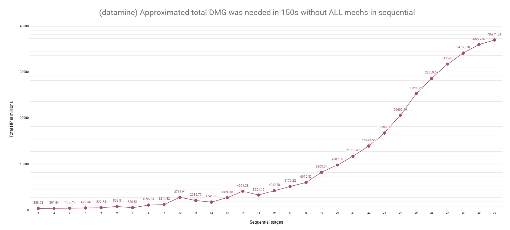</a>
   
  <i>Мой ранний график требуемого урона Sequential в Excel.</i>

#### Сравниваем гир и убираем то, что сокращается

Ещё одной важной вкладкой стало сравнение гира. Снова спасибо **Maygi**: она хорошо начала эту идею, но не закончила. После разбора категорий я понял, какие множители нужны, и сделал свой расчёт с нуля.

Главное - разделить то, что меняется, и то, что остаётся одинаковым:

- **Значения, зависящие от гира:** пересчитать для каждого варианта.
- **Неизменные множители:** одинаковые эффекты оружия, матриц и других источников сокращаются при сравнении.

> [!IMPORTANT]
> **Если множитель между двумя вариантами не меняется, зачем учитывать его так, будто он влияет на разницу?**

Именно такую проблему я видел у [Tower of Fantasy Tools](https://www.toweroffantasytools.com/). Сервис красивый и удобнее моей таблицы, но при моих сравнениях давал существенные ошибки. По видимой активности моей таблицей пользовались много, несмотря на менее удобный интерфейс. Спасибо всем, кто доверял моей работе.

Оглядываясь назад, стоило написать автору и поработать вместе. Честно? Мне было лень. Возможно, было и немного эгоизма, но начинать общение и распутывать чужие расчёты при настолько разных формулах совсем не хотелось.&nbsp;

#### Как таблица продолжала расти

Новая вкладка обычно начиналась с вопроса: во время игры, подготовки к прохождению или спора о механике. Я разбирался, сохранял расчёт и старался сделать его пригодным для других. Одни вкладки становились постоянными калькуляторами, другие оставались разовым сравнением или незавершённым тестом.

**Что реально улучшит этот билд?**

Разбор резистов и категорий бафов дал основу для небольших практических задач:

- **Resists, Resists Table и Resist Ignore dmg impact.** Зная резисты контента, можно посчитать пользу игнора или среза. Готовые таблицы избавляли от повторения одного расчёта при каждом сравнении билдов.
- **Crit.** Крит на экране персонажа не равен шансу против любого врага. Вкладка переводила рейтинг в шанс и обратно для разных уровней противника, хранила найденные значения крит-резиста. Становилось понятнее, почему подходящий на кактусе набор иначе работает в контенте.
- **Gear Compare.** Обычный вопрос: эта новая вещь действительно лучше при моих текущих статах? Там же сравнивалась ценность роллов, ведь одинаковый ролл по-разному полезен разным аккаунтам.
- **Effective HP.** Считал и выживаемость: что дадут HP, резисты и разные защитные эффекты. Снижение урона и снижение атаки врага держал отдельно из-за разного стакинга.
- **Universal Base ATK.** По изменению статов от известного бафа восстанавливал универсальную и стихийную части базовой атаки, чтобы оценить другой баф на base ATK.

**Хватает ли нам урона на контент?**

- **SEQ DB и Bygone DMG.** Сравнение урона по кактусу с требованиями этапа. Одного HP для Sequential недостаточно: нужны время и резисты. Калькулятор Bygone решал похожую задачу - какой урон делает прохождение босса реалистичным.
- **OOW DB и OOW Resists.** HP и скейлинг сложности рядом помогали отличить размер полоски здоровья от резистов за процентом сложности. Так проще сравнивать билды на разных этапах сезона.
- **OOW Boses и Final Trial.** Иногда дело было в механике, а не в статах. Я собирал карточки боссов и заметки о сложности и уроне механик FT. Например, отображаемый множитель 0.4 в моих тестах работал как 0.7.

Такие таблицы помогали обсуждать конкретный забег.

**Players Compare: снимок одного сравнения**

Вкладка появилась из желания понять разницу в DPS между игроками и командами в OOW и рейдах. Для себя сравнивал и результаты Bygone: человек уступает по статам или причина худшего времени другая?

&nbsp;Один из примеров - великий **M (macroer)**. Сравнивал его с другими, чтобы понять разницу именно между аккаунтами. В [одном из сравнений](https://docs.google.com/spreadsheets/d/1RExuEj6DGWgaYnN2lmYjbEO-ip-KzwHyNfGK_0M8Uro/edit#gid=15741196) рядом стоят M, Syota и Eren.

У такого сравнения были границы:

- **Данные игрока.** Только если человек ими поделился. Значения я вводил вручную, поэтому сравнение описывало аккаунты в конкретный момент.
- **Одинаковые условия.** В инструкции вкладки требовались одинаковые оружие и матрицы. Хотелось оценить разницу именно от статов.
- **Соло и команда отдельно.** Саппорт-бафы меняли относительный разрыв. Получалось сравнение урона по статам, а реальное прохождение зависело и от действий в бою.

На обсуждаемый вопрос этого хватало. После сравнения вкладка оставалась его снимком.

**Делаем датамайн читаемым**

Внутренние названия ещё надо было перевести на понятный игрокам язык:

- **Multype datamine.** Сканер группировал модификаторы по атрибуту и категории модуля. К этой базе можно было вернуться, чтобы проверить категорию бафа.
- **Multype Rename.** Я вручную связывал записи с оружием, матрицами, трейтами, реликами и привычными названиями. В таблице сразу предупреждал: здесь возможны ошибки.&nbsp; Узнать странное внутреннее имя - отдельная задача от правильного извлечения категории.
- **Enemies Name.** Заметки, связывающие внутренние ID противников с понятными именами.

У сканера появились отдельные скрипты сравнения патчей и переноса сгруппированных данных в Excel. Поддержание актуальности и понятности само становилось отдельной работой.

**Таблица была ещё и моим блокнотом**

- **Shit.** Да, именно так. Мой черновик для проверки вообще любых расчётов в игре. Всё, что тестировал и считал, попадало сюда.
- **Zero 4p.** Проверка щитов, которые активировали четыре матрицы Zero в патче 4.6. Маленький вопрос получил отдельное место для тестов.
- **Gear CS.** Попытка разобрать вклад статов в Combat Strength. Осталась пометка *in progress*.
- **MMO global cooking и MMO Multype.** Отдельные расчёты резистов и категории для MMO. С этой версией тоже надо было разобраться.
- **Titan chance, Shield Ignore и TODO.** Небольшие справочники, быстрые калькуляторы и вопросы на будущее. В TODO были гайды и «перевести датамайн на человеческий язык». Это хорошо передаёт, чего мне тогда не хватало.

Так всё и росло: повторно используемые расчёты, объяснённые данные и незаконченные заметки. Всё из одного процесса - играешь, задаёшь вопросы, проверяешь ответы.&nbsp;

---

### Сайт для датамайна

&nbsp;Я хотел оформить собранное в **красивом, понятном и удобном виде**. Часть находок была обычным справочником: человек должен открыть страницу и найти ответ, не изучая устройство моего Excel.

Так появился статический сайт, сохранённый в [tof-datamine-site](https://github.com/smilekritik/tof-datamine-site). Сначала это были информационные страницы, которые я наполнял вручную или почти вручную.

  <a href="screenshots/legacy-datamine-hub.webp">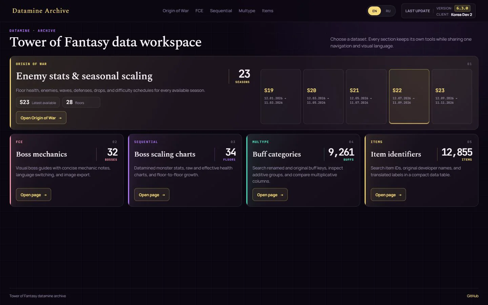</a>
   
  <i>Сохранённая версия Datamine Archive из tof-datamine-site.</i>

**Отдельная страница для каждой темы**

- **OOW:** сезоны, этажи, волны врагов, HP и сложность.
- **Механики боссов FCE:** карточки на английском и русском, которые можно сохранить картинкой и отправить команде.
- **Sequential:** таблицы и графики HP, требуемого урона и скачков сложности.
- **Multype:** группы модификаторов из сканера и понятные подписи к опознанным эффектам.
- **Items:** поиск ID и названий предметов.

В основе лежали статические файлы. Я выбирал нужную информацию, связывал её с тем, что знают игроки, готовил объяснения и оформление.

**Что значит «почти вручную»**

Не каждую цифру надо было печатать самому. Когда я понимал связь в данных, небольшой скрипт мог повторить поиск. Например, HP для Sequential:

1. **Передать файл:** экспортированную таблицу `DT_MonsterStaticData_Overseas.json`.
2. **Выбрать записи:** `endless_special_boss_<stage>` и их `MaxHealth`.
3. **Подготовить страницу:** использовать значения в таблицах и графиках, затем проверить пояснения и поправки на механики.

Эту связь видно в [процессоре Sequential](https://github.com/smilekritik/tof-datamine-site/blob/main/pipeline/processors/build-seq-data.js). Когда знаешь нужные записи, повторное копирование можно автоматизировать.

Остальное требовало участия. Описания и картинки боссов надо разложить по карточкам, бафам дать понятные имена, необычному этапу добавить пояснение. В архиве для этого есть локальные редакторы: они отдельно сохраняли карточки, ренеймы и поправки этапов, не смешивая их с извлечёнными числами.

Сайт стал местом, где находки можно читать и делиться ими.&nbsp; А новые расчёты я продолжал разбирать в Excel.

### Проблема каждого нового патча

Статическая страница решила вопрос оформления, но добавила обслуживание. После обновления игры рабочая страница ещё не означала, что её цифры актуальны.&nbsp;

За словами «обновить сайт» скрывалось несколько задач:

- **Заново найти входные файлы.** Полезного было мало на фоне огромного экспорта клиента.
- **Восстановить связи.** Изменение записи, ссылки или описания могло затронуть несколько страниц.
- **Сохранить ручную работу.** Обновление не должно стирать мои пояснения, переводы и подписи.
- **Опубликовать согласованные данные.** Обновлённая таблица рядом со старым зависимым каталогом даст правдоподобную, но неправильную страницу.

Так извлечение и обработка данных стали отдельным проектом. Мне нужен был воспроизводимый путь от выбранного клиента игры до файлов сайта.

**Под эту задачу и вырос экспортёр.** Он находит клиент, извлекает нужные таблицы и медиа, запускает обработку в порядке зависимостей, собирает каталоги и проверяет результат перед упаковкой. Ручные редакторские данные тоже явно входят в этот процесс.&nbsp;

Патч может и удалять данные. Поэтому обновление содержит не только новые и изменённые файлы, но и удаления, иначе старые записи и картинки остаются на сервере. Ошибка проверки останавливает выпуск пакета. Полная схема есть в [описании пайплайна](pipeline.md).

### От справочника к инструментам

Данные пригодились и за пределами архива. Один персонаж, эффект матриц или стат гира использовался в нескольких местах, и смысл должен был совпадать везде.

Дальше было два направления:

- **Более полный справочник:** персонажи, матрицы, релики, прокачка и арт из одних источников.
- **Инструменты для конкретного аккаунта:** карточка билда, сравнение вещей, история круток и рейтинги.

Для первого требовалось полнее разобрать клиент. Для второго - получить то, чего в статических файлах игры нет: **текущие данные игрока**.

### Как данные игрока попали в инструменты

Ранние сравнения зависели от того, чем люди со мной поделились. А для постоянного инструмента ручной ввод всего гира, матриц и систем аккаунта становился существенной частью работы.

Сборщик решает это чтением данных, которые клиент игры уже получает. Ответы с профилем, инвентарём и крутками он превращает в структурированный импорт. Основная сложность - надёжно расшифровать ответы и понять, что данные пришли полностью. Об этом отдельно в [части 7](#part-7-the-live-data-collector).

Получились **два потока данных**:

| Источник | Что даёт | Для чего |
| --- | --- | --- |
| Файлы установленного клиента | Правила, каталоги, описания, картинки и настройки боёв | Справочные страницы и исходные значения расчётов |
| Импорты игроков | Гир, системы аккаунта, инвентарь и история круток | Build, Optimizer, Wish и Ranking |

Экспорт игры не восстановит чью-то историю круток. А захват аккаунта не заменит таблицы, объясняющие статы на вещах. Нужны оба источника, каждый для своей задачи.&nbsp;

### Собираем всё в один проект

Как только одинаковые расчёты понадобились нескольким инструментам, копировать формулы по страницам означало вернуть старую проблему поддержки. Исправление наследования стихий или Titan должно доходить до всех потребителей.

Сейчас общие части выделены в пакеты:

- **Contracts:** форматы файлов и API, которыми обмениваются компоненты.
- **Game-domain:** расчёты для Build, Ranking и Optimizer.
- **Сгенерированные каталоги:** игровые сущности, диапазоны статов и исходные значения.
- **Общие ассеты и UI-компоненты:** одинаковое представление сущности на разных страницах и языках.

Сайт, API и экспортёр живут в одном репозитории, чтобы изменение формата можно было проверить и на стороне записи, и на стороне чтения. Так отдельные вручную поддерживаемые страницы превратились в ToF Hub.&nbsp;

Дальше я разбираю эту работу по темам. Это техническое описание, а не утверждение, что все функции создавались ровно в таком порядке.

<a href="#contents">↑ К содержанию</a>

---

## Часть 2. Как я разбирался в файлах игры

Когда начал превращать экспорт в страницы сайта, пришлось связать файлы с тем, что знают игроки. Для страницы босса надо понять, кто появляется на этаже, какие статы ему принадлежат и откуда брать имя и картинку.

### Собираем одного противника из разных файлов

Можно найти таблицу, полную HP, и всё ещё не понимать, о каких знакомых противниках речь. Для одной нормальной записи пришлось собрать несколько связей:

| Что хочу показать | Что надо связать |
| --- | --- |
| Враг на этаже | Состав волны и ссылку `MonsterClass` |
| Его базовые статы | `AttributeID` из состава или настроек класса и нужную строку статов |
| Понятное имя | Значения Blueprint, иногда унаследованные от родителя, и ссылку на локализацию |
| Картинку | Ссылку на изображение или подтверждённое соответствие нужной текстуре |

Поиск родительских классов я добавил в [общий обработчик противников](../scripts/game-processors/processors/enemy-identity.ts). Если имя наследовалось от другого Blueprint, шёл по цепочке и ставил читаемую подпись рядом со статами.&nbsp;

### Выбираем правильную версию значения

Ещё нужно было понять, какую копию таблицы читать. В экспорте есть база в `Resources/`, международные переопределения в `ResourcesOverSea/` и отдельные семейства Balance/MMO.

Для Global использую нужные Overseas-переопределения и базовые значения, когда переопределения нет. Это правило должно одинаково работать для описания и подставляемых в него чисел. Найти правильный текст - только половина работы, если значения взяты из другой версии.&nbsp;

### Для MMO снова пришлось искать связи

В MMO встречались знакомые названия: `BigSecret` для Bygone и `OriginWar` для OOW. Но таблицы и правила скейлинга были другими.

Я проследил привязки таблиц в ассетах вроде `BP_GameData_MMO_Base`, чтобы выяснить, какие данные противников и прогрессии относятся к этой версии. Так получилось разделить две игры, вместо того чтобы склеивать записи только по похожим именам.

### Как эти данные помогли сделать полезные моды

Изучение файлов пригодилось и для UI-модов. Я мог связать эффект с внутренним ID и картинкой, а потом изменить то, как важная информация видна в бою.

#### Отметки добивания на полоске HP

Многие, возможно, видели мой вариант полоски. Он отмечал **порог добивания Lechesis в 16%**, с разным положением отметок для противников с **тремя или пятью полосками HP**.

  <a href="screenshots/mod-execute-thresholds.webp">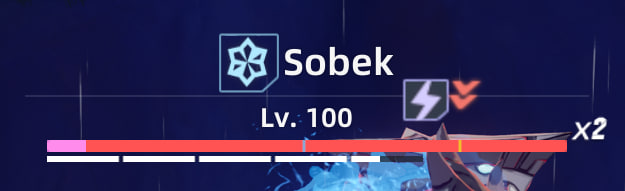</a>
   
  <i>Обе отметки показывают порог 16% для противников с тремя или пятью полосками HP.</i>

#### Дебафы, которые видно во время боя

&nbsp;Я переработал иконки статусов, чтобы **дебафы, запрещающие отдельные действия**, выделялись. В активной драке хотелось быстро понимать, что именно мешает нажимать кнопки, среди всех остальных эффектов.

  <a href="screenshots/mod-debuff-icons.webp">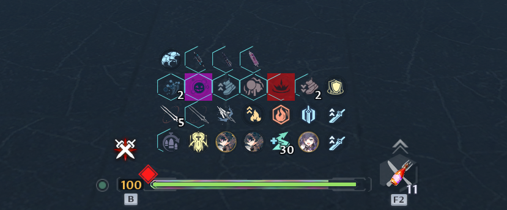</a>
   
  <i>Новые иконки выделяли эффекты, запрещавшие отдельные действия.</i>

#### Разным бафам нужны разные картинки

Другой мод оказался гораздо сложнее: заменить **одинаковые иконки разных бафов на понятные уникальные картинки**. Эффекты выглядели одинаково, и различать их было неудобно, даже когда знаешь механику.

С понятными изображениями можно:

- **Замечать отсутствующий баф во время прохождения**, в том числе если кто-то забыл его принести.
- **Смотреть запись и находить потерянный аптайм:** какой эффект пропал и когда.

  <a href="screenshots/mod-distinct-buff-icons.webp">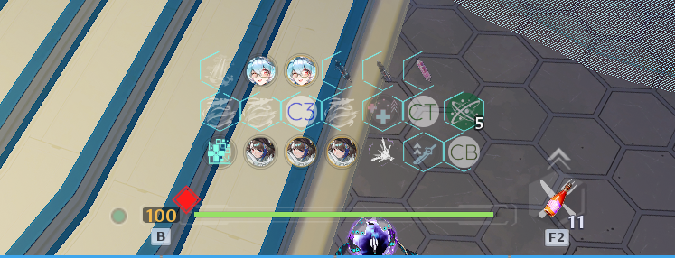</a>
   
  <i>Уникальные картинки помогали замечать отсутствующие бафы и проверять аптайм на записях.</i>

&nbsp;На экране изменения выглядели простыми, но мне они были очень полезны. Сделать их помогло именно понимание данных этих эффектов.

### Больше года в файлах

**Я копаюсь в этих файлах больше года и всё ещё не знаю, где лежат все полезные данные и как всё связано.**

Найденные пути и открытые вопросы сохраняю в [заметках об игровых данных](game-data/README.md), а группы источников перечислены в [описании происхождения данных](data-provenance.md).

<a href="#contents">↑ К содержанию</a>

---

## Часть 3. Как появились справочные страницы

> [!TIP]
> **Перейти к теме:** [Simulacra](#simulacra) · [История изменений](#balance-changelog) · [Релики](#relics) · [Питомцы](#pets) · [Косметика](#cosmetics) · [Арт](#arts) · [OOW](#origin-of-war) · [Bygone](#bygone-phantasm) · [Sequential и Biochemical Collapse](#sequential-phantasm-and-biochemical-collapse) · [Механики боссов](#boss-mechanics) · [Handbook](#handbook) · [Множители](#multiplicative-buffs) · [ID предметов](#item-identifiers) · [Версии клиентов](#version-tracker-and-branch-patcher)

### Simulacra

Отправной точкой дизайна стал **[tof.gg](https://tof.gg/)**. Ребята сделали похожий справочник и держали его в сети больше года. Дизайн мне показался современным, и я захотел близко повторить оформление, а затем наполнять его своими автоматическими пайплайнами. Насколько у них всё было ручным или сгенерированным, я не знал.

Чтобы заполнить такой интерфейс из экспорта, связал персонажа с оружием, навыками, звёздами и артом. Пересборка страницы стала зависеть от этих ссылок, а не от ручного ввода каждого персонажа.

В двух местах легко ошибиться:

- **Уровни навыков.** Я сохранял координаты ключей кривой. Четвёртый сохранённый ключ может означать седьмой уровень. Если считать уровень по позиции в массиве, получится неправильная прогрессия.
- **Аргументы описаний.** Каждый плейсхолдер нужно связать с нужным эффектом или значением прокачки. Число из похожего эффекта даст красивое, но неправильное описание.

Для арта тоже прошёл по ссылкам костюмов и текстур. Новому персонажу не требуется очередная ручная запись с именем папки.&nbsp;

  <a href="screenshots/gefion.webp">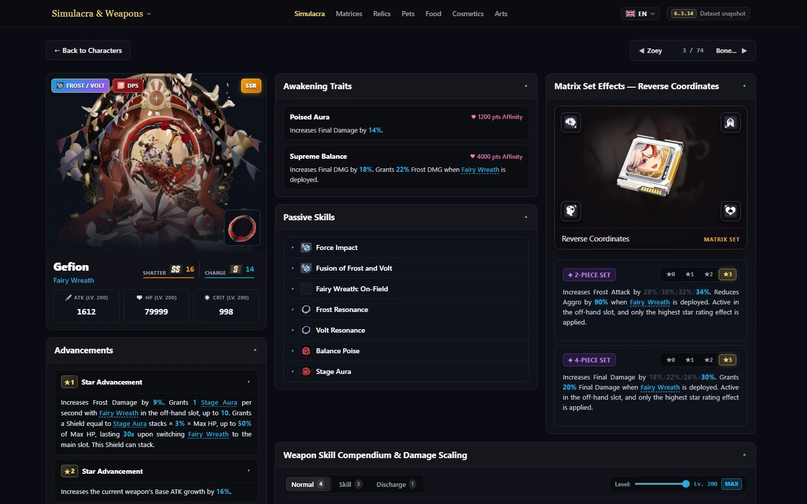</a>
   
  <i>Страница персонажа собирает отдельно извлечённые записи в одно представление.</i>

### История изменений баланса

&nbsp;Я хотел записывать патчи, потому что устал каждый раз перепроверять: изменились ли цифры, сломалось ли взаимодействие, не тронул ли разработчик что-то ещё?

Инструмент сравнивает экспорт с сохранённой базой и показывает старые и новые значения статов, навыков, звёзд, трейтов и матриц. Уже есть конкретный список того, что надо проверить в игре.

**Сравнение работает хорошо, но полная история патчей требует постоянно следить за лайвом и тестами и экспортировать каждую версию.** Поддерживать это настолько внимательно я не собираюсь. Зато при следующем экспорте инструмент сам найдёт изменения, которые раньше приходилось выискивать вручную.

### Релики

Мне хотелось, чтобы карточка отвечала на простой вопрос: **через сколько снова можно нажать способность?** Для MMO пришлось отличать базовый кулдаун от улучшенного, уменьшений кулдауна и других длительностей, например стана.

В [обработчике реликов](../scripts/game-processors/processors/build-relics.ts) задал порядок выбора: сначала кулдаун нулевого уровня, потом базовое значение с исключением полей сокращений, бафов и станов. Если в эффекте подходящей цифры нет, беру её из описания способности.&nbsp;

### Питомцы

Smart Servants снова заставили перепроверять сырые значения. Коэффициент наследования атаки **`1.0` выглядит как 100%**, но может быть заглушкой. В таких случаях, включая `FightPet_12`, [обработчик питомцев](../scripts/game-processors/processors/build-pets.ts) берёт процент из описания звёзд.

Для каждого уровня звёзд отдельно сохраняю:

- **Слоты:** сколько модулей можно поставить.
- **Вместимость:** какую суммарную нагрузку модулей выдержит питомец.

&nbsp;Пустой слот ещё не означает, что туда поместится очередной модуль. Для планирования улучшений нужны оба ограничения.

### Косметика

Хотел показывать анимированные стикеры так, как они двигаются в игре. Но вместо готового GIF часто находился **атлас текстур: несколько кадров в одной картинке**, и материал с правилами отображения.

Чтобы получить анимацию, пришлось:

1. **Пройти по материалу и его родителям**, найти текстуру и параметры.
2. **Прочитать сетку кадров и скорость**, проверить поддерживаемую схему FlipBook.
3. **Разрезать текстуру на кадры и собрать анимацию** для сайта.

Так появились скачиваемые GIF, в том числе стикеры в этой статье.&nbsp;

Полная схема шейдера в экспорте не сохранилась, поэтому **скорость воспроизведения восстановлена приблизительно**. Поддерживаемые варианты и неразобранные эффекты записаны в [заметках о косметике](game-data/cosmetics.md).

### Арт

&nbsp;Хотелось сохранить старые картинки, даже если их уже убрали из новых клиентов. Одного свежего экспорта недостаточно, поэтому **исторический арт стал отдельным входом** bootstrap-пакета.

Для новых картинок добавил поиск загрузочных экранов, обоев и других групп. Обработчик сообщает о новых находках, которым нужны подписи, и сохраняет уже подготовленные названия. Так автоматическое извлечение не стирает работу по оформлению архива.

### Origin of War

Для OOW пришлось разделить **коэффициент статов конкретного раунда и меняющийся процент сложности сезона**. Это разные параметры; если их смешать, цифры противников станут вводить в заблуждение.&nbsp;

В одном разобранном раунде значение кривой `200` означает **коэффициент статов 2×**. Базовые `62,961,076` HP босса превращаются в `125,922,152`. Это сила, заданная раунду, а не утверждение, что изменение сезонного процента сложности удваивает HP.

С бафами тоже пришлось разобраться:

- **Веса выпадения:** долю бафа считаю относительно суммы весов пула. Сам вес ещё не процент.
- **Маркеры окружения:** часть записей относится к окружению, а не к дополнительному бафу врага. Их убираю из списка эффектов противника.

Исходные поля, этот пример и неразобранные детали расписания есть в [заметках об OOW](game-data/origin-of-war.md).

### Bygone Phantasm

Bygone показал ещё одну границу экспорта: **список возможных боссов не объясняет, какого выберет сервер**. Для этажа могли подходить несколько пулов, а прочитанные файлы не определяли выбор между ними.

&nbsp;Поэтому страница сохраняет кандидатов. Конкретный состав назначаю, только когда подходит один пул, без придумывания повторяющейся лестницы из неоднозначных данных.

Для MMO проследил привязку HP-бафа и кривую скейлинга. Там, где данные это подтверждают, считаю:

`HP = базовое HP × (1 + целые стаки HP-бафа)`

Если баф не укладывается в такую схему, оставляю HP неизвестным. Что удалось восстановить, а что нет, описано отдельно для [Global](game-data/bygone.md) и [MMO](game-data/mmo-bygone.md).

### Sequential Phantasm и Biochemical Collapse

#### Делаем сравнение из Excel настраиваемым

Раннее сравнение Sequential перенёс на сайт, чтобы можно было менять **игнор резистов и Space Support**, а не смотреть на один фиксированный порог урона. Цель - ориентир урона по кактусу без учёта механик этапа.

Важно правильно учесть бонусы. В модели графика Space Support добавляется к уже имеющейся категории бонуса урона эталонного бойца. Ещё пять процентных пунктов к 50% дают `1.55 / 1.50`, то есть примерно **3,33% прироста урона**.&nbsp; Отдельный множитель ×1.05 завысил бы результат. Формула, предположения и исключённые механики есть в [заметках о Sequential](game-data/sequential.md).

#### Разбираемся с описаниями эффектов MMO

В Biochemical Collapse обнаружилась другая проблема: карта описаний повторяла некоторые тексты под соседними ключами. Если брать ключ по ID описания эффекта, можно получить чужой текст.

Например, запись имела `DescID=10` и аргументы `[12,500]`, но под ключом 10 было неправильное описание. Я выстроил различающиеся тексты по порядку ключей и уже потом подставил числа, проверив схему на связанных записях. Так преимущества и недостатки получили свои значения. Пример и проверка записаны в [заметках о Biochemical Collapse](game-data/biochemical-collapse.md).

### Механики боссов

Для карточки текст и статы должны относиться **к одному бою и одной фазе**. Под знакомым именем могло быть несколько записей. Поэтому связал конфигурацию Frontier Clash со статами последней фазы, а для исключений использовал точные ID атрибутов из лестницы.

Внутренние ID конфигураций отделил от номеров сезонов в интерфейсе. Даже правильно извлечённый босс непонятен, если поставить его под неправильный сезон.&nbsp;

### Handbook

**[Handbook](https://tof.smilekritik.beer/datamine/handbook/)** я сделал, чтобы **наглядно показать и сравнить** разбросы гира, шансы и прокачку, о которых игра толком не рассказывает. Хотелось до траты материалов увидеть возможные роллы вещи, вероятность нужного стата и стоимость улучшений.&nbsp;

#### Диапазоны гира и шансы

- **Разбросы статов:** база, минимальный и максимальный ролл, средний и максимальный итог после пяти улучшений. Есть фильтры качества.
- **Шансы по слоту и источнику:** набор возможных статов и их веса. Отдельно вероятность одного выбора и рассчитанная вероятность появления стата на вещи с учётом гарантированных статов и выбора без повторов.
- **Titan:** диапазоны роста по числу улучшений, значения и шансы редких свойств, вероятность смены редкого стата. Средние оценки отдельно от минимумов и максимумов.

  <a href="screenshots/handbook.webp">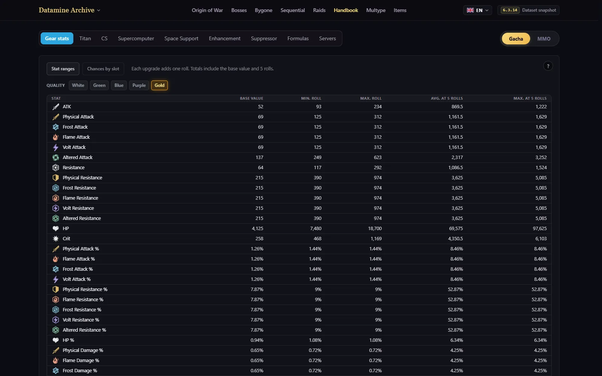</a>
   
  <i>Диапазоны гира: базовые значения, отдельные роллы и итог после пяти улучшений.</i>

#### Планирование прокачки

Здесь хотелось сравнивать **стоимость, условия открытия и бонусы на выбранном отрезке улучшений**.

- **Supercomputer:** опыт, шансы исходов, примерное количество попыток и бонусы по уровням.
- **Space Support:** уровни модулей, общая стоимость и дополнительные улучшения базовых модулей для открытия следующих ступеней.
- **Enhancement и Suppressor:** материалы между уровнями, требования и получаемые статы.
- **Системы MMO:** статы карт расширения, установочные слоты и звёзды, а также планировщик Brainfield с выбором узлов, материалами и складываемыми статами.

Там же находятся веса и составляющие CS, справочник формул и список серверов.

#### Один пример: восстанавливаем Brainfield

Для дерева талантов таблицы давали значения и стоимость узлов, но координаты и связи пришлось доставать из **экспортированного макета интерфейса**. У каждого уровня узла своя запись улучшения, поэтому стоимость суммирую по выбранным уровням, а не умножаю последнюю строку на количество.

В итоге можно посчитать материалы и прямые прибавки статов. Взаимодействия особых навыков всё ещё требуют проверки в игре; ограничения есть в [заметках о Brainfield](game-data/brainfield.md).

### Категории множителей

Я хотел удобно показать результаты исследования категорий, в том числе тестов вместе с **Avorozer**.

В Excel отдельно лежали **датамайн-таблица** и **таблица ренеймов**, где я связывал внутренние имена с понятными эффектами. Чтобы узнать категорию бафа, приходилось сводить две вкладки. Смотреть, проверять связи и править подписи было неудобно.

&nbsp;В **визуальной таблице Multype** собрал вместе понятные имена, извлечённые категории и исходные записи. Теперь видно, какие эффекты относятся к одной группе, без переключения вкладок. Проверять и исправлять ренеймы тоже проще, когда рядом лежит сам датамайн.

### ID предметов

Поиск предметов я в основном использую для **моддинга и тестового сервера**. Именно по этим ID **выдаю тестовому персонажу нужные вещи**, поэтому хотелось удобно искать идентификатор по знакомому названию.

&nbsp;Нужные соответствия оказались **вне игровых архивов**: в `MappingItemId*.json` внутри `Hotta/Config`. Я явно добавил их в экспортёр вместе с таблицами предметов, чтобы связать ID, названия и качество.

### Трекер версий и патчер клиентов

Сам пользуюсь вариантом трекера с **уведомлениями в Telegram о новой версии клиента**. Так узнаю об обновлениях, быстро открываю свежие файлы и делаю ликсы.&nbsp;

Публичная страница показывает остальным, **какая ветка на какой версии**, и постепенно собирает историю новых обновлений. Удобно тем, кто следит за релизами или хочет копаться в свежих файлах. Версии лаунчера и ресурсов разделены: они описывают разные части установки.

[Патчер веток](../tools/tof-client-patcher/README.md) помогает получить нужный клиент. Он готовит настройки лаунчера, чистит кеш обновлений, а скачивание оставляет официальному обновлятору. Сделал его обычным читаемым BAT/PowerShell-файлом, чтобы хватало встроенных инструментов Windows.

<a href="#contents">↑ К содержанию</a>

---

## Часть 4. Формулы: измерял, проверял, исправлял

Build, Ranking и Optimizer используют [`packages/game-domain`](../packages/game-domain). Генератор справочных значений использует закреплённую версию [apache1123/tof-tools](https://github.com/apache1123/tof-tools), а уточнения сохраняются рядом с доказательствами из файлов игры и наблюдениями по гиру.

### Отдельное спасибо rikuzero1

**rikuzero1** я хочу поблагодарить отдельно за **статьи на Reddit и проверку моих формул**. Мы не так много пересекались лично, но я считаю его другом и очень ценю его технические разборы и замечания.

Исследования, датамайн и разработку своего проекта я делал сам. Его публикации служили полезными источниками, а проверки помогали находить и исправлять ошибки в моих расчётах.

На мой взгляд, по объёму технического вклада в комьюнити его работа сопоставима с Maygi. Просто большая часть разошлась по статьям и обсуждениям, а не собралась в одном широко известном ресурсе. **Спасибо, rikuzero1.**&nbsp;

### Добавленные статы Titan

Чтобы сравнивать вещь с её возможным максимумом, нужен предел роста добавленных статов Titan. Каждый из них не получает полный независимый рост оригинального стата. Текущая модель пересчитывает долю пост-Titan-роллов основного стата в диапазон целевого:

`добавленный стат = начальное значение целевого + наблюдаемая доля × пост-Titan-роллы основного × максимальный ролл целевого`

[Сохранённые наблюдения](../scripts/data/titan-augment-observations.json) уточняют исходные предположения о фиксированной доле. Высокая доля на реальной вещи - **наблюдаемая граница модели**, а не обещание следующего улучшения.&nbsp;

### Одинаковые статы должны получать одинаковый потолок

Подтягивание семейства Titan может поднять более низкий стихийный стат. Проекция выбирает большее из этого результата и подтверждённого собственного роста, оставляя неподтверждённые ранги неизвестными. Перестановка одинаковых по смыслу строк не должна менять оценку их качества.

### Дуо-оружие выбирает лучшие значения отдельно

Я использовал и [обсуждение AntonioS3 на Reddit](https://www.reddit.com/r/TowerofFantasy/comments/1cqzb6j/potential_major_bug_with_dual_element_systemsub/) с тестами **Kune**. Сначала это выглядело как сообщение о баге. Уточнения **noname6600** и дополнительные тесты Asuka от **rikuzero1** помогли объяснить результаты.

**Наследование экипировки и внешние бафы - разные этапы:**

- **Гир:** для flat ATK, ATK% и DMG% независимо сравниваются суммы двух стихий со всего комплекта. Каждая категория может прийти от своей стихии.
- **Внешние бафы:** бонусы матриц, оружия и еды должны подходить элементу наносимого урона. Наследование гира другой стихии не переносит её бафы.
- **Окно статов может обмануть:** баф побочной стихии повышает отображаемую атаку, но не обязательно урон проверяемого удара. Карманные эффекты, меняющие элемент урона, работают по своим правилам.

`наследуемая категория = max(сумма стихии 1, сумма стихии 2)`

Frost/Volt может взять flat ATK от Volt, ATK% от Frost и DMG% от Volt. В [коде выбора дуо-статов](../packages/game-domain/src/build/gear-score.ts) эти решения хранятся отдельно, а универсальная ATK учитывается один раз. Выбор лучшей стихии на каждом куске или сравнение уже забафанной финальной атаки дали бы другой результат.&nbsp;

### Сколько стоит единица стата?

&nbsp;Для небольших изменений использую упрощённую модель урона:

`output = A × (1 + d) × (1 + c × k)`

`A` - итоговая атака, `d` - складываемый бонус урона, `c` - шанс крита, `k` - дополнительный урон крита. Проценты записываются долями единицы.

| Изменение | Относительный вес около текущего профиля |
| --- | --- |
| Единица flat ATK | `(1 + a) / A`, где `a` - подходящий ATK% |
| ATK% | `B / A`, где `B` - затрагиваемая базовая атака |
| DMG% | `1 / (1 + d)` |
| Шанс крита | `k / (1 + c × k)`, пока не достигнут кап |
| Рейтинг крита | Вес шанса крита, поделённый на зависящий от уровня коэффициент перевода |

Эти веса оценивают относительный прирост наносимого урона. Для замены вещи нужно пересчитать итоговые статы, особенно рядом с капом крита или границей выбора стихии.

Контекста оценки два:

- **Global Roll Value (GRV):** фиксированный эталонный профиль сайта для сравнения вещей.
- **Personal Roll Value (PRV):** текущие статы и капы конкретного аккаунта.

Оценка хилера оптимизирует ATK, танка - эффективное HP.

### Оптимизатор продолжает идею Excel

&nbsp;Сайт применяет расчёт «снять старое и надеть новое» ко всему инвентарю. После каждой замены профиль пересчитывается, потому что одна вещь меняет ценность следующей.

Для проекций Titan нужны известные оригинальные статы и достаточно понятная история роллов. Они показывают подтверждаемые итоговые значения, не предсказывая шанс улучшения и число необходимых кликов.

### Проверяем Combat Strength по данным сервера

Свой CS проверял по **отдельным суммам оружия и матриц, которые возвращает сервер**. Оружие, статы матриц, комплекты и системы прокачки считал отдельно, чтобы совпавший общий итог не скрывал ошибку в одной части.

Для одного сохранённого билда были такие ориентиры:

| Компонент захвата | Сырой CS сервера |
| --- | --- |
| Оружие | 15,221.153 |
| Три трёхзвёздочных комплекта матриц 100-го уровня | 25,720.008 |

Эти сравнения сохранил в [проверках CS](../apps/web/src/features/build/system-cs.test.ts). С отображением статов тоже нюанс: сырые `416.6667` крита на матрице игра показывает как `416`. Для оценки сохраняю дробную часть вместо сложения уже округлённых подписей.&nbsp;

### Отделяем билд от временных бафов

При импорте возникла другая проблема: **захваченная атака описывает состояние персонажа в конкретный момент**. Временный баф матриц повышает её при том же гире.&nbsp; Если не учесть баф, сравнение исказится.

По данным эффектов разделил источники:

- **Постоянные пассивки реликов:** считаю подходящий стихийный бонус один раз.
- **Поддерживаемые временные ATK%-бафы:** определяю эффект и стаки, убираю их вклад из входных значений оценки. Еда и разрешённые инъекции остаются частью выбранного набора.

Если временный эффект атаки можно опознать, но нельзя посчитать его вклад, такой захват не допускаю в рейтинг. [Логика нормализации](../packages/game-domain/src/build/temporary-attack.ts) сохраняет неразобранные случаи вместо придумывания преимущества гира.

### Восстанавливаем описания карт MMO

Для карт расширения пришлось разделить **число надетых карт** и **их звёзды**. Параметры описаний вычисляются по кривой от количества карт. Базовые статы используют коэффициенты звёзд и кривую уровня.

Хорошей проверкой стала Charge. Один параметр её описания получает **4.45% с одной картой** и **29.638% с четырьмя**. Значение для четырёх совпало с записанным игровым описанием и его округлением.&nbsp; Сравнение сохранил в [проверках карт](../packages/game-domain/src/build/mmo-card.test.ts).

Так удалось воспроизвести цифры описания. Особые взаимодействия в реальном бою всё ещё требуют отдельных тестов.

<a href="#contents">↑ К содержанию</a>

---

## Часть 5. Инструменты

Для вдохновения я смотрел на сервисы, которые решали похожие задачи в других играх:

| Задача | Пример | Что хотелось решить в ToF |
| --- | --- | --- |
| Понятная карточка билда | [Enka.Network](https://enka.network/) | Собрать аккаунт в одно изображение, которым можно поделиться |
| Сравнение экипировки в общих условиях | [Akasha](https://akasha.cv/leaderboards) | Определить, что именно измеряет рейтинг гира |
| Сохранение круток и статистика | [Paimon.moe](https://paimon.moe/) | Хранить историю дольше ограниченного игрового окна |
| Информация о боях и результаты | [Stygian.moe](https://www.stygian.moe/) | Связать контент, команды и прохождения |

### Рейтинг гира

Рейтинг оценивает **экипировку по заданной модели**, а не мастерство игрока или полный урон команды. Поэтому разделены:

- **Отдельная вещь:** её текущие статы относительно эталонного максимума роли и направления.
- **Лучший известный набор игрока:** сохранённые вещи для роли и стихии, включая импортированный рюкзак.
- **Надетый билд:** комплект в конкретном захвате.

&nbsp;Сохранение вещей между импортами позволяет не терять фрост-набор, если человек переключился на другую стихию. Улучшенная вещь приходит уже с другими статами, поэтому наблюдения нужно сопоставить, не посчитав один предмет дважды и не склеив разные вещи.

  <a href="screenshots/ranking.webp">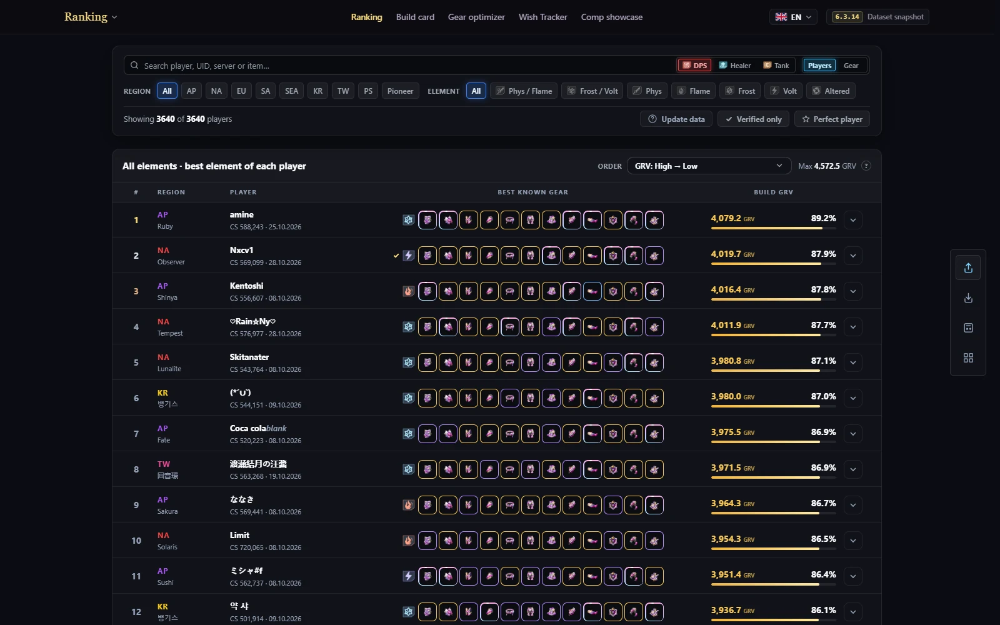</a>
   
  <i>Публичный рейтинг на момент скриншота. Места отражают модель оценки экипировки.</i>

### Карточка билда

&nbsp;Карточка собирает экипировку, оружие, матрицы, релики и поддерживаемые системы прокачки в одном месте. За итоговыми цифрами есть разбивка. Ручное редактирование, OCR скриншотов и структурированный импорт заполняют профиль аккаунта, который затем используется в персональных сравнениях.

  <a href="screenshots/build-card.webp">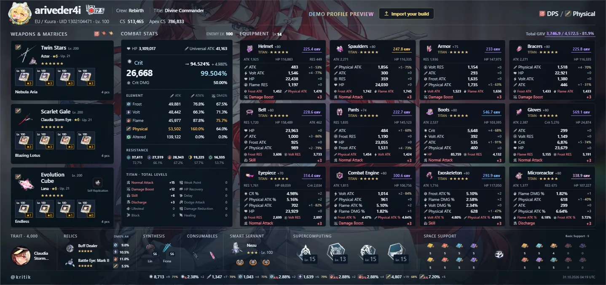</a>
   
  <i>Встроенный демонстрационный профиль в виде карточки билда.</i>

### Оптимизатор

&nbsp;Optimizer читает надетый гир и, если он импортирован, рюкзак из Build, затем сравнивает замены для выбранной роли и стихии. Показывает персональные веса статов и поддерживаемые сценарии Titan. Расчёты разобраны в [части 4](#part-4-formulas-measured-and-corrected).

  <a href="screenshots/optimizer.webp">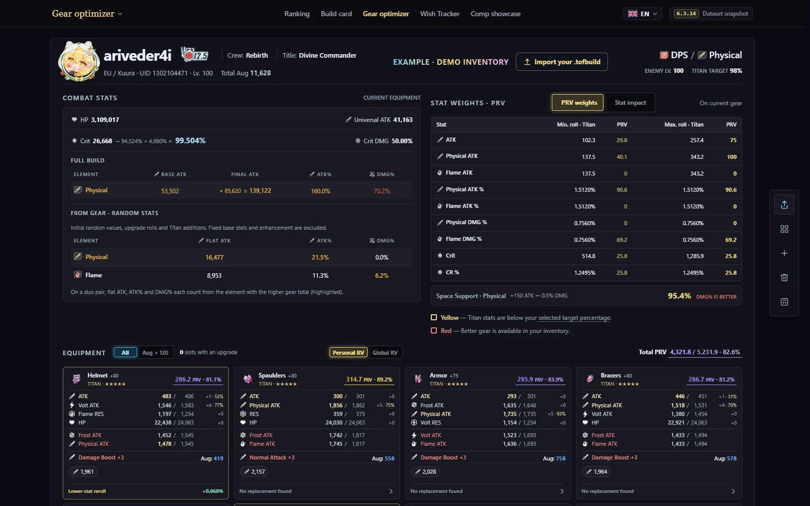</a>
   
  <i>Оптимизатор с демонстрационным инвентарём: персональные веса статов и сравнение гира.</i>

### История круток

Здесь пришлось сохранять порядок каждого трека и убирать дубли повторных импортов. Неполная история сама не объясняет, с какого pity начался отсчёт.&nbsp; Поэтому использую переданный снимок pity, если он есть. Баннер определяю по исходным кодам пулов и поддерживаемому расписанию: одного выпавшего предмета недостаточно.

У стандартных и событийных круток отдельные истории, статистика, серии, оценки удачи, симуляции и экспортируемые карточки. Непонятная принадлежность к баннеру остаётся непонятной.

Принятый импорт даёт данные доступа для последующих обращений. Одного чужого UID недостаточно, чтобы открыть историю. Она хранится отдельно от публичной базы гира.

  <a href="screenshots/wish.webp">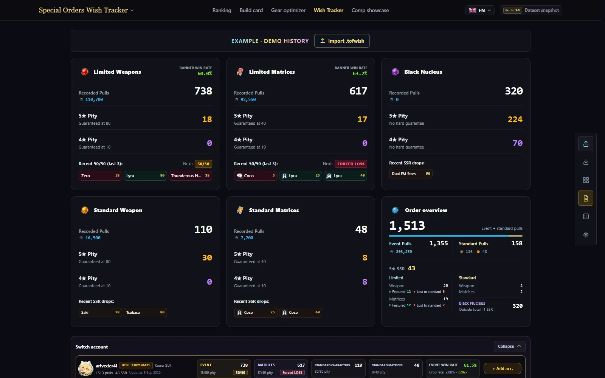</a>
   
  <i>Wish Tracker со встроенным примером истории.</i>

### Рейтинги рейдов

&nbsp;Мне хотелось сравнивать регионы и смотреть результаты игроков за разные сезоны. Внутри игры мешали три вещи:

| Что было неудобно | Что сделал на ToF Hub |
| --- | --- |
| **Для сравнения регионов нужно заходить на аккаунт в каждом из них.** Исторические результаты не посмотреть вместе. | Фильтры региона и сезона, времена разных регионов в одном месте. |
| **Игра сохраняет ник на момент проходки и больше не обновляет его**, хотя присылает ID игрока. | Связь результатов по доступным идентификаторам и переключение на текущие ники, если они известны. Исходный ник остаётся в истории. |
| **Нет удобного просмотра своих результатов за разные сезоны.** | Поиск по нику или UID и история прохождений конкретного игрока. |

Всё это собрал в **[рейтинге рейдов](https://tof.smilekritik.beer/datamine/raids/?tab=ranking)**. Можно сравнить регионы, проследить игрока после смены имени и посмотреть старые прохождения без постоянного переключения игровых аккаунтов.

  <a href="screenshots/raid-ranking.webp">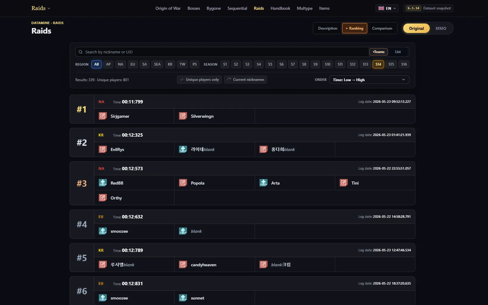</a>
   
  <i>Публичный рейтинг рейдов с результатами всех регионов в одном месте.</i>

### Карточки команд

Часто нужно спланировать прохождение или дать человеку гайд: кто что должен взять. Раньше похожие картинки состава мы собирали локально в **Photoshop**.

&nbsp;Поэтому сделал редактор команды **доступным всем в браузере**. Можно собрать четыре или восемь игроков для Standard/MMO, указать роли, трейты, оружие, матрицы и релики и поделиться планом ссылкой или картинкой.

Текущее поведение описано в [руководстве по инструментам](tools.md), а входные форматы - в [руководстве по импорту](imports.md).

<a href="#contents">↑ К содержанию</a>

---

## Часть 6. Технические решения

Когда инструменты стали использовать общие игровые данные и захваты аккаунтов, пришлось следить за согласованностью всей системы. Правильная формула мало поможет, если в базе старые оценки, обновление оставило удалённые картинки, а несколько импортов съели ресурсы, нужные для выдачи страниц.

### Извлечение данных не должно запускаться при открытии страницы

Сайт, API и экспортёр держу в одном монорепозитории, с общими контрактами и расчётами. Тогда изменение формата доходит и до того, кто его пишет, и до того, кто читает. Пакет расчётов не работает с файлами и сетью: браузер и сервер используют одинаковые правила без зависимости от окружения друг друга.

У каждого окружения своя задача:

- **Экспортёр** открывает архивы игры и создаёт каталоги, медиа и отчёты. Нативное извлечение работает в Windows; обработку уже готового сырого экспорта можно запускать и в Docker.
- **Next.js** отдаёт страницы и интерактивные инструменты. Сгенерированные каталоги и картинки Nginx раздаёт напрямую.
- **NestJS API** принимает импорты и хранит данные игроков в PostgreSQL. Он читает готовые справочные значения, а не открывает игровые архивы.

Тяжёлая реконструкция игровых данных выполняется на отдельном этапе сборки. Открытие персонажа не запускает экспорт, а работающему сайту не нужно нативное окружение извлечения.&nbsp;

В Windows-экспортёр упаковал код обработки и runtime, чтобы на другой машине не пришлось повторять мою установку Node, pnpm и компилятора. Часть нативных компонентов может скачиваться при первом запуске; версии и контрольные суммы закреплены. Границы сервисов описаны в [обзоре архитектуры](architecture/overview.md).

### Проверяем цепочку зависимостей до упаковки

Обработчик может ждать каталог или сущность, которую другой обработчик ещё не создал. Эти связи я явно описал в [графе задач](../scripts/game-processors/contracts/jobs.json). До упаковки весь процесс проходит через промежуточное дерево файлов.

Выборочное извлечение добавляет ещё одну проблему. Обработчик, написанный на полном экспорте, может читать таблицу, которую правила экспортёра вообще не включили. Добавил **трассировку чтения файлов**: записываю реально прочитанные входы и сверяю с правилами извлечения. Новый клиент всё равно требует настоящей проверки; старый trace показывает только пути, по которым прошёл тот запуск.&nbsp;

Поиск медиа запускаю дважды. Сначала он собирает ссылки из нормализованных каталогов, но последующие генераторы могут добавить новые. Поэтому перед финальной проверкой нужен второй проход.

Проверки охватывают необходимые входы, схемы каталогов, ссылки на сущности, согласованность языков и заявленные медиа. Превью и оригинал тоже различаются: наличие WebP не выполняет обещание страницы дать исходный PNG.

С путями пришлось учитывать окружение. Windows может принять неправильный регистр имени, а Linux - нет. Поэтому разрешение URL вынес в общий пакет ассетов и сохраняю настоящую идентичность исходного файла, а не собираю пути заново в каждой странице.&nbsp;

### Обновляем добавления вместе с удалениями

Если просто копировать новые файлы поверх старого сайта, удалённые записи и картинки останутся. [Сборщик релизов](../tools/patch-exporter/src/release-package.ts) хеширует всё дерево результата и сравнивает с базовым манифестом.

- **Полный релиз** содержит всё публикуемое дерево.
- **Дельта-релиз** содержит изменённые файлы и список удалений. Его манифест при этом описывает полный ожидаемый результат.

&nbsp;Неизменный арт можно оставить на месте, а установщик знает, что удалить. Ручные подписи и исторические картинки входят как явные исходные данные. Пересборка не зависит от случайных остатков в старой папке сервера.

Установка всё ещё требует согласованных действий. Обновлятор копирует файлы и применяет удаления, но не переключает весь работающий сайт атомарно. После установки перезапускаю web и API, чтобы очистить кеши процессов. Если меняется используемый при сборке манифест, пересобираю web-приложение. Граница между подготовкой и установкой обновления описана в [пайплайне](pipeline.md).

### Загружаем только то, что нужно странице

Полные каталоги полезны генераторам, но списку персонажей в браузере не нужны сразу все навыки, описания и уровни прокачки. Поэтому делаю **компактные runtime-каталоги и отдельные файлы подробностей**. Список получает краткие данные, а открытый персонаж - его детальную запись.

На сервере [загрузчик](../apps/web/src/lib/game-data-server/loader.ts) объединяет одинаковые чтения в пределах запроса. При добавлении подробностей создаёт результат именно для этого запроса. Если менять общий каталог, выбранный персонаж или коллекция одного запроса могут повлиять на другой.

Браузер начинает с серверных данных и кеширует по каталогу и языку. [Клиентский хук](../apps/web/src/lib/game-data-client/use-game-data.ts) отбрасывает запоздалые ответы после перехода или смены языка: старый запрос не должен перезаписывать новое состояние.

Начальный выбор берётся из URL. Сохранённые предпочтения браузера читаются после монтирования, чтобы первый клиентский рендер совпал с серверным.

То же правило применил к анимированной косметике: в списках статичные превью, а сама анимация загружается при открытии просмотра. Чтобы показать каталог, не нужно скачивать и проигрывать все анимации сразу.&nbsp;

### Считаем оценки при записи, а не при каждом открытии рейтинга

В рейтинге много сочетаний стихий и ролей. Пересчитывать их для каждой вещи при каждом открытии доски - повторять одну работу, даже если гир не изменился.

Перенёс расчёт на импорт и перескоринг. Хранилище записывает оценки по направлениям и [заранее выбранные лучшие строки](../apps/api/src/ranking/best-tracks.ts). Общая доска может прочитать одну лучшую строку на вещь или игрока, а не получать все варианты и сортировать их в API. Фильтры, порядок и лимит страницы применяет PostgreSQL через нужные таблицы и индексы.

**Цена решения - больше работы и места при записи.** Импорт должен обновлять производные строки, зато обычное чтение использует готовый результат. Точные места найденного игрока и сохранённого билда всё равно требуют отдельных запросов: я не выдаю номер внутри поисковой выдачи за реальное место рейтинга.

#### Кешируем частые запросы

Поверх базы работает Redis. Кеширую выбранные частые первые страницы; поиск и произвольные комбинации обходят этот кеш ответов. Внутри одного API-процесса одинаковые промахи кеша используют одно общее вычисление, а не запускают запрос повторно.

В [ключи кеша](../apps/api/src/ranking/cache/ranking-cache.service.ts) входит **ревизия рейтинговых данных из PostgreSQL**. Импорт и пересчёт увеличивают её. Следующее чтение использует новое пространство ключей: не надо ждать истечения старого TTL, чтобы показать свежие оценки.

**Но небольшое чтение ревизии из базы нужно и при попадании в кеш.** Redis снимает тяжёлые запросы, а PostgreSQL остаётся источником истины и запасным вариантом, если Redis недоступен.

В [Compose](../compose.yml) для Redis задано 64 MiB, вытеснение записей и отключённое сохранение на диск. Всё содержимое можно восстановить из постоянных данных.&nbsp;

### Исправленная формула должна дойти до старых оценок

Ревизия данных рейтинга не объясняет, какой формулой посчитана сохранённая оценка. Исправление общей функции меняет будущие вычисления, но не трогает уже записанные числа.

Добавил отдельный [отпечаток расчётной версии](../apps/api/src/players/scoring-revision.ts), включающий каталог оценок, runtime-расчёты и код сохранения. Он хеширует содержимое, а не время файлов или ручной номер версии, который легко забыть увеличить. Исправление дуо-наследования или коэффициента запускает тот же путь обслуживания.

До готовности запускаемый API сравнивает отпечаток с сохранённым. Если они отличаются:

1. Берёт блокировку базы в транзакции, чтобы одновременные запуски не начали независимый пересчёт.
2. Пересчитывает сохранённые оценки гира и игроков по текущим правилам.
3. Вместе фиксирует оценки, отпечаток формул и ревизию рейтинговых данных.

&nbsp;При ошибке транзакция откатывается, а частично обновлённые оценки не помечаются актуальными. **Цена - время запуска и потенциально длинная транзакция обслуживания.** Я предпочёл включить эту работу в проверку готовности, чтобы новый API не отдавал оценки, о которых уже знает, что они посчитаны по другим правилам.

### Тяжёлые импорты выполняются по очереди между процессами API

Импорт может требовать расшифровки, проверки схемы, сопоставления вещей, записи и пересчёта. Отправил эту работу в **очередь на PostgreSQL**. Ожидающие задания переживают перезапуск API, а допуск и получение работы координируются через одну базу.

Сначала endpoint делает дешёвые проверки размера, оболочки и формы запроса. Принятому запросу выдаёт ID задания, страница опрашивает статус. Не нужно держать один HTTP-запрос открытым до конца импорта. Зарегистрированный обработчик запускает тяжёлую часть, когда очередь доходит до задания.&nbsp;

Переменная JavaScript координировала бы только один процесс. Поэтому использую advisory lock PostgreSQL на допуске и получении задания, с проверкой уже работающего. Обычные тяжёлые задания идут по одному и при нескольких процессах API.

Лимиты: одно активное задание на IP, не больше 20 ожидающих и 128 MiB активных файловых данных, плюс ограничения отдельных форматов. **Я согласился на меньшую пропускную способность, чтобы ограничить конкурирующие записи и работу с файлами.** Люди за одним внешним IP при этом делят лимит допуска.

#### Восстанавливаем состояние без повторного импорта

Если обработчик импортировал данные, но запись итогового статуса упала, живой worker повторяет именно сохранение результата, прежде чем взять следующую работу. Весь импорт заново не запускается.

**Падение процесса - другой случай:** прерванное задание со временем истекает как неуспешное, и человеку может понадобиться повторно отправить файл. Одинаковые захваты билда отсеиваются по дайджесту на уровне хранения.

Короткий результат задания отделён от приватной выдачи карточки и рюкзака. Выдача привязана к отправителю, забирается один раз или истекает через час.

После завершения очередь очищает **свой загруженный файл и сырой адрес отправителя**. У принятых профилей и метаданных импорта отдельное хранение. Публичная доска показывает статусы и время, а не приватные результаты. Ограничения и восстановление описаны в [документации очереди](architecture/job-queue.md).

### Принятие данных, владение и подтверждение источника - разные вещи

Один путь импорта принимает обычный JSON и зашифрованные для конкретной установки файлы. Шифрование защищает доставку, но не доказывает, что цифры пришли из игры. Перед сохранением всё равно проверяю схему, идентификаторы и правила предметной области.

Для сохранённых карточек подписываю дайджест принятого содержимого. Необязательный рюкзак выдаётся отдельно. Последующее сохранение должно соответствовать подписанным данным: нельзя локально поменять статы и незаметно выдать результат за исходный принятый захват. Подпись подтверждает неизменность принятого содержимого; источник и допуск в рейтинг проверяются отдельно.

&nbsp;У приватной истории круток своё правило доступа: после принятого импорта выдаётся токен устройства для следующих обращений. Публичный UID - идентификатор поиска, а не разрешение читать историю. Границы описаны в [форматах импорта](imports.md).

Для миграций и работающего API использую разные роли базы. Runtime-роли нужен доступ к данным, а не владение схемой; при старте API это проверяет. Так возможности соединения ограничены независимо от проверки конкретного запроса.

### Переиспользуем пайплайн, не позволяя переводу менять данные

Игровые описания и интерфейс сайта приходят из разных источников. Реестр языков общий, но игровой текст разрешается по точному namespace и ключу. Поиск по английскому отображаемому имени привязал бы переводы не к тем записям при совпадении названий.

Для каждого игрового языка обработчики и генераторы запускаются в **отдельном рабочем дереве**. Английская версия задаёт структуру сущностей и числа. При слиянии используются стабильные ID и переносятся только локализуемые поля: перевод не должен переставить сущности в массиве или изменить стат вместе с подписью.&nbsp;

При генерации отсутствующий перевод заменяется английским с тем же namespace и ключом, а количество замен сохраняется в манифесте. При загрузке отсутствие языкового каталога допускает английский вариант, но ошибки JSON и сети остаются ошибками. Иначе поломанный релиз данных выглядел бы просто недопереведённой страницей.

Фразы интерфейса лежат в своих таблицах и проходят отдельную проверку покрытия. Полноту интерфейса можно проверять отдельно от языковых файлов конкретного клиента. Оба пути описаны в [документации локализации](architecture/localization.md).

<a href="#contents">↑ К содержанию</a>

---

## Часть 7. Приложение для сбора данных

### Идея пришла из другой игры

Вдохновением стал **[BPSR-ZDPS](https://github.com/Blue-Protocol-Source/BPSR-ZDPS)**, DPS-метр комьюнити **Blue Protocol: Star Resonance**. Он читал сетевые пакеты и показывал урон, которого сама игра не показывала. Увидел такое решение и захотел попробовать в ToF.&nbsp;

Для ToF Hub хотел собирать экипировку, статы, инвентарь и крутки, которые уже приходят клиенту. Тогда не придётся вручную переносить аккаунт в инструменты или собирать его из скриншотов.

### От веб-интерфейса к Windows-приложению

Я веб-разработчик, так что сделать интерфейс было привычной задачей. А вот заставить **WinDivert и Windows-захват** надёжно работать оказалось непросто.

На разработку ушло **больше недели**, а само приложение уже прошло **около 50 багфиксов**.&nbsp;

- **Захват в Windows:** WinDivert вынесен в отдельный helper. Права администратора нужны только ему. Он копирует входящий трафик, ничего в нём не меняя.
- **TCP-сообщения:** сначала пришлось восстанавливать поток байтов, учитывать повторные передачи и находить границы сообщений. Только потом можно читать экипировку и историю.
- **UDP-канал Unreal:** обновления акторов имеют другой, битовый формат. Для них нужен отдельный разбор. Непонятные части оставлял сырыми.

### Что пакеты показали о лагах игры

#### Пресет менял вещи по одной

Наблюдать TCP при смене пресета оказалось интересно. Для каждого заменяемого предмета видел примерно такую цепочку:

1. **Снять вещь**, передав информацию о её статах.
2. **Обновить статы персонажа** после снятия.
3. **Надеть замену.**
4. **Снова обновить статы.**

Полный пресет повторял это для экипировки и **всех двенадцати матриц**, по одной. Один клик порождал пачку промежуточных состояний прежде, чем приходил итоговый набор.&nbsp;

На массовых мировых боссах я получал обновления и об игроках **в других местах того же канала**, а не только о стоящих рядом.

Это выглядело как одна из причин лагов переполненного канала: больше игроков переодеваются - больше обновлений получают все. Пресеты усиливали уже существовавшее поведение. Я не измерял долю сервера, сети и клиента в этих лагах, но повторяющиеся обновления в захватах видел напрямую.

#### В мировой чат приходил не только текст

Live Capture мог найти игрока **по отправленному им сообщению в чат**. Вместе с ним приходили статы и оружие, даже если я не запрашивал профиль.&nbsp;

Одно сообщение было меньше смены пресета, но расходилось шире. Это напомнило, как в первый месяц EU Astora отключали мировой чат. Причину того отключения сами пакеты, конечно, не доказывают.

### Перед экспортом нужно дождаться полных данных

**Полусменившийся пресет отправил бы в калькуляторы неправильные статы.** Приложению нужно дождаться и страниц инвентаря, и пачек истории, прежде чем предлагать полный экспорт.&nbsp;

Реализация и форматы описаны в [обзоре сборщика](../README.md#how-the-live-collector-works) и [руководстве по импорту](imports.md).

<a href="#contents">↑ К содержанию</a>

---

## Часть 8. Почему я ушёл из игры

Мне нравилось изучать ToF, минмаксить, соревноваться и разбираться во всём вместе с командой. Возможность становиться лучше в разных частях игры долго удерживала мой интерес.

**Ниже всего несколько случаев, которые я помню до сих пор.** Их было гораздо больше. Они накапливались, желание играть становилось всё меньше, пока негатив не перевесил удовольствие.&nbsp;

Больше всего выматывало играть по правилам, которые могли поменять, даже не сказав нам. Это касалось механик, времени на соревнования и вообще того, имеют ли результаты в рейтинге какой-то смысл.

**В этой части:** [Тихие изменения](#silent-changes-to-the-rules) · [Мотивация в контенте](#content-without-a-reason-to-return) · [Расписание](#competition-on-the-developers-calendar) · [Собрать людей](#getting-people-into-the-same-run) · [Баги и последняя капля](#bugs-for-breakfast-packs-for-120)

### Тихие изменения правил

Сильнее всего бесило ощущение, что **каждый патч превращает ToF в другую игру**, а изменения даже не попадают в патчноут. Разобрал механику - и всё равно не знаешь, не обнулит ли твой результат следующее обновление.

#### OOW: снова проверяем те же скрытые цифры

Резисты OOW я измерял вручную и не любил гадать, что поменяют в следующем сезоне. Подняли резисты - и старый билд с **45% игнора** снова может оказаться конкурентнее нового с **30%**, хотя по остальному урону новый значительно сильнее.

Баланс боя менялся через значение, которого большинство игроков даже не видело. Чтобы узнать, приходилось снова измерять.

#### Huma: один микропатч сломал, следующий вернул

Это произошло, когда мы активно использовали матрицы Huma в **челленджах Final Trial с огромным уроном противников**:

- **Один микропатч:** стакинг перестал работать.
- **Следующий:** вернулся.
- **Для команды:** защитное взаимодействие, на котором держался набор, могло исчезнуть и появиться между обновлениями.

Вот это постоянное отслеживание каждой мелочи и добивало. Приходилось заново проверять, работает ли наша стратегия, даже если патчноут не давал ни одной причины её перепроверять.&nbsp;

#### Ограничение среза резистов в 30%

Примерно в пятом-шестом сезоне рейдов начал сталкиваться с тем, что определил как **лимит в 30%**. Когда его ввели, установить так и не смог.

Клетки Fiona до этого стакались, и само складывание никуда не делось. Четыре саппорта по 8% дают **номинальные 32%**. Отдельное ограничение фактического среза и было вопросом.

Сам кап как решение баланса я могу понять. Моя догадка: 30% хорошо совпадали с такой комбинацией:

| Источник | Срез резистов |
| --- | ---: |
| Asuka A6 | 12% |
| Meryl A0 | 10% |
| Клетка Fiona | 8% |
| **Итого** | **30%** |

Бесила история до этого. **Три года**, по моему опыту, Frost получал и сильный урон, и необычно щедрые саппорт-возможности. Разрядка Terminator срезала целых **50%**, а у физы было что-то вроде **10% Umi**. Своего Terminator у других стихий не было.

Годами играем вокруг такого перекоса, потом появляется важное правило, и никто не объясняет, когда его изменили. <strong>Игрок должен хотя бы иметь возможность узнать об </strong><strong>изменении баланса.</strong>&nbsp;

Насколько могу судить, я первым начал публично рассказывать про этот конкретный лимит, потому что как раз изучал взаимодействия. В рейде со сферой лично видел стакинг и среза резистов, и продления окна уязвимости. Позже эти взаимодействия тоже урезали.

#### Final Trial: настройка и реальный бой не совпали

На релизе настраиваемая сложность казалась отличной площадкой для исследований. Потом сравнил ползунок с тем, что происходило в бою:

| Что проверял | Что получилось |
| --- | --- |
| Множитель резистов **0.4** | Ожидал 40% исходного значения |
| Резисты по тестам урона | Расчёты указывали на **0.7** |
| Дополнительные источники среза | Ничего не улучшали |

&nbsp;Так и закрепил в своих исследованиях существование лимита. Отображаемая настройка, измеренный урон и отсутствие пользы от дополнительного среза показали проблему. Когда именно ограничение попало в игру, я всё ещё не знал.

---

### Контент, в который нет причины возвращаться

Мне нравился сложный контент. Хотелось возвращаться, улучшать результат и соревноваться. Особенно хорошо проблему показывали два режима:

- **Final Trial:** в версии, где я играл, будто по одной команде с сервера попробовали ради развлечения и разошлись. В MMO хотя бы дали причину участвовать. Выкрутить ползунки до невозможности наносить урон - не решение вопроса мотивации.
- **Frontier Clash:** один раз записал результат, и дальше особо незачем упираться. Почему не делать рейтинг снова актуальным на каждом новом боссе? По-моему, очевидный способ дать людям следующий повод соревноваться.

&nbsp;Мотивация от самого режима заканчивалась, даже когда желание играть у меня ещё было.

---

### Соревнования по расписанию разработчика

Расписание релизов тоже определяло, каким билдам дадут поиграть. Сначала выглядело безобидно: OOW пересекается с патчем на неделю. Если выходит особенно сильное Frost-оружие, план соревнований часто уже понятен.

Новые релизы и распределение саппорт-бафов могли выбрать нужную стихию ещё до того, как мы начинали что-то пробовать.

Потом окно стало совсем болезненно коротким:

- **Ждём:** контент выходит примерно раз в три месяца.
- **Играем:** около **трёх дней реального соревнования**.
- **На практике:** иногда команда просто не собиралась в эти дни.

Что за хрень? Это же тот контент, в который я хочу играть. А если человек работает все три дня? Если наши свободные вечера просто не совпали?

Месяцы ожидания не помогают согласовать эти несколько дней. Насколько я видел в момент ухода и после него, с расписанием становилось только хуже.&nbsp;

---

### Собрать людей в один забег

Поиск игроков тоже выматывал, и я сейчас не только про свою постоянную команду.

- Договорились, проверили, что все свободны, но начало всё равно **на 30–60 минут позже**.
- У других свободен **час раз в полнолуние**, когда совпадут все возможные обстоятельства.

Короткое окно соревнований и непредсказуемое время старта - отвратительное сочетание. Это преследовало почти всё, что я пытался организовать. В какой-то момент бесконечно ждать уже не мог.&nbsp;

Можете назвать слабым. Я это ненавидел.

---

### Баги по утрам и паки по 120

Последняя проблема объединяла всё остальное: **баги постоянно определяли, как мы соревнуемся**.

Одни ломали прохождение, другие резко упрощали контент. Информацию о полезных взаимодействиях часто держали внутри небольших групп, поэтому результат зависел и от того, что команда знала и скрывала.

#### Рейд с меха-скорпионом

Урон механики мог просто не проходить по боссу. По результатам моего исследования он считался уроном релика и не засчитывался.

Я разобрал это подробно и сохранил доказательства. За свой вывод отвечаю: <strong>никакие предполагаемые магические действия, которые мне советовали, баг </strong><strong>не исправляли</strong>.&nbsp;

Оставалось одновременно выполнить два условия:

- Вся команда идеально нажала механику.
- Баг в этой попытке не сработал.

Своё исполнение можно тренировать. На работу самой игровой механики оставалось надеяться.

#### Баннер синтеза Fiona: последняя капля

Насколько я знаю, разработчикам сообщали об аномальном уроне синтеза ещё на бете. В Global он всё равно вышел таким.

А дальше произошло то, что я уже не смог принять:

1. **Сломанный урон вышел в игру.** Команды записали результаты с его использованием.
2. **Урон исправили без объявленного времени изменения.** Новые результаты уже ставились в других условиях.
3. **Старые результаты оставили.** Исправление механики не вернуло нормальное соревнование для тех, кто играл позже.
4. **Обещанное продолжение не наступило.** Разработчики написали, что разберутся с рейтингом в следующем патче. Я не увидел ни исправления, ни новой комнаты, которая хотя бы убрала испорченную доску в прошлое.

По моим воспоминаниям, старая доска **Altered Sequential висела примерно полгода**. Новая комната, как в других патчах, хотя бы дала бы людям новое соревнование.

Результат больше не означал, что команда прошла ту же задачу в тех же условиях. А ведь ради этого я и вкладывал столько сил.&nbsp;

#### После моего ухода это продолжалось

Для меня это не были отдельные случайности. Уже после ухода слышал про:

- **Рейды за десять секунд**, где в восьми лучших командах EU всего **девять уникальных игроков**. Восемь полных составов могли бы представлять до 64 человек.
- **Frontier Clash за две секунды.**

Злюсь я здесь на разработчиков. Люди, забивавшие места рейтинга дуо-проходками, использовали выданную им систему. Сделать соревнование, которое хочется воспринимать всерьёз, должны были разработчики.

Проблема была не в соревновании с Fiona. **Проблема в том, что один день решил результат на весь патч.** Кто-то просто не мог потратить именно этот день на активный пуш. Когда урон исправили, а результаты оставили, для всех остальных соревновательный контент фактически закончился.

В самый первый день бага я сказал: **«Если завтра починят и ничего не сделают с рейтингами, я ухожу».**

Так и случилось. Я ушёл. **Свои слова я держу. Все до последнего.**

<a href="#contents">↑ К содержанию</a>

---

## Часть 9. Почему я продолжаю делать и поддерживать ToF Hub

Мне **очень, ОЧЕНЬ нравится изучать эту игру**. Среди игр и комьюнити, в которых участвовал, ToF показалась местом, где я могу сделать что-то полезное. Здесь много материала для исследований, а людей, которые разбирались под капотом, сравнительно немного. К тому же у меня уже была своя база данных и опыта, с которой можно продолжать.&nbsp;

### Возвращение к незаконченному сайту

Эта работа началась ещё во время игры. К уходу я собрал страницу множителей, набросал основу для других страниц и отложил проект.

Потом появилось свободное время, и захотелось вернуться в родной любимый ToF через этот недоделанный сайт. Снова открыл проект и начал заканчивать оставленные идеи.&nbsp;

**Примерно за два месяца он вырос в тот ToF Hub, который я описываю в этой статье.** Всё время находились ещё исследования, которые хотелось показать, и инструменты, которые хотелось сделать на их основе.

### Чему я научился в процессе

Считаю, получилось неплохо.&nbsp; Но не меньше готовых страниц ценю опыт, который получил:

- **Датамайн:** искать полезные данные, связывать их и проверять, какие выводы они позволяют сделать.
- **Дизайн:** превращать знания в страницы, сравнения и интерактивные инструменты, понятные другому человеку.
- **Бекенд и десктоп:** делать сервисы сайта и рабочее Windows-приложение для захвата, выходя за пределы привычного веб-интерфейса.
- **Ограниченные ресурсы:** оптимизировать всё под тот хостинг, который у меня был.

Про последний пункт хорошо говорит моя публичная приписка:

> *current host is 500mb ram + 1/999999 part of zeon, so if something will be laggy -> sry.*

### Как показать то, что я знаю

Мне также хотелось проверить, насколько хорошо могу визуализировать свои знания. Где-то нужно понятное объяснение, где-то таблица, график или инструмент, в котором можно подставить собственные значения.

Из этого эксперимента и получился ToF Hub. У меня всё ещё есть что изучать и как лучше показывать находки, и мне нравится учиться это делать. Поэтому я продолжаю развивать и поддерживать проект, хотя сам давно вышел из игры.

<a href="#contents">↑ К содержанию</a>

---

## Благодарности

Исследования, сайт и инструменты я делал с помощью, независимыми проверками и материалами людей и проектов ниже.

| За что спасибо | Человек или проект |
| --- | --- |
| Таблица командного DPS и важная отправная точка моих исследований | Maygi |
| Статьи и технические обсуждения на Reddit, проверка и исправления моих формул | rikuzero1 |
| Независимые тесты, расчёты и сверка результатов при разборе категорий бафов | Avorozer |
| Ссылки на тестовые клиенты и первые пояснения, открывшие новый путь к данным | Afrodiy |
| Тесты наследования дуо-экипировки и обсуждение, использованное в формулах | Kune; [пост AntonioS3 на Reddit](https://www.reddit.com/r/TowerofFantasy/comments/1cqzb6j/potential_major_bug_with_dual_element_systemsub/), уточнения и тесты noname6600 и rikuzero1 |
| Исходные определения экипировки и модель для закреплённого генератора справочных значений | [apache1123/tof-tools](https://github.com/apache1123/tof-tools) |
| Первоначальный визуальный ориентир для Simulacra и справочных страниц | [tof.gg](https://tof.gg/) |
| Инструменты просмотра и экспорта файлов Unreal Engine | FModel и UnrealExporter/CUE4Parse |

Если кого-то не упомянул лично - извините. Я постарался выделить тех, кто сильнее всего повлиял на мою игру и развитие проекта. Я рад всем, с кем удалось поиграть или просто пообщаться о ToF.

Спасибо и игрокам, которые делились данными аккаунтов, скриншотами, захватами и наблюдениями: благодаря этому можно было сравнивать расчёты с реальной игрой. И отдельное спасибо авторам ранних ToF-проектов, о которых я рассказал в первой части.&nbsp;

<a href="#contents">↑ К содержанию</a>

