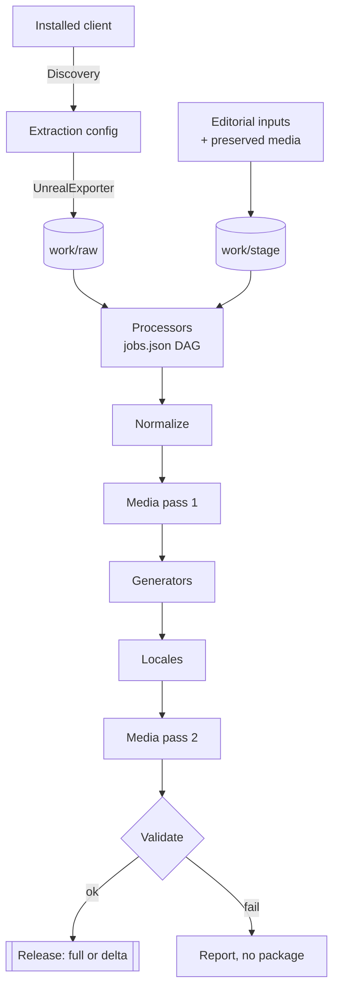

# Game-data pipeline

The pipeline turns an installed Tower of Fantasy client into the catalogs, localizations and images the site serves. Its source lives next to the website so that schemas, generators and readers are always released together.

## Overview



| Stage | Input | Work | Output |
| --- | --- | --- | --- |
| Discovery | Game installation | Read client and version metadata, locate archives | Extraction configuration |
| Extraction | Game archives, export rules | Export selected tables, Blueprints, localization and textures with UnrealExporter | `work/raw` |
| Stage | Editorial inputs, preserved media | Prepare a fresh processor input tree | `work/stage` |
| Processors | Raw export, job graph | Run `scripts/game-processors` in dependency order | Per-mode and per-entity files |
| Normalize | Processor output | Stable identities, language-neutral and localized datasets | `public/game-data` |
| Media | Image references | Resolve exact source files, keep required PNGs, convert previews to WebP | `public/game-assets` |
| Generators | Normalized catalogs | Build, Wish, Handbook, progression, formulas, hubs, link previews | Page and runtime JSON |
| Locales | Every client culture | Rerun processors and generators per culture, record fallbacks | Localized catalogs |
| Validate | Finished output | Schemas, cross-file integrity, declared media | Pass, or a failed run |
| Release | Validated tree, optional baseline | Hash every file, list deletions | `tof-update-*` directory or ZIP |

The media stage runs twice because generators can reference images that the first normalized catalogs did not. Locale passes share media.

### Artwork observations

The Arts normalizer records first observations by normalized texture `sourcePath`
(case-insensitive, with normalized separators), using the item ID only when no
path is available. Each batch of new paths advances `discoveryHistory.revision`;
items receive `addedInRevision`, `addedInVersion` and `isNew`. Removed paths
remain known, so a returning texture is not treated as a new addition. These
fields describe catalog observations; game release dates remain unknown.

`scripts/normalize-game-data/artwork-history.ts` reads the prior English
`arts.json` and an optional staging `info/arts/artwork-history.json`. Staging
selects the highest available revision from curated and site inputs. Portable
packaging carries the current journal in `site-inputs/artwork-history.json`.
Without a prior journal, the first inventory becomes revision zero. A subsequent
batch uses `export-version.json.version` when available.

`processors/build-artworks.ts` supplies staging `info/arts/data/artworks.json`;
the Arts adapter writes the journal and item metadata into generated locale
catalogs. The existing runtime generator consumes those catalogs. A source
inventory or a current game-data snapshot is supplied separately from source.

## Running it

### Windows: from an installed game

Build the exporter from the source already included in `tools/patch-exporter`.
On Windows x64, install Node.js `>=24.15.0 <25`, pnpm `12.5.1`, Visual Studio Build
Tools with *Desktop development with C++* and the Windows SDK. Restore the
bootstrap data package first, then run from the repository root:

```powershell
pnpm install --frozen-lockfile
pnpm --filter @tof-hub/tof-exporter package
.\tools\patch-exporter\dist\ToFExporter.exe --full
```

The package command compiles the JavaScript pipeline and C++ launcher and creates
`tools/patch-exporter/dist/ToFExporter.exe`. A GitHub-hosted prebuilt EXE is not a
prerequisite. Select the game installation; the executable performs the stages
above and writes its update under `tools/patch-exporter/dist/output/tof-update-*/`
when run in that location. To install it, pass the update folder's absolute path:

```powershell
pnpm --filter @tof-hub/tof-exporter apply-update -- "<ABSOLUTE_PATH_TO_TOF_UPDATE_FOLDER>"
```

After packaging, the executable carries its own runtime and processing code, so
the computer running it needs no Node, pnpm or compiler installation. Some native
components may be downloaded on first use. The website's Docker build and the
Windows EXE packaging command are separate build targets.

### Docker: from an existing raw export

1. Run `setup` and restore the bootstrap package (see the [README](../README.md#getting-started)).
2. Set `RAW_GAME_DIR` in `.env` to the folder that contains `Hotta/Content`.
3. Run the pipeline:

   ```bash
   docker compose --profile tools run --build --rm tooling
   ```

4. Read the validation result and reports in `ignore/export/pre-release`.
5. Install the output:

   ```bash
   docker compose --profile tools run --rm bootstrap node scripts/install-public-data.mjs ignore/export/public
   ```

To choose the number of workers:

```bash
docker compose --profile tools run --rm tooling pnpm --filter @tof-hub/tof-exporter run pipeline --raw /raw --out /output --jobs 8
```

The container processes an already extracted raw tree. Native game extraction is only supported by the Windows executable.

### From the repository

```bash
pnpm install --frozen-lockfile
node scripts/bootstrap.mjs
pnpm --filter @tof-hub/tof-exporter run pipeline --raw <RAW_ROOT> --out <OUTPUT_DIR> --jobs 8
```

| Option | Purpose |
| --- | --- |
| `--jobs <n>` | Parallel workers |
| `--work <dir>` | Working directory |
| `--steps <list>` | Run selected steps only (see `PIPELINE_STEPS`) |
| `--trace` | Record file reads for coverage reports |

A partial run assumes its prerequisites already exist. Rerunning only the media step cannot replace normalization after a source change. Raw input is read-only; keep output, work and trace directories outside the source tree.

### Client-side item mappings

`MappingItemId.json`, `MappingItemIdAndName.json` and `MappingItemIdAndColor.json`
come from `<GAME_ROOT>/Client/WindowsNoEditor/Hotta/Config`, outside the game
archives. Normal extraction copies them into the raw tree. When an existing raw
export lacks these files, supply `--game-path <GAME_ROOT>` (or the saved
`GAME_PATH.txt` for `run --raw`). `build-items-json` fails on missing mappings
instead of silently publishing an incomplete catalog.

### Cosmetics and runtime catalogs

The cosmetics processor reads sticker master tables, exact item/unlock joins,
badge full art and avatar material references. Normalization and the runtime
builder preserve the same category and animation metadata for each culture.
The exporter renders supported animation recipes during the media stage and
includes source and rendering reports in the update package. Timing in the
supported material reconstruction is explicitly inferred; unsupported effects
remain unresolved. See [cosmetics sources and limitations](game-data/cosmetics.md).

## Source map

The manifest builder accepts `pnpm build:data-manifest --snapshot-version <version>`
to explicitly label a dataset snapshot. It updates `snapshot.version` and
`gameVersion` together. This is an editorial metadata override, not evidence of a
new extraction: source branches, hashes, export timestamps and per-client versions
remain unchanged. An actual later export supplies its own version normally.

Site generators live in `scripts/generators/`, audits in `scripts/checks/`, and
shared helpers in `scripts/lib/`. Root pnpm commands and the exporter use these
same implementations. `scripts/lib/site-paths.cjs` resolves the raw, staging,
public and maintained-input directories in both repository and portable runs.

After locale projections are merged, the pipeline refreshes Handbook
supercomputing, MMO threshold references and hub summaries from the merged
catalogs. Runtime projections are built after final media resolution. They retain
only datasets and cultures the website serves; locale lanes skip this final
projection. Full canonical catalogs remain available to pipeline generators.

`pnpm generate:summaries` refreshes the derived Handbook summary, section hubs
and runtime data after a standalone catalog change. It consumes existing output
and does not extract the game. A normal full pipeline run performs this work in
dependency order.

| File | Responsibility |
| --- | --- |
| `tools/patch-exporter/src/run-command.ts` | Installed game → extraction → pipeline → release |
| `tools/patch-exporter/src/pipeline-run.ts` | Stages, generator order, locales, media, reports |
| `tools/patch-exporter/src/selective-list.ts` | Extraction rules and key configuration |
| `tools/patch-exporter/src/media-exporter.ts` | Media resolution, PNG originals, WebP previews |
| `tools/patch-exporter/src/release-package.ts` | Hashes, full and delta packages |
| `tools/patch-exporter/scripts/apply-update.ts` | Installs an update, including deletions |
| `tools/patch-exporter/config/export-rules.json` | What to extract |
| `tools/patch-exporter/config/runtime.json` | Pinned native tools, URLs and checksums |
| `scripts/game-processors/contracts/jobs.json` | Processor dependency graph |
| `scripts/game-processors/contracts/outputs.json` | Declared processor outputs |

## Bootstrap package

The current client cannot reproduce everything the site shows: some historical images are gone from the game, and some reference tables come from outside it. These are explicit, versioned inputs in the bootstrap package, pinned by [`config/bootstrap.json`](../config/bootstrap.json) and restored by `scripts/bootstrap.mjs`.

It contains import mappings, small build-time manifests, extraction key configuration and preserved artwork. It contains no user data and no installation key, and it is not a substitute for a fresh pipeline run.
All application, processor, generator and exporter source code is in the Git
checkout. The companion ZIP supplies data only; building the exporter does not
reconstruct historical artwork that is absent from the installed client.

## Content update packages

Here, a release means the exporter's local `tof-update-*` output, not a GitHub
Release containing the tool's source or executable.

The first release is a **full** release and establishes the baseline manifest. Later releases compare file hashes, include changed files and list removed ones.

| Option | Effect |
| --- | --- |
| `--full` | Force a full release |
| `--baseline <dir>` | Compare against a specific baseline |

Install with:

```bash
pnpm --filter @tof-hub/tof-exporter apply-update -- <UPDATE_DIRECTORY_OR_ZIP>
```

Copying files by hand installs new files but cannot apply deletions. Keep release manifests with your deployment records.

## Building the exporter

Requires Windows x64, Node and pnpm, internet access on first run, and Visual Studio 2022 Build Tools with *Desktop development with C++* and the Windows SDK. After restoring the bootstrap package:

```bash
pnpm install --frozen-lockfile
pnpm --filter @tof-hub/tof-exporter build            # dist/scripts/*.js
pnpm --filter @tof-hub/tof-exporter package          # tools/patch-exporter/dist/ToFExporter.exe
pnpm --filter @tof-hub/tof-exporter package --zip    # plus a ZIP
```

`build` bundles the TypeScript entry points into JavaScript. `package` includes
that build and also assembles the native executable, processors, generators,
curated inputs and runtime. Native EXE packaging is explicit; building the website
alone does not invoke the Windows C++ compiler. Downloaded runtime components
are verified against `tools/patch-exporter/config/runtime.json`; the archive tool
has its own pinned checksum. Optional native DLLs can be supplied with
`TOF_UNREAL_RUNTIME_DIR`.

Distribute the executable with its third-party notices, never local caches, `work/raw` or a full checkout.

### Maintaining extraction rules

Regenerate the rules from a traced pipeline run:

```bash
pnpm exec tsx tools/patch-exporter/scripts/generate-export-rules.ts --report <TRACE_REPORT> --write
```

Or refresh declared paths without extracting:

```bash
pnpm exec tsx tools/patch-exporter/scripts/generate-export-rules.ts --refresh-declared --write
```

The second mode adds declared table and media paths while keeping the traced baseline. It does not prove a new client contains those files. Review the diff and run the coverage tests.

## Adding a table or feature

1. Identify the exact raw path, table, row keys, fields, region and version.
2. Extend an existing processor or generator and its contract in `jobs.json`.
3. Add extraction coverage for every table and texture it needs.
4. Resolve identities through verified references, never by name matching.
5. Extend normalization and the localized projection.
6. Let the existing media discovery pick up referenced images.
7. Validate a clean run, then a second unchanged run.
8. Document the source, units and open questions in [game data](game-data/README.md).

Never hand-edit generated output.

## What is automated

Catalogs, localizations and images derived from game tables are rebuilt on every run. These are separate, maintained inputs:

- banner schedules and editorial boss notes;
- preserved historical artwork;
- player and raid observations (`TOF_RAID_RANKINGS_FILE`, schema in `packages/contracts/src/raid-rankings.ts`).

No generator invents a missing value or infers a schedule from artwork.

## Diagnostics

| Problem | Action |
| --- | --- |
| Missing raw tables | Check client region and extraction coverage. Never silently substitute another region. |
| `Missing site input` | Restore the matching bootstrap package. |
| Missing declared image | Inspect the media report and the source reference. Do not invent a path. |
| Locale missing in client | Check the localization manifest and its English fallbacks. |
| Failure during a partial run | Rerun the prerequisites, or the full pipeline into a clean directory. |
| Corrupt update | Keep the previous deployment, regenerate and validate before applying. |

Fixture tests cover packaging and contracts. Only a real export proves coverage of a new game update.
